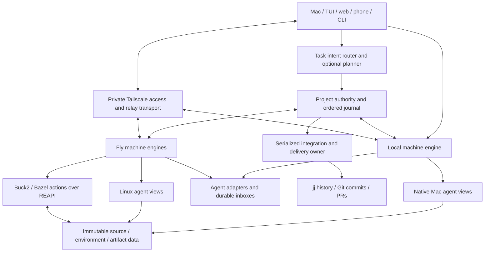

# Rudder v4: shared workspaces, reusable builds, coordinated agents

Status: v4 direction accepted for implementation, 2026-10-30. Implementation
and delivery proceed in independently verifiable milestones; this document is
not evidence that the full rewrite has shipped. Implementation choices marked
provisional must pass the experiments before becoming commitments. This revises the earlier
[plan at 91579cf](https://github.com/exla-ai/rudder/blob/91579cf631b1d9d78afbbd786a6dc1f8120cc1ca/PLAN.md).
Existing coordination files remain in use until their consumers have migrated.

Discussion updates: plan for approximately 50 software engineers; prefer a
Rudder-owned workspace/VFS model with focused jj integration and Buck2 as the
leading Cloud build-engine candidate. The direct messaging design in section 10
is accepted direction; backend injection mechanisms and guarantees are explicit.
Before launch, simplify the public CLI/slash-command surface (section 16) and
deliver real agent-to-agent steering and interruption of active runs (10.6).
Ordinary task input selects planning automatically (section 17); standalone
`/gam` is sunset. Tailscale access and responsive Cloud terminals are part of
the product architecture (section 18), with staged delivery recorded in section 19.

Companion documents:

- [Research and implementation evidence](docs/architecture/research.md).
- [Experiments, acceptance gates, and failure cases](docs/architecture/experiments.md).
- [Implementation state and context handoff](docs/architecture/implementation.md).

## 1. Product objective and constraints

Make a new agent a cheap writable branch of an already prepared environment.
Keep source, dependencies, toolchains, build results, and relevant knowledge
available across machines without copying or recomputing them for each agent.
Judge success by time to a correct completed build and an accepted change, as
well as launch latency and resource consumption.

The user has established these directions:

- Rudder Cloud executes in Linux VMs on Fly.io today.
- Cloud can enforce chosen tools, pinned environments, and build conventions.
- Local Rudder on macOS remains part of the architecture.
- Agents should communicate while running. Betting on evolving channel APIs is
  acceptable if their adapters can change independently.
- Agents must be able to steer and interrupt peers while they are running,
  within delegated scope, with observable outcomes and preserved workspace state.
- The rewrite must remove redundant user commands and generated coordination
  machinery. A simpler CLI/slash surface is a launch requirement, not later polish.
- Users express a task or follow-up; Rudder chooses when decomposition is useful.
  They should not have to invoke `/plan`. Sunset standalone `/gam`; preserve
  review as a normal verification capability and reuse its backend transports.
- Local and Cloud execution should feel continuous: ready private previews,
  responsive text, preserved sessions and explicit reconnect state. Tailscale
  strengthens private connectivity without becoming a requirement for basic use.
- Extending/forking jj, building a VFS, or eventually building source-control
  machinery is in scope when evidence justifies it. Existing implementation
  boundaries are not product requirements.

Thousands of concurrent agents is a capacity goal, not a fixed machine count or
a claim of near-zero total cost. RAM, CPU, model quotas, cache traffic, and
verification throughput remain real costs.

## 2. Recommended architecture and decision status

| Area | Recommendation | Status |
|---|---|---|
| Workspace abstraction | Immutable source/environment roots plus a private mutable view; persistent checkpoints reference shared content | Architectural commitment proposed |
| Distributed data | Content-addressed storage, local read caches, lazy hydration, prefetch, reference-aware collection | Architectural commitment proposed |
| Build correctness | Separate action-result index keyed by complete inputs; prefer Buck2 with Bazel interoperability through REAPI | Recommended; compare actual workloads and integration cost |
| Linux filesystem | Own persistent workspace/VFS semantics; evaluate EdenFS reuse and Nydus/Buildbarn/native materialization components | Implementation foundation open until E1/E2 |
| macOS filesystem | Native APFS materialization first; evaluate a lazy NFS/FSKit view for very large trees | Native default recommended; VFS experiment open |
| Source history | Retain jj's changes, conflicts, operation log, and Git backend; remove workspace setup from launch's critical path | Recommended; extend through pinned library interfaces first |
| Process ownership | One persistent Rust engine per machine owns processes, PTYs, workspaces, local journal and adapters | Architectural commitment proposed |
| Fleet authority | One transactional authority per project orders assignments, decisions and integrations | Architectural commitment proposed |
| Metadata stores | SQLite locally; PostgreSQL for durable Cloud project coordination; Node API may remain | Recommended, distinct from a language rewrite |
| Agent transport | Direct addressed conversations over durable Rudder mailboxes; first-class Codex app-server and Claude Channels adapters | Messaging direction accepted; backend capability tests required |
| Human command surface | Small canonical CLI families, minimal Rudder slash commands, visible task/agent actions; native backend commands remain available | Simplification required before launch; dispositions in section 16 |
| Task routing | Automatic choice of discussion, direct execution or decomposition; optional Decisions API classifies and the planner constructs the plan | Required direction; routing quality and bounds tested in E12 |
| Private connectivity | Reuse authenticated Tailscale identity and project-scoped preview discovery; preserve relay fallback and application authorization | Required product work; E13 |
| Isolation | Platform-specific execution profiles; VM, network and filesystem boundaries selected separately from caching | Open policy with required capability probes |
| New VCS / permanent jj fork | Escalation path after library/upstream approaches demonstrably fail | Deliberately deferred, not ruled out |

The ideal is one coherent logical data plane and workspace model. Existing
Nydus image blobs, REAPI files/trees, and jj objects have different formats.
Adapters must preserve identities; they are not interchangeable encodings.
Do not promise byte deduplication across formats before measuring it.

## 3. Starting point and extraction seams

Current Rudder already has important machinery to preserve:

| Today | Reuse or migration seam |
|---|---|
| Native `App` is a single serialized state owner | Extract its lifecycle/scheduler ownership into the machine engine |
| Interactive native scheduler and headless TS scheduler are mutually exclusive | Preserve that exclusion during migration |
| `attach.rs` and `view.rs` expose several views over one owner | Reuse view/event separation rather than introduce a second scheduler |
| `/gam` uses Claude Channels and Codex app-server | Extract backend transports from `native/src/gam_link.rs` |
| `src/jj.ts` and `native/src/gitio.rs` manage workspaces/integration | Introduce one VCS adapter; consolidate duplicate paths incrementally |
| Home supervisor starts a dashboard per project and reparses run files | Replace its lifecycle dependency with engine commands and projections |
| Mac app wraps the web surface and invokes `cloud pull` | Connect to the local engine; preserve copy semantics until explicit move exists |
| Run records, hooks, steer receipts and completion reports exist | Import/export them through versioned adapters during transition |

Earlier measurements report small source trees and large dependency/build
trees: about 17 MB tracked versus 1.6 GB built for one workspace. Treat those as
historical observations to reproduce, not workload-independent constants.

The current Fly guest was inspected: kernel `6.12.114-fly`, OverlayFS and FUSE
available, `/dev/kvm` absent, Landlock ABI query returns `ENOSYS`, no btrfs in
the supported filesystem list. Mount/delegation permissions still require an
actual isolated experiment. Do not assume btrfs, Landlock, nested microVMs,
or delegated cgroup v2 on existing workers.

## 4. Ownership and system shape



### Machine engine

The engine owns process trees, PTYs, backend sessions, workspace handles,
cache mounts, lifecycle transitions, and a durable local journal. Slow storage,
network, Git and build operations run outside its state mutation loop and
return typed results. A UI closing does not close agents.

Use SQLite transactions for local journal/outbox/state. Commit command payload,
idempotency key, ownership epoch, acceptance receipt and pending effect/outbox
entry atomically before returning acceptance. Recovery distinguishes accepted
but not started, started with uncertain outcome, and completed. Retries return
the original receipt/result and reconcile uncertain external effects rather
than blindly repeating them. Keep UI input/selection and
rendering state in surfaces. Preserve the existing terminal experience through
an attach adapter while moving ownership.

### Project authority

Cloud has a durable project authority with a transactional event sequence,
topic versions, assignment epochs, integration head and command deduplication.
PostgreSQL is the default recommendation for this role. Per-machine SQLite
databases are journals/replicas, not independent writers of one fleet truth.
The current debounced SQLite-to-S3 backup path is not sufficient justification
for acknowledging a new fleet decision as durably committed.

A local-only project can designate its local engine as authority. Offline Mac
work on a Cloud project records provisional events and branches; reconnect
reconciles them explicitly. Offline operation does not silently create a second
Cloud integration or publishing owner.

No custom consensus algorithm. Use database transactions and fencing first;
introduce an established replicated coordinator only when availability requires
it. Keep transport/outbox records in the transaction that commits their event.

## 5. Core identities and contracts

Version all serialized formats. References carry object kind, hash algorithm,
digest and byte size. Preserve standard raw-blob hashes and REAPI's digest/size
contract; object typing does not silently change its hash preimage. Canonical
metadata encodings distinguish a directory, environment, checkpoint and result.

| Object | Meaning and validity |
|---|---|
| `SourceRoot` | Immutable tree of source files, modes and symlinks, with source ancestry references |
| `EnvironmentRoot` | Prepared dependency/toolchain trees, installer inputs, platform/ABI, configuration and provenance |
| `WorkspaceView` | Pinned source/environment roots, private writes, agent-local Git metadata, engine owner epoch |
| `Checkpoint` | Consistent view root, source delta, prepared-state references, durability level, knowledge cursor |
| `ActionKey` | Command, input closure, toolchain, platform, declared environment, outputs and execution policy |
| `ActionResult` | Immutable output manifest and provenance for a matching action key |
| `Change` | Stable Rudder change identity, base/parents, source-root mapping, decision dependencies, verification evidence and jj mapping |
| `RunAttempt` | Backend/session, workspace, resource profile, current owner epoch and lifecycle facts |
| `Decision` | Topic/version, statement, scope, author, authority, acceptance state and supersession links |
| `DeliveryProof` | Concrete target, revision/artifact, provider, verification time and checks |

`Change` is orchestration metadata over history. It does not require a new
user-facing VCS or replace jj's conflict representation.

The workspace backend must implement at least:

```text
prepare(environment_spec) -> EnvironmentRoot
create(source_root, environment_root, owner_epoch) -> WorkspaceView
checkpoint(view, consistency, durability) -> Checkpoint
seal(view) -> immutable final source delta and artifact references
materialize(checkpoint, platform_profile) -> WorkspaceView
destroy(view) -> retained checkpoint references and reclaimed private state
```

Capabilities advertise native/lazy materialization, live checkpoint barriers,
file versus block CoW, notifications, mmap, cross-platform resume and durability.
Unsupported capabilities must not be silently emulated by full copies and then
reported as constant-cost forks.

## 6. Distributed workspace and cache data plane

### 6.1 What a fork shares

A prepared environment contains already installed toolchains/dependencies and
reusable immutable state. Source roots and environment roots advance separately.
Forking a virtual view creates a small descriptor and private writable state;
it must not enumerate or copy all inherited files in the target fast path.

Immutable directory metadata is shared persistently. A mutation replaces the
affected path's metadata nodes and dirty file data. Small files can use whole
file blobs; large-file chunking is an implementation choice measured in E2.
File-level CoW can copy an entire modified file. Block-level CoW copies dirty
blocks but introduces another storage/runtime layer. Make that cost explicit.

Small source trees may be eagerly materialized when that beats a virtual mount.
The central objective is eliminating repeated large dependency/build setup,
not requiring every byte to traverse a new filesystem.

### 6.2 Storage tiers

```text
Agent view: private writable source and build scratch
    -> shared immutable metadata and mounted prepared inputs
    -> machine RAM/page cache and local NVMe content cache
    -> regional content cache / optional measured peer fetch
    -> durable content store and immutable published manifests
```

Local caches are shared by compatible agents on a worker. A new worker loads
metadata and the needed working set, with prefetch for observed build/read
patterns. Avoid a remote metadata request for every `stat`, directory entry or
tiny file. Keep packed/indexed metadata locally available. Track cache misses
by bytes and latency, not just object counts.

Place work near its prepared roots and recent build inputs while considering
CPU, RAM, provider quotas and queue delay. A cold worker is a normal supported
case. Lazy loading must improve time to useful work rather than merely move
the download stall into the first compile.

Standard Fly Volumes provide worker-local storage, not a shared fleet volume.
Use regional object/cache services for remote misses. Durable checkpoints and
their roots must remain reconstructible after loss of a worker volume.

### 6.3 Publish, mutation and recovery

- Pin every running view's inherited roots. Integration creates new roots;
  it never mutates the base underneath existing views.
- Record source mutations durably, including deletion, rename, modes, symlinks,
  and overlay-specific whiteout/opaque-directory meaning.
- Notifications accelerate dirty-path discovery; reconcile the sealed view.
  Notification loss, mmap writes and atomic-save patterns are explicit tests.
- A consistent checkpoint requires a backend snapshot barrier or quiesced
  writers, including child processes. Copying an actively changing directory
  is not a checkpoint consistency protocol.
- Acquire staging retention leases before uploading missing data and metadata,
  then atomically publish the root and transfer retention from staging to it.
  Local checkpoints and replicated checkpoints have different durability
  labels. Unpublished writes remain exposed to worker loss; measure their RPO.
- Retain roots referenced by live views, accepted changes, retained checkpoints,
  integrations and delivery evidence. Use leases/pins plus a conservative GC
  grace period. GC traverses each adapter's references, including RAFS data blobs
  and action outputs, and validates its sweep generation against concurrent
  publications before deletion. A new root cannot reference swept objects.
- Preserve local journals across engine restarts. A cache eviction cannot
  discard the only copy of acknowledged mutable data.

### 6.4 Reuse candidates and build-versus-own decision

Use [the evidence matrix](docs/architecture/research.md#2-storage-and-workspace-implementations)
and E1/E2 to select one first materializer:

1. Nydus RAFS is a strong prepared immutable environment format; evaluate its
   documented writable overlay as well as kernel OverlayFS.
2. Buildbarn CAS/VFS is a strong REAPI-compatible and cross-platform reference;
   immutable CAS files need explicit copy-up, and scratch needs Rudder durability.
3. JuiceFS is a useful complete distributed filesystem comparison. Its clones
   share data, but copy metadata per entry and are not atomic directory forks.
4. Current BranchFS supplies useful branch ergonomics but eagerly snapshots
   the visible tree. It does not establish the desired constant-cost fork.
5. BuildBuddy's distributed CoW disk/RAM design is an execution-state reference;
   its relevant enterprise code is not available for unrestricted production
   adoption. OverlayBD needs host kernel/device capabilities not established on Fly.

Rudder should own the view/checkpoint/mutation protocol and project semantics.
Reuse proven blob storage, hashing, compression, virtual-file primitives and
build protocols. Build a custom VFS only for capabilities the selected foundation
cannot supply at the measured cost. Avoid stacking two complete filesystems
unless their separate benefit is demonstrated.

## 7. Opinionated Cloud build contract

### 7.1 Two indexes over reusable content

An environment index answers which prepared filesystem to start from. An action
cache answers whether a particular computation's results can be reused.
Compiled outputs depend on source and other inputs even if the lockfile is
unchanged. Reusing a prepared build directory is not proof that its outputs
are valid for a new source tree.

Prefer Buck2 for the opinionated Cloud build engine, retain Bazel as a supported
frontend, and use REAPI as the remote execution/cache contract with Buildbarn
as a reference backend. Buck2's incremental graph and deferred materialization
are promising integration points, not a measured Rudder speed claim. Compare
representative Rust/JS/Python and native Mac workloads before fixing the default.

Stock Buck2 does not share one warm graph across every divergent workspace:
commands with different DICE states require coordination or isolation. Design
branch-aware graph ownership explicitly; a focused engine extension/fork is in
scope. Both engines can use one REAPI service without necessarily producing
identical action keys or cross-engine cache hits.
[Buck2 execution model](https://buck2.build/docs/concepts/architecture/),
[REAPI support](https://buck2.build/docs/users/remote_execution/),
[concurrency implementation](https://github.com/meta/buck2/blob/a75b9021cc7d0ef51c7c86fa4d237cef1dc02f6f/app/buck2_concurrency/src/lib.rs).

Use a checked-in root `rudder.toml` for environment/profile, supported platform,
build driver, verification targets, outputs and allowed effects. Do not put
tracked project configuration inside the ignored `.rudder/` runtime directory.

### 7.2 Cacheable actions

A cacheable action has a declared source/dependency closure, pinned compiler
and SDK, platform/ABI, normalized paths, command/options, relevant non-secret
environment and declared outputs. Include installer scripts, patches, package
manager/runtime versions, and native-package configuration in environment keys.

Resolve dependencies in a separate preparation phase. Build/test actions use
their declared inputs; undeclared network/time/randomness/external state must
be removed, modeled, or mark the action uncacheable. Verify provenance and
digests before admitting results. Separate secret-bearing operations, signing
and deployments from public reusable build outputs.

Nix is a candidate producer of pinned environments/toolchain closures, not a
substitute for a build action graph. Begin with digest-pinned Linux images and
adopt Nix if the preparation experiment demonstrates a benefit.

Language integrations (pnpm/uv/sccache/turbo/Go) can provide an earlier path.
They keep their native validity rules and report cacheability honestly. Do not
advertise arbitrary shell commands as hermetic. Compare Rust incremental builds
with remote sccache before globally disabling incremental compilation.

### 7.3 Cache economics and compiler state

Coalesce concurrent preparation and action misses by key. Publish only complete
results; failed/cancelled builders cannot publish success. Use local hits first,
regional remote hits next, then execute. Account for network cost, decompression,
metadata, fan-out, eviction, storage growth and preparation cost.

Do not share a writable `target`, `.next`, `.venv`, compiler daemon or Git index
between independent agents. Share immutable inputs/results; mutable scratch
belongs to an attempt or explicitly serialized build service.

Warm compiler daemon state can outperform artifact-only caching. Keep it as
an independently measured layer: persistent build services on current workers
first; VM/process-memory snapshots only if E4 proves remaining initialization
cost is material. No nested KVM is available in the inspected Fly guest.

## 8. History, Git tooling, and the jj extension path

Retain jj as history/integration authority in the initial design. Source-control
semantics, distributed filesystem snapshots, and build action validity are
different contracts. Source history should not contain dependency trees or
ephemeral runtime journals merely because they appear in an agent's view.

Each agent still needs normal repository discovery, `git diff/status`, branch
identity, and tool compatibility. Give it private writable worktree metadata;
shared Git object data may be read-only. Real Git worktrees share common refs
and object storage even with private HEAD/index. Use private writable object
stores with alternates, or explicitly serialize common-store/ref writes with
per-run branch namespaces. Specify how agent-created commits, HEAD changes and
rebases are imported. Do not share one writable `.git` index or fake a few Git
commands and assume the rest works.

jj 0.46 introduces colocated child workspaces using real Git worktrees, requiring
Git >=2.42. Rudder currently pins 0.40. That upgrade needs packaging and compatibility
tests, including stock Mac Git. Both versions expose working-copy factory/library
interfaces. A pinned `rudder-vcs` helper can register a managed materializer;
stock jj will not recognize a custom type without that registration.

Keep an ordinary recoverable integration checkout. Start by keeping jj out of
launch's critical path and importing sealed source changes through the adapter.
Benchmark fsmonitor and correct ignore boundaries before attributing snapshot
cost to the VCS design. Keep jj library churn behind one versioned adapter.

Escalate in this order:

1. Current CLI/library adapter plus separated workspace/environment data.
2. Custom working-copy implementation and upstreamable jj extension.
3. A small maintained jj fork if essential interfaces are unavailable.
4. A new VCS only after a concrete semantic requirement cannot be met: first-class
   conflict state, cross-root history, undo/recovery and Git interchange must
   have explicit replacement specifications and migration tests.

EdenFS/Sapling provides a useful lazy-working-copy reference. Its public packaging
and Git compatibility require qualification; it is not a drop-in replacement.

## 9. Local macOS and cross-platform continuity

Share source/manifest/protocol identities across platforms. Partition installed
environments, compiler outputs and action keys by OS, architecture, ABI,
toolchain and SDK. Linux binaries and native macOS build state are not generally
interchangeable. Portable source/package bytes may be shared when appropriate.

Use ordinary APFS workspaces first for native Mac execution. APFS clone/copyfile
shares data on one filesystem but still visits directory entries. Detect and
report actual cloning (`COPYFILE_STATE_WAS_CLONED` or a forced-clone path);
best-effort copying can silently become a byte copy. Measure large trees; do not
promise O(1) directory cloning. A prepared workspace pool can amortize
materialization but has a resource cost to report.

Evaluate a lazy Mac filesystem using Buildbarn's NFS approach or an FSKit
extension if metadata/materialization dominates. FSKit/resource APIs have OS
version gates: FSKit starts at macOS 15.4, while its path/generic URL resources
start at macOS 26. The current Mac app supports macOS 14. Preserve a compatible
native path while qualifying any new VFS for mmap, executable loading, Xcode,
file notifications, locking, atomic saves and recovery on real hardware.

Before cross-platform materialization, detect case-folding/Unicode name
collisions, incompatible symlinks and mode assumptions. Fail with a precise
compatibility result rather than silently changing a source tree's identity.

The recommended profiles preserve native Mac workflows and offer optional
Linux VM execution on Mac for Cloud parity. Native Xcode,
Keychain, signing, debugging and local tools remain native capabilities.
Treat signing credentials and local absolute paths as explicitly scoped inputs,
not portable cache material.

Offline work uses pinned local manifests and its journal. Explicitly distinguish:

- **Copy/fork:** a new workspace/run identity; the original continues.
- **Move:** checkpoint, replicate required objects/cursors, revoke the previous
  owner epoch, resume with a new owner. Uncontrolled external credentials can
  defeat side-effect fencing; require confirmed shutdown or a controlled
  publishing path before asserting exclusive migration.

Current Mac `cloud pull` is a copy and must keep that behavior until move is built.

## 10. Agent communication and shared knowledge

### 10.1 Direct conversations over durable Rudder mailboxes

Agents address peers directly. Rudder authenticates, persists and routes their
messages; an LLM conductor is not required to relay or approve every exchange.
Questions, answers, objections and proposals can use natural language inside a
structured envelope. The project journal and accepted decision projections
remain authoritative; ordinary conversation does not itself accept a decision.

```text
Codex agent <-> durable project mailboxes <-> Claude agent
                         |
            decisions, checkpoints and artifacts
```

Every event has a stable ID, conversation/request/reply correlation, project
sequence, authenticated author, recipient/run epoch, intent, priority, scope,
relevant topic versions, source checkpoint/artifact references, expiry and
supersession references. Rudder supplies identity and authority metadata; the
sender cannot assert another agent's or the user's identity.

Persist the event and delivery intent before acknowledging the sender. Keep
per-recipient cursors and an outbox for reconnect/replay. Use bounded queues,
backpressure and idempotent request/reply handling. Coalesce superseded
informational updates while preserving conversations and decision history.
Track acknowledgments per event; advance a cursor only across contiguous
acknowledged or explicitly superseded/skipped entries. Retain durable inbound
and reply records until the receiving engine has committed the proper receipt.

```text
recorded -> routed -> adapter-written -> agent-acknowledged -> verified
```

These are separate facts. An adapter response proves only what that API actually
acknowledges. A changed PTY timestamp is not an acknowledgment. An explicit
agent/tool acknowledgment still does not prove that resulting code complies.

Authenticate adapters with run-scoped capabilities and socket/OS permissions.
A model-visible nonce is a prompt convention, not transport authentication.
Relaying a sibling message never elevates it to user authority.

### 10.2 Injection is a first-class backend contract

Generalize `/gam`'s existing native integrations. Outbound agent tools and inbound
context delivery are separate interfaces: MCP tools can send/reply/ack, while a
backend-specific adapter decides when and how inbound messages become visible.
Negotiate capabilities and report the actual mode on the board.

| Backend and state | Inbound path | Meaning and limit |
|---|---|---|
| Codex, idle | app-server `turn/start` | Start processing an addressed event in the existing thread |
| Codex, active and a steer is warranted | `turn/steer` with `expectedTurnId` | Append input to the intended active turn; reject/reconcile stale-turn races |
| Codex, active and interruption requested | `turn/interrupt` for the intended thread/turn | Confirm interrupted lifecycle outcome; RPC acceptance alone is not proof the work stopped |
| Codex, ordinary update while busy | Persist/coalesce in Rudder inbox; deliver at the chosen turn boundary | Avoid steering on every informational message |
| Codex, passive history/context update | `thread/inject_items`, only when supported and deliberately selected | Appends persisted model-visible items for subsequent requests; does not itself start a turn or prove processing |
| Claude, channel enabled | Per-run MCP server declaring `claude/channel`, emitting `notifications/claude/channel` | Tagged inbound context; busy-session events can be grouped on the next turn |
| Claude, active and interruption requested | Qualified native control path; current interactive CLI provides Ctrl+C for active operations | Channels alone are not an interrupt primitive; confirm outcome and preserve the conversation/draft |
| Either backend, outbound reply or receipt | Rudder MCP tools or equivalent CLI adapter | Correlated reply/explicit acknowledgment stored by Rudder |
| Channel/API unavailable | Durable inbox plus an advertised supported fallback | Keep messages pending/replayable; do not silently claim native delivery |

Codex is a first-class app-server session integration. Keep the UI and engine
attached to the same thread, preserve provenance in injected peer context, and
use structured lifecycle events. Raw history APIs must not impersonate a user,
system message or another agent. An injection without a new model request must
not be counted as an agent having processed it.
Because steering carries user input, wrap peer text as attributed collaboration
data rather than silently converting it into a user command. Preserve real
tool-result provenance through supported tool-output paths where applicable.
Serialize outbound mutations per run; reconcile stale turns and uncertain
outcomes before retrying. Request IDs correlate RPCs but do not deduplicate
agent actions. Do not retry every steer error as a fresh turn.
[Official Codex app-server contract](https://learn.chatgpt.com/docs/app-server).

Claude Channels does not acknowledge notifications. A successful transport
write is not delivery confirmation; disabled/unloaded channels can drop events.
Expose reply and acknowledgment tools and retain events until their application
state is known. Current preview custom-channel activation has interactive/session
and organization-policy constraints; do not assume development channels work in
`-p` or Agent SDK sessions. This restriction is specific to the custom preview
bypass; approved channels have separately documented noninteractive support.
Qualify the managed interactive CLI/PTY execution profile and advertise a
fallback when the channel cannot load.
[Claude Channels contract](https://code.claude.com/docs/en/channels-reference).

Urgency cannot create a backend capability. Use supported steering/interruption
boundaries; block affected integration immediately when a decision is invalidated,
even if the recipient cannot process its update until a later turn. Terminal
paste remains an explicit legacy compatibility mode with weaker guarantees.

Add ACP for compatible agents without reducing Codex/Claude to the least capable
transport. Version-test loading, cancellation, resume and steering independently.

### 10.3 Agent tools, context references and delivery policy

Provide a common MCP/CLI vocabulary:

```text
agents.find(owns, task_or_interface)
agents.send(to, message, references, priority)
agents.ask(to, question, references) -> request_id
agents.reply(request_id, answer, references)
agents.inbox(since)
agents.ack(event_ids, observed_topic_versions)
agents.await(request_id, deadline)
agents.steer(to, instruction, references)
agents.interrupt(to, reason, followup)
agents.resume(to, followup)
```

`ask` is asynchronous so an agent can continue independent work. Explicit
`await` marks a real dependency and avoids polling/model turns while waiting.
Track deadlines, unanswered requests and wait cycles; route unresolved blockers
to their designated owner. Replies and retries retain their original correlation.

| Priority | Scheduling policy |
|---|---|
| Informational | Batch/coalesce for a convenient processing boundary |
| Question/blocker | Notify the recipient and track the reply/wait state |
| Invalidating decision or interface change | Prioritize supported steering and prevent stale integration until reconciled |

Use targeted recipients and subscriptions by task, interface and topic. General
broadcasts are exceptional. Route mechanically from declared/observed relevance;
an LLM relevance check is not on every message's delivery critical path.

Example: backend agent sends interface version 7 with checkpoint 842; frontend
agent asks whether an expired session returns 401 or null; backend replies with
the contract test. The frontend can inspect the referenced immutable checkpoint
before integration, subject to access policy. It need not import the sender's
entire conversation or guess which mutable tree the message describes.

Agent fork/checkpoint records bind workspace state, the supported conversation
checkpoint, knowledge cursor and owner identity. A Codex thread fork copies
conversation history; it does not itself clone the workspace or process memory.
The engine records the coupled operation durably before declaring a child ready.

### 10.4 Decisions and authority

Use typed acts: `propose`, `accept`, `supersede`, `acknowledge`, `question`,
`answer`, `interface-change`, `checkpoint`, `complete`, and `request-integration`.
Store immutable entries with topic versions and optimistic concurrency checks.

The user has highest applicable authority. A designated project/conductor
authority accepts cross-cutting decisions; workers can accept decisions within
explicitly delegated implementation scope. Interface owners propose/publish
versioned contracts with affected consumers. Authority is assigned by the
system, not a field an agent can assert for itself.

Two incompatible accept attempts for one topic version cannot both become
current. Experiments remain scoped to their experiment. Current truth is a
versioned projection of accepted events and supersession links.

Use declared dependencies, interfaces, topics and observed writes to route
updates. File overlap alone cannot infer semantic ownership or every affected
consumer. Record decision versions used to produce a change; supersession
queues reconciliation for affected work before integration.

### 10.5 Agent-friendly interface and prompt economy

Expose a small consistent tool/CLI vocabulary: task/branch status, relevant
decisions, ask/reply, propose decision, acknowledge updates, run checks, checkpoint,
and hand back a change. Commands return structured results and concise human
summaries. Large artifacts are referenced by digest with targeted retrieval.

Keep bootstrap/tool schemas stable and brief; deliver relevant deltas instead
of rewriting the fleet into every system prompt. Cacheable prefixes and model
context need measurement on the actual CLIs. Avoid broadcasting every event to
every agent. Budget message volume and parallelism against successful work.

Keep `AGENTS.md` as versioned repo guidance; refresh when its digest changes.
During migration, generated context files remain compatibility projections.
Retire fan-out only when durable delivery, offline catch-up and fallback readers
pass E6. Move secrets through scoped credentials/projections and non-secret
shared context into the journal; do not bulk-export vaults into snapshots.

### 10.6 Peer steering and interruption during active execution

This is a required execution capability, separate from sending an informational
message. Delegated peers can call it directly; no LLM conductor or repeated
human confirmation is required for an authorized in-scope operation. The engine
checks run-scoped capabilities, the target attempt/owner epoch and applicable
user intent. Peers cannot revive a task the user intentionally stopped.

| Operation | Required meaning |
|---|---|
| Send | Make peer information available according to inbox policy |
| Steer | Change the active agent's direction through its qualified live-input path, preserving session/workspace continuity |
| Interrupt | Stop the current turn/operation and report its observed outcome, preserving uncommitted source work and conversation |
| Interrupt then steer | Durably order stop confirmation before delivering the replacement instruction and resuming work |
| Cancel/terminate | End an attempt or kill its process; explicit separate intent, not an alias for interrupt |
| Resume | Continue a paused/interrupted session under the current accepted decisions and owner epoch |

Persist requester, reason, target identity/epoch/turn, replacement instruction,
idempotency key, acceptance receipt and outcome events. Serialize requests per
target; reject stale targets, deduplicate retries and resolve conflicting
steers by their recorded authority/order. Bound repeated interruption loops and
surface conflicts rather than letting agents continually cancel one another.

For Codex use app-server steering/interruption and observe the corresponding
turn outcome. For Claude qualify the running-operation interrupt path for the
managed execution profile; its interactive CLI documents Ctrl+C, but that key
also clears input or exits when idle. Never blindly replay an interrupt into a
new turn or retry it until the process dies. SDK/ACP control paths require their
own capability tests. Channels carry follow-up context but cannot alone prove
that current work was interrupted.
[Codex control](https://learn.chatgpt.com/docs/app-server),
[Claude interactive control](https://code.claude.com/docs/en/interactive-mode).

Distinguish requested, backend-accepted, interruption-observed, follow-up-delivered
and resumed. Do not mark the task complete or integrate its workspace merely
because an interrupt or turn-end hook fired. Reconcile running tool/child-process
state and dirty files before checkpointing or resuming; stopping a turn does
not undo external side effects or prove every background process has stopped.
Unconfirmed outcomes remain pending/uncertain and cannot trigger duplicate
replacement work under a new owner without reconciliation.

Codex and Claude's supported managed profiles must demonstrate live steering,
confirmed interruption and correct continuation in E6 before launch. An adapter
that only queues a message cannot advertise interruption as supported.

## 11. Integration, verification, and truthful delivery

One project integration owner holds a monotonically increasing epoch. Recipients
validate that epoch on integration and privileged delivery operations. A timed-out
advisory lock must not permit an old owner to continue writing. Database compare-
and-set updates protect integration head and event ordering.

For each landing batch:

1. Seal candidate deltas against their actual bases and record knowledge cursors.
2. Compose through jj, preserving unresolved conflicts as explicit state.
3. Reconcile current accepted decisions and interface changes.
4. Pin relevant decision and build-policy versions; run affected canonical gates
   against that exact composed source/environment and version vector.
5. Advance integration head only if the prior head, owner epoch and relevant
   decision/policy versions still match in the final transaction. Otherwise
   reconcile and reverify affected work.
6. Export normal Git commits/branches/PRs and retain evidence linking tested tree,
   environment, action results, decision versions and integration revision.

A failed batch must be split or reverified; new source heads invalidate stale
gate evidence. Cached test results are accepted only under a valid declared
input/effect contract. External integration/smoke tests run as configured.

Completion, local integration, remote push and verified deployment remain distinct.
Publishing requires the user's authorized workflow and records concrete target,
artifact/revision, provider, URL/app path, verification time and smoke results.

## 12. Execution profiles and resource policy

Do not select a sandbox runtime to solve storage reuse. On Fly, the VM is already
an outer boundary; agents within it share its kernel. Start with account/org
isolation and explicit network policies. Cache namespaces/authentication isolate
private projects; only deliberately public verified content is globally shared.

Probe kernel, mount, namespace and resource-delegation capabilities at startup.
Landlock, gVisor, container profiles, dedicated VMs and future host-controlled
microVMs are policy choices with separate compatibility/performance gates.
The default must match actual Fly capabilities. macOS uses its own policy.

Cap CPU/RAM/processes/storage/I/O through available mechanisms and scheduling.
Reservations include build processes and model quotas. Storage sharing alone
does not justify launching 1,000 memory-hungry agents on a small worker.

## 13. Multi-month delivery plan

The resource assumption is approximately 50 software engineers. Organize
parallel workspace/storage, build-platform, agent-protocol/coordination, VCS,
Cloud/Mac and validation workstreams around shared contracts and milestone
gates. Durations below are provisional workstream ranges, not a whole-team
calendar or a claim that additional staffing removes correctness dependencies.
Critical path: evidence -> data contracts -> workspace/recovery -> integration
-> fleet ownership -> surfaces.

| Phase | Approximate duration | Concrete deliverable | Exit gate |
|---|---|---|---|
| 0: evidence and choices | 2-3 weeks | Reproduce baseline; storage/build prototypes; native Mac baseline; public command/caller inventory and simplified workflows | E0-E4 results, initial E11 inventory and ADRs |
| 1: persistent local engine | 3-5 weeks | Engine skeleton, versioned protocol/journal, attach adapter, one ownership flag, restart recovery | Agent survives surface close; no double launch; E5 core cases |
| 2: shared prepared workspaces | 4-6 weeks | Basic CAS, immutable roots, copy-up, checkpoints, atomic publish/retention/GC, local cache, lazy remote restore | E1/E2/E5 on two Fly workers and supported Mac path |
| 3: build/action data plane | 3-5 weeks, overlaps phase 2 after basic CAS | Canonical Cloud profile, action-result index over CAS, coalesced misses, provenance, diagnostics | E3 soundness and first-completed-test targets; no invalid hits |
| 4: coordination and source bridge | 4-6 weeks | Generalized adapters, live peer steer/interrupt/resume, project journal, decision cursors, jj bridge, fenced integration | E6/E7/E8 including control races, offline and supersession cases |
| 5: fleet and surface migration | 4-6 weeks | Cache-aware placement, Cloud authority, surface projections, compact command registry and explicit copy/move | E8/E9/E11; callers migrated and legacy writers disabled |
| 6: scale and release hardening | 3-5 weeks | Workload replay, performance tuning, simplified help/onboarding, bounded legacy removal and rollback drills | E9/E10/E11 plus supported backend control gates |

Replace the earlier two-engineer/6-9-month calendar with a staffed workstream
schedule after phase 0. Memory snapshots, a new VCS, custom kernel work and a
new Mac VFS need explicit teams and acceptance gates if selected.

The current home efficiency work can run alongside phase 0: remove blocking CLI
updates/fetches, bound output reads, cache unchanged run records, stop live model
credential probes, wire persistent package/compiler caches, and reduce generated
context fan-out. Record before/after; these fixes do not prove the new design.

## 14. Migration and rollback rules

- Introduce `engineAuthority = legacy-native | legacy-ts | fabric` per project.
  Transfer ownership with a receipt/epoch; never dual-write scheduling state.
  Existing binaries do not honor the new epoch: first quiesce their scheduler,
  drain outstanding commands, and confirm shutdown or explicit handover. A new
  flag alone cannot fence an old dashboard or CLI writer.
- Version workspace handles so existing jj workspaces and run records continue
  through the legacy adapter until completion. Do not rewrite active work in place.
- Run new projections and journals in shadow comparison before granting control.
  Keep compatibility exports until all consumers are migrated.
- Migrate one project/account at a time. Rollback pauses new owners, seals or exports
  source deltas to ordinary files/Git, and resumes through a compatible adapter.
- Protect original checkouts and user edits. VFS testing uses managed disposable
  workspaces; direct main-owner mode remains an explicit separate execution mode.
- Retain recovery without the running daemon: readable manifests, verified blobs,
  ordinary source exports, and jj/Git integration history.

## 15. Success measures and outstanding decisions

Measure p50/p95/p99 for command acceptance, workspace-ready, first tool completion,
first completed test/build, integration queue and verified accepted changes/hour.
Separate warm node, cold node, warm remote cache, empty cache and offline cases.
Count physical disk bytes, remote bytes, metadata operations, peak RAM, build CPU,
cache correctness, failed replays and dollars per accepted change.

Initial numerical hypotheses and reproducible workloads live in
[the experiment plan](docs/architecture/experiments.md). They are unmeasured targets.
There is no blanket `<50 MB per agent` RAM or total-build guarantee.

Decisions still to ratify with evidence:

1. First Linux materializer: Nydus, Buildbarn-derived view, or a small Rudder VFS.
2. Cloud's required build profile and conversion/onboarding burden.
3. Native Mac support floor and whether lazy materialization earns default status.
4. jj upgrade/helper strategy, with real Git worktree compatibility.
5. CAS formats/bridges, chunk size, regional cache layout and checkpoint RPO.
6. Project-authority availability topology and offline delegated authority.
7. Which workloads justify compiler-service or process/VM-memory checkpoints.
8. Isolation/tenant placement policy as unrelated customers share fleet capacity.
9. Final public CLI/slash vocabulary, compatibility window and retirement owners.

These choices should become small ADRs with evidence, reversibility and an owner.
The ideal architecture is the shared identity/ownership/correctness model above;
individual runtimes and storage libraries must earn their place through gates.

## 16. Simplify the product and command surface before launch

### 16.1 One ordinary task path and visible targeted actions

The human surface should make starting work, selecting an agent, sending a
follow-up, steering/interrupting, continuing a conversation, reviewing a change
and choosing local/Cloud execution straightforward. Preserve an explicit planning
intent and visible execution scope. Avoid requiring users to memorize internal
scheduler vocabulary or a long list of slash commands.

Project task input starts work; an agent's composer addresses that agent; a group
composer/action has a visible selected scope. A message never silently becomes
a broadcast or restarts stopped tasks. Stop/resume/review/change actions remain
deterministic controls backed by engine APIs, without an LLM round trip.

Keep one accountable owner for a task even when it is decomposed. Make the
selected route and execution scope visible; do not require an orchestration
command. Discussion and plan-only intent must not launch implementation workers. Audit
actual current dispatch before migration: present source starts an isolated
worker on plain input, while older comments/guidance describe a main-checkout
default. Document one chosen behavior and test it; command cleanup must not
silently change which checkout receives edits.

### 16.2 Inventory and proposed dispositions

Inventory CLI dispatch, slash handlers and suggestions, hidden/legacy aliases,
keybindings, callbacks, help, scripts, skills, prompts and Cloud/Mac callers.
Record each command's owner, real behavior, usage evidence and keep/merge/
automate/remove disposition. The user's non-use of `/nudge` is explicit evidence;
absence of telemetry alone is not proof that no automation calls a command.

| Current surface | Proposed disposition and preserved capability |
|---|---|
| `/nudge` | Remove the special human command. Use addressed/scoped send and steer; make resume a separate explicit operation |
| `/tell` | Replace with ordinary addressed messaging; old active paired sessions remain readable/resumable through migration |
| `/model`, `/fast` | One model/effort/speed control, with a small optional shortcut |
| `/main`, `/m` and task-start aliases | One start path with explicit execution/checkout choice; temporary aliases only where compatibility requires |
| `/resume`, `/restore`, `/handoff` | One continue-conversation flow distinguishing continue, copy and exclusive move |
| `/plan` | Automatic planning from ordinary input; preserve a bounded compatibility alias during migration and an explicit plan-only intent |
| `/gam`, `/tell` paired-review entry points | Sunset standalone generator/adversarial-pair workflow; review is a normal change/gate operation, and backend transport extraction remains useful |
| `/swarm` | An optional experiment operation under ordinary task planning, with explicit experiment budget and winner-selection policy |
| `/review-all`, `/merge-all`, `/verify` | Change/review actions and automatic validity gates; preserve batch capability and delivery authorization |
| `/cloud`, `/sync` variants | Execution-location and synchronization controls with clear scope; move remains explicit |
| `/notify`, `/sound`, `/color`, `/telemetry` | Settings instead of prominent operational commands |
| `/usage`, `/diff`, board/view aliases | Views with one canonical action each |
| `/share`, `remember`, `context`, `done` | Scoped agent tools and context/credential interfaces; retain required legacy callbacks until migrated |
| Backend-specific slash commands | Preserve forwarding in the backend's own composer/terminal; keep them distinct from Rudder's command namespace |

Do not describe already retired `/ask` or native `/run` as newly removed work.
Current `/sync` concerns Cloud/config/default-branch synchronization; it is
different from the old jj-workspace sync command. `/nudge` currently bundles
broadcast and recovery/resumption behavior, so deleting only its spelling would
leave the underlying ambiguity unresolved.

### 16.3 Compact public CLI, complete machine API

Target roughly six to eight human command families and three to five globally
advertised Rudder slash entries, subject to usability evidence. Initial CLI
families to evaluate: open/attach (`rudder`), start (`run`), agent inspection/
control, change review/integration, project/execution settings, authentication
and diagnostics. Exact names remain a product decision, not a shipped contract.

Consolidate parallel status/log/watch/list/report paths; backend-specific start
aliases become options on one start operation. Old sail/onload/bootstrap/setup
and provider-management vocabulary belongs behind appropriate administration
interfaces or is removed after caller migration. Agent callbacks and internal
RPC handlers are not ordinary human commands.

Preserve stable JSON output, exit codes, scripting/noninteractive behavior and
completion for the canonical automation API. Agents retain richer typed tools,
including discovery, messaging, live steer/interrupt/resume, checkpoints and
integration, even as the human vocabulary shrinks. Every surface uses the same
versioned operation registry with capability, scope, arguments and receipt
semantics. Help and completion derive from it rather than drifting across TS,
Rust, web, Mac and agent prompts.

### 16.4 Remove obsolete machinery, with a bounded migration

Keep versioned repo guidance such as `AGENTS.md`. Replace generated fleet-file
fan-out with journal projections and scoped tools once their consumers migrate.
Delete obsolete writers, parsers, scheduler branches, flags, docs and tests after
their behavior is replaced; do not merely hide them behind an advanced menu.
Preserve source/history exports and deliberate offline compatibility paths.

Aliases needed by scripts receive a named owner, canonical replacement and
finite compatibility window. Update callers first, then remove dispatch and
suggestion/help entries. Preserve active sessions and existing completion
callbacks during transition. No destructive cleanup of user-authored files or
session history is implied by this plan.

E11 is a pre-launch gate alongside the data-plane/coordination gates. A release
cannot pass with a new engine underneath the old confusing command surface.

## 17. Automatic planning and task ownership

### 17.1 Intent first, execution scope second

One task entry point accepts natural language, attachments and conversation
references. Follow-ups to a selected agent stay addressed to that agent unless
the user changes scope. Deterministic controls such as interrupt, resume,
review, open and settings execute through typed operations, without a model
classification round trip.

The router selects a small set of paths:

| Route | Result |
|---|---|
| Discuss / plan only | One conversational owner reads, researches and explains; it may save requested planning documents but launches no implementation fleet |
| Direct execution | One owner works in the explicitly selected checkout/location, verifies results and carries any authorized delivery through completion |
| Decompose | The owner requests a structured plan, validates dependencies and scopes, then schedules isolated workers within policy and budget |

Complexity alone is not permission to edit, publish, spend without bounds or
change execution location. Preserve read-only requests, existing authorization,
resource limits and explicit checkout choice. A plan approval already supplied
in the conversation is not discarded just because planning became automatic.
During the first migration, retain existing DAG approval semantics and expose
the chosen route before launch. The final v4 policy must give approval a durable
scope/version so re-planning cannot silently enlarge it.

Do not replace the task owner with a read-only planner and then lose the owner
for testing, integration, release and delivery. Decomposition creates children
of that owner. Reviewers report evidence through the same communication API;
they do not require a persistent `/gam` pair or an infinite review loop.

### 17.2 Optional OpenAI Decisions classifier

The [Decisions API](https://developers.openai.com/api/docs/guides/decisions)
fits bounded routing: choose among supplied routes or estimate whether
decomposition is warranted. Its typed classification does not construct a DAG
or call tools. Use the selected coding/planning backend to generate the plan.

Keep this provider behind an adapter. It is optional: Claude-only users and
offline local work retain deterministic routing without supplying an OpenAI
API key. Codex subscription authentication is not silently treated as an API
key. Set a short deadline, validate response names/types/options, record the
classifier and policy version, and fall back visibly on unavailability. Never
retry a classifier indefinitely before accepting a task.

Classification receives the minimum necessary intent/context summary, not
credentials or a wholesale transcript. Separate route selection from project
`Decision` records in section 10: a model route is a proposal under product
policy, not an accepted architectural contract or new authority grant.

Calibrate thresholds on labeled Rudder requests. Report false decomposition,
missed useful parallelism, read-only violations, latency and provider cost.
Do not publish the vendor's relative speed claim as Rudder latency evidence.

### 17.3 Re-planning while work is running

The task owner can add, replace or cancel pending nodes through versioned
commands. Already-running children receive relevant changes through durable
send/steer/interrupt operations. Re-planning checks the plan version, owner
epoch, accepted contract versions and granted budget before committing.

Make the changed plan and reasons visible in activity. Preserve completed work,
session identity, source checkpoints and delivery evidence. Interrupting a child
does not erase its changes or credit its task as complete. A routine message
must not restart the full planner or create another fleet.

## 18. Immediate private access and responsive Cloud terminals

### 18.1 Tailscale as a transport capability

Reuse an already authenticated tailnet identity and persisted machine state.
Do not demand an enrollment key on every boot. Report actual daemon/backend
readiness, device identity and online state rather than inferring readiness
from the existence of a process or a stale IP address. Keep probes and CLI
commands asynchronous and bounded so network discovery cannot stall agents or
PTY delivery.

Model connectivity independently from execution ownership. A reachable machine
is not an authorized project owner. Keep Rudder authentication, tenant/project
ACLs, operation receipts and fencing regardless of whether a connection uses
Tailscale, Fly private networking, a local socket or the existing TLS relay.
Tailscale ACL policy must still allow the device and service. Direct connectivity
is an optimization; a relay remains available for clients outside the tailnet.

Do not default to Funnel or public listeners. The initial preview integration
uses private Tailscale Serve where available and a clearly identified private
HTTP fallback only under the configured tailnet policy. Require authentication
inside sensitive development apps; the tailnet network is not a substitute
for the app's authorization model.

### 18.2 Project-scoped previews and local open

Map a listener to its process, workspace and project before advertising it.
Exclude Rudder control/agent infrastructure and unrelated listeners. A preview
reference includes project/workspace identity, owner attempt, port, protocol,
device identity, readiness and last observation. Detect IPv4/IPv6 loopback
correctly and retire routes when their owning process exits or changes.

Publish a ready preview into the existing project state, UI and agent tools.
Opening it from the laptop chooses an authorized reachable address and invokes
the local browser immediately; it does not upload or re-deploy the project.
If the daemon is offline, the laptop is outside the tailnet, or the listener is
not yet ready, show the actual state and retry discovery without opening a
dead or unrelated URL. Do not silently choose another project's identical port.

A compact preview action and structured output may support scripts. Prefer
discoverable links/actions in existing surfaces over another family of slash
commands. Full laptop-to-Cloud service discovery, reverse-direction previews
and direct terminal transport are later capabilities with the same identity
contract; existing Cloud-to-laptop previews do not prove those are implemented.

### 18.3 Separate text rendering from authoritative control

Keep the existing persistent attach session and predictive local echo. Treat
terminal output as bytes, preserve UTF-8 and terminal-control ordering, and
coalesce bursts within a small bounded latency budget. A split escape, paste
or synchronized-update frame must not be interpreted as a completed frame.
Use backpressure and bounded queues rather than allowing a slow browser to
consume arbitrary memory or block every other surface.

Never replay an old Ctrl+C or an unacknowledged privileged action as ordinary
buffered keystrokes into a new owner. Fence socket callbacks by connection
generation. Reset connection-local decoders at reconnect; flush output before
terminal exit/control messages where ordering requires it. Track controller
ownership separately from a spectator's connection and preserve that contract.

For v4, prefer sequenced screen updates and a complete screen snapshot on
cursor mismatch, with bounded per-view queues. Record a resume cursor and
explicit gap/reset rather than presenting an arbitrary tail of escape bytes
as a faithful screen. A slow observer can skip to a fresh snapshot; durable
agent messages and operation receipts must remain replayable. Terminal text
delivery is not a durable command receipt or proof that an agent acted.

### 18.4 Measure the whole path

Trace input capture, send, relay/worker arrival, PTY write, PTY output and local
paint using monotonic times per process and correlation IDs across processes.
Report clock assumptions for cross-machine measurements. Separate key-to-local
prediction from authoritative echo and rollback, large paste, scroll, full
repaint, first attach and reconnect after sleep. Measure slow viewers under
continuous output and multiple active projects.

Target immediate local feedback without delaying real output to manufacture a
good metric. Publish samples and bounds, including p95/p99 and memory growth
on a suitable sample size. E13 qualifies networking and terminal changes on
real laptop/Cloud connections as well as deterministic fault tests.

## 19. Implementation, context handoff and delivery

This is a staged multi-month rewrite, not a single version-number change.
The first implementation track improves task routing/command cleanup, private
preview readiness and the current terminal transport. These are useful v4
foundations; they do not supply the persistent Rust engine, distributed VFS,
branch-aware Buck2 integration or durable project authority by themselves.

Persist completed changes, open contracts, exact validation and the next
dependency-ordered task in
[the implementation record](docs/architecture/implementation.md). That file,
this plan and the experiment specification are the restart point after context
compaction. Never rely on a disappearing chat summary as the only record.

Ship only the implementation actually verified. Product pushes follow the
repository's version/tag/CI npm workflow. Cloud changes additionally require a
new worker image/control-plane deployment as appropriate, verification of the
canonical production target, and recorded revision, image/deployment identity,
verification time and smoke checks. Do not restart active agents merely to
claim rollout: distinguish a published image from homes that adopted it.

The full stable v4 milestone requires the relevant E0-E13 gates, migration and
recovery drills, supported Mac and Codex/Claude behavior, and release evidence.
Do not mark that milestone complete because a local build, push or preliminary
Cloud deployment succeeded.
