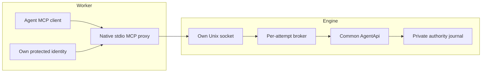

# Scoped agent broker and MCP proxy

Restricted workers get a read-only per-attempt projection containing only their
own `identity.json` and `broker.sock`. They do not mount the engine journal,
CAS, shared credential directory or other agents' identities. The broker runs
outside the worker namespace and invokes the common capability-authenticated
`AgentApi` against its fixed configured journal.



Production runtime owns `AgentBroker` handles. It projects credentials before
PTY launch, starts the broker asynchronously after PTY ownership exists, and
installs its nonblocking `close_callback` with the backend link's termination
callback. The proxy retries endpoint startup for at most five seconds. An
identity-only projection is allowed during that interval; the read-only
directory mount sees the socket appear later. No free function starts an
unowned detached broker or installs a global registry.

The native integration surface is:

- `socket_path(home, project, run, attempt)` derives a distinct endpoint. Deep
  home paths use a short private per-user socket base to fit Unix path limits.
- `project_identity(socket, identity)` atomically creates or rotates the
  sibling `identity.json`. Its temporary file stays outside the mounted
  directory. Replacing the attempt's project/run/owner/run epoch is rejected.
- `AgentBroker::spawn(BrokerConfig { journal_path, identity_file, socket_path })`
  opens the host broker. `binding`, `socket_path`, `close_callback`, `close`
  and `is_closed` expose ownership/lifecycle without App mutation.

The engine projection is mode 0700; its identity is an owned, single-link,
regular mode-0600 file, and its socket is mode 0600. Symlinks, extra projected
entries and unsafe ownership are rejected. An OS file lock outside the mounted
projection serializes endpoint ownership and stale-socket replacement. A live
listener is never silently replaced. A dead process's owned socket may be
recovered after the lock is acquired and a connection is refused.

## Authentication and rotation

Each request carries its own identity binding and token over the private Unix
socket. The server compares project, run, owner epoch and run epoch to its
startup binding, compares fixed-size token hashes to the current protected
projection, and checks the capability against current journal authority.
Caller-supplied authors, principals, journal paths and identity paths are not
request fields. Tool arguments retain the common API's strict schemas and
recipient/scope/epoch grants; message authors come from the issued capability.

The broker caches an immutable protected per-token identity snapshot outside
the mounted directory. In-flight calls retain that snapshot rather than
adopting a newly rotated file token. Journal revocation and epoch checks still
run on each API operation, including await iterations. Later calls can use a
new token for the same attempt. A replacement epoch requires a new endpoint and
new proxy; an old process never silently adopts it.

Revocation can briefly precede atomic token publication. The proxy permits a
bounded 500 ms rotation window for pre-dispatch authentication rejection and
read-only channel polling, retrying only after observing a different token in
the same binding. It never blindly replays a tool call after dispatch failure.

## Protocol and limits

Frames contain a four-byte big-endian JSON length followed by exactly that many
UTF-8 JSON bytes. Requests carry format version 1, a UUID request id, the bound
identity and one operation: authenticate, tool call, pending messages or cancel.
Responses bind the same version/id and carry either a result or a sanitized
error. Neither successful results nor error paths contain server-selected
authority filesystem paths or credential values.

Per broker, admission is bounded at eight connections and four active API calls.
Request frames are at most 256 KiB, responses at most 8 MiB, initial frame reads
have a two-second deadline and calls a 32-second deadline around the API's
30-second maximum wait. Slow response readers have bounded socket write time.
Oversized/malformed/partial frames close that connection. Bytes from a partial
response are never followed by a second error frame.

Cancellation uses a separately authenticated request and a shared cancellation
flag. Complete connection hangup also cancels a pending call; a normal write
half-close preserves the response. Closing the broker cancels admitted work and
shuts down its connections without blocking App on network/SQLite work. These
actions do not claim to roll back an accepted command or stop a backend turn.
Uncertain outcomes still use durable idempotency keys and scoped receipts.

## MCP compatibility and verification

The worker invokes:

```text
rudder-native fabric mcp --broker-socket /run/rudder/agent/broker.sock --identity-file /run/rudder/agent/identity.json
```

`--channel` opts into the existing Claude channel notification. Proxy mode
rejects `--journal`; it has no fallback that opens authority files. The legacy
direct local MCP mode remains available for existing local profiles. A trusted
foreground `fabric broker` harness is provided for socket qualification;
production runtime uses an owned in-process handle.

Tool definitions, structured tool results, authenticated peer envelopes,
correlated replies, explicit acknowledgments, contiguous cursor behavior and
channel provenance use the same common implementation as direct MCP. Writing
a notification never acknowledges a message or proves model adoption. Commands
record accepted intent rather than backend execution.

Rust tests exercise token revocation/rotation, in-flight authority freezing,
epoch replacement, endpoint restart, live takeover refusal, half-close,
cancellation, call/frame bounds and slow-reader recovery. Node tests use the
real broker socket and actual stdio MCP clients to check peer envelopes, ack
holes, ask/reply, same-attempt rotation, restart, malformed frames and scoped
authentication. Physical mount isolation and managed-launch qualification are
separate execution-profile checks; a passing socket test does not establish
that a worker namespace was correctly constructed.
