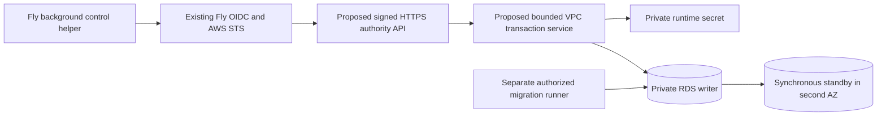

# Project authority provider rollout

Review date: **2026-10-30 UTC**. Status: **unapplied candidate, transport unresolved**.
No database, network, secret, IAM grant or production activation was created.
Existing AWS/S3 authorization does not select RDS or authorize this persistent spend.

Recommend qualifying traditional **RDS for PostgreSQL Multi-AZ DB instance** in
`us-east-1`, with one synchronous standby, first. Prefer a small AWS VPC authority
API for the next transport design. Keep Cloud authority inactive until the provider
failure envelope, transport, cost and physical migration gates below pass.
This is a reviewable proposal, not a provider durability certification.

## Provider decision

The required contract is the [fleet authority contract](fleet-authority.md):
every acknowledged authority transaction survives the supported automatic
failover envelope, and an obsolete writer cannot continue committing. Otherwise
owner epochs, accepted heads and idempotency receipts can rewind together.

| Candidate | Current primary evidence | Decision and remaining question |
|---|---|---|
| RDS PostgreSQL traditional Multi-AZ **DB instance** | AWS documents synchronous replication to one standby in another AZ. [Current documentation](https://docs.aws.amazon.com/AmazonRDS/latest/UserGuide/Concepts.MultiAZSingleStandby.html). | First candidate. Confirm current degraded-operation acknowledgment and promotion policy for the selected 17.x version, class and region. |
| Fly Managed Postgres | Fly Support's October 2 answer explicitly describes asynchronous replication and possible recent-write loss on automatic failover. [Support answer](https://community.fly.io/t/expectations-when-migrating-from-self-managed-to-managed-postgres/28742). | Does not meet this authority contract by default. General HA, private-network and backup features do not resolve the acknowledgment issue. [Current service documentation](https://docs.fly.io/postgres). |
| Neon | Commit acknowledgment follows WAL safekeeper quorum; its protocol describes proposer recovery/fencing. [Architecture](https://neon.com/docs/introduction/architecture-overview), [protocol](https://github.com/neondatabase/neon/blob/main/docs/safekeeper-protocol.md). | Credible alternative. Confirm deployed quorum/failure domains, old-compute exclusion, endpoint and selected plan; run the same application drills. |
| Aurora PostgreSQL | AWS describes six storage copies across three AZs, with four acknowledgments for a write. [Engineering description](https://aws.amazon.com/blogs/database/amazon-aurora-under-the-hood-quorum-and-correlated-failure/). | Credible separate qualification. Storage quorum alone does not qualify endpoint failover, restoration or a cross-region configuration. |

Do not substitute the three-instance RDS Multi-AZ **DB cluster**: its documented
semisynchronous topology differs from this template. Evaluate its exact behavior
separately. [Cluster documentation](https://docs.aws.amazon.com/AmazonRDS/latest/UserGuide/multi-az-db-clusters-concepts.html).

RDS's older implementation description permits a current instance to continue
alone after replication connectivity loss. Obtain current provider confirmation
for subsequent loss of that instance, stale-standby exclusion and partition
recovery; the synchronous label does not answer those cases.
[AWS implementation discussion](https://aws.amazon.com/blogs/database/amazon-rds-under-the-hood-multi-az/).
The RDS SLA supplies availability-credit remedies, not a blanket zero-loss RPO
contract. Record engineering documentation, any written provider confirmation,
commercial terms and measured results separately. [RDS SLA](https://aws.amazon.com/rds/sla/).

## Fly access and identity

Reuse the qualified [Fabric OIDC pattern](../../infra/fabric-store.mjs): existing
issuer `https://oidc.fly.io/exla`, audience `sts.amazonaws.com`, exact control-app
subject pattern `exla:rudder-cloud-control:*`. Mint short-lived STS sessions for a
**separate authority role**, with transport-specific permissions. Preserve the
existing S3 role and OIDC provider. Do not copy an admin profile, create AWS access
keys, or introduce X509/PKI infrastructure. The subject identifies a workload;
it is not an authenticated project epoch, engine incarnation or machine boot.
[Fly OIDC documentation](https://docs.fly.io/security/openid-connect).

| Transport to review | Boundary and implementation work | Operational assessment |
|---|---|---|
| **Private RDS behind a small VPC authority API** | Fly control obtains STS credentials and signs HTTPS requests to explicit API Gateway HTTP API routes using `AWS_IAM`. A VPC Lambda hosts the existing transaction library and uses a separate execution role to retrieve only the runtime secret. PG traffic remains private with verified TLS. | Preferred next design: no permanent jump hosts or database credentials on Fly. Requires authenticated ingress/context mapping, retry/settlement, concurrency and cold-start qualification. Not implemented by this foundation. [IAM route authorization](https://docs.aws.amazon.com/apigateway/latest/developerguide/http-api-access-control-iam.html). |
| Restricted public RDS TLS endpoint + fixed Fly egress + IAM DB authentication | Dedicated app/region egress addresses, SG allowlist of exact IPv4 `/32` or IPv6 `/128`, real writer hostname/CA verification, OIDC → STS → fresh per-connection IAM token; exact `rds-db:connect` resource and runtime DB username. | Fewer services, but DB has a public endpoint. Frozen adapter accepts a password string and has no per-connect token provider; token rotation and IAM mode require implementation. This template remains private. [Fly egress](https://docs.fly.io/networking/egress-ips), [IAM DB policy](https://docs.aws.amazon.com/AmazonRDS/latest/UserGuide/UsingWithRDS.IAMDBAuth.IAMPolicy.html). |
| Neon quorum service | Direct unpooled writer with verified TLS, restricted IP access where supported and a protected credential store; or a VPC API using Neon PrivateLink. Disable scale-to-zero for initial lease-budget qualification. | Removes database-host operations, but direct access and private access have different security/cost boundaries. PrivateLink requires an AWS-side client; it does not connect Fly's private network automatically. [Private Networking](https://neon.com/docs/guides/neon-private-networking), [compute lifecycle](https://neon.com/docs/introduction/compute-lifecycle). |
| Two SSM relay instances + private RDS | Existing Fly OIDC/STS identity could start narrowly scoped remote-host forwarding sessions; no SSH/public inbound port is needed. Scope the session document to the exact writer endpoint and port. | About $14.71/month of additional small-host/IP/root-disk cost, plus two OS/agent patch streams, tunnel renewal, DNS/failover and client-slot handling. Not selected or included. PostgreSQL hostname verification must survive the tunnel; configuring `localhost` as the TLS identity is invalid. [SSM remote-host forwarding](https://docs.aws.amazon.com/systems-manager/latest/userguide/session-manager-working-with-sessions-start.html). |

IAM DB tokens last 15 minutes and authenticate new connections, rather than
expiring established sessions. AWS documents an additional 300–1000 MiB memory
requirement, and `rds_iam` takes precedence over password authentication. Thus
2 GiB sizing and a one-time token substituted into today's config are not an
approved direct-IAM solution. [IAM DB authentication](https://docs.aws.amazon.com/AmazonRDS/latest/UserGuide/UsingWithRDS.IAMDBAuth.html).

The API is an authorization/transaction service, not another scheduler. Resolve
account/project/principal/credential/boot context through trusted ingress and DB
membership; request-body authors are not identities. A signed control workload
alone does not authorize every tenant. Native views continue to use background
helpers and typed App messages, with no network in the App loop.

For a Lambda implementation, reserve bounded concurrency and account for *all*
warm/old deployment environments and pools. Four connections per environment and
DB role connection limit 16 are upper bounds, not a safe scaling formula by
themselves. Drain old pools and qualify burst/retry pressure. Preserve server-side
statement/lock/idle-transaction deadlines, post-lock `clock_timestamp()`, actual
connection settlement and typed uncertain COMMIT recovery. Lambda return/freeze
must not leave a busy slot reusable. Choose a function timeout longer than the
request/settlement envelope and fail closed on initialization exhaustion.

## Unapplied private foundation

[CloudFormation JSON](../../cloud/infra/project-authority/private-rds.cfn.json)
and its [pure generator](../../cloud/infra/project-authority/template.mjs) follow
the existing infrastructure style. The [rollout config](../../cloud/infra/project-authority/rollout.example.json)
keeps `{ "mode": "inactive" }` and `transport: "unresolved"`. It is review metadata,
not a config object to pass wholesale to `createAuthority`.

All 19 resources are conditional on `ProvisioningState=reviewed-preproduction`;
the default creates none. The enabled template is still a preproduction database
foundation: it creates no authority API, tunnel, public DB route, Fly role or
runtime policy attachment. No deployment script is provided. Later disabling
the CloudFormation condition does **not** freeze a previously activated service
or stop billing retained resources.

| Concern | Concrete foundation setting |
|---|---|
| Network | Dedicated `10.48.0.0/16` VPC; two explicit distinct us-east-1 AZs and isolated `/24` subnets; no IGW/NAT/default route; private IPv4 RDS endpoint. TCP 5432 ingress only from separate, initially unattached runtime/operator SGs. Review CIDR conflicts before adding any transport. |
| Database | Explicit available PostgreSQL `17.x` minor required; traditional `AWS::RDS::DBInstance`, `MultiAZ=true`; no cluster/reader/proxy substitution. `db.t4g.small` is a preproduction sizing candidate; `db.m7g.large` is the priced non-burst alternative. |
| Durability | Encrypted gp3 starts at 20 GiB, autoscaling ceiling 100 GiB; `synchronous_commit=on`. At qualification verify `fsync`, `full_page_writes`, effective replication/commit policy and storage behavior. gp3 and instance size need measured commit-latency headroom. [RDS storage](https://docs.aws.amazon.com/AmazonRDS/latest/UserGuide/CHAP_Storage.html). |
| TLS | Explicit `rds.force_ssl=1`, TLS minimum 1.2, RDS CA identifier; client uses the actual writer endpoint with certificate-chain **and hostname** verification. Pin/review the current AWS CA bundle and its digest; rehearse certificate rotation. [RDS PostgreSQL TLS](https://docs.aws.amazon.com/AmazonRDS/latest/UserGuide/PostgreSQL.Concepts.General.SSL.html). |
| Credentials | RDS generates/rotates the administrator secret in Secrets Manager. A different generated runtime secret is not installed into PG by the template. Separate retained storage and secret KMS keys. Outputs contain ARNs/endpoint metadata only. [RDS-managed master password](https://docs.aws.amazon.com/AmazonRDS/latest/UserGuide/rds-secrets-manager.html). |
| Privilege | Operator role trusts one explicitly reviewed existing role and can read only the two bootstrap secrets. Unattached runtime policy can read only its runtime secret and decrypt that secret through Secrets Manager. Runtime gets no master secret, RDS modification, IAM or schema-owner privilege. |
| Backups/retention | 35-day automated backups, explicit UTC backup/maintenance windows, `DeleteAutomatedBackups=false`, copy tags to snapshots, deletion protection, `Retain` on replacement/deletion for DB/keys/secret/dependent private network; additional [stack policy](../../cloud/infra/project-authority/stack-policy.json) rejects their replacement/deletion during update. Retention is not an immutable off-account backup. |
| Patching | Auto minor/major upgrade disabled for this explicit qualification baseline; plan reviewed minor/security maintenance and rerun affected drills. This does not promise AWS will indefinitely retain an old engine version. Extended Support is disabled rather than silently accepting its future surcharge. |

Network reachability for the operator and runtime remains a gate. A VPC API needs
a separate execution role, private Secrets Manager interface endpoint and tightly
scoped endpoint SG/policy; the foundation's PG-only client SGs do not supply HTTPS
access to that endpoint. Use an authorized one-off private migration runner, not
a new public admin route. [Secrets Manager private access](https://docs.aws.amazon.com/secretsmanager/latest/userguide/vpc-endpoint-overview.html).

[bootstrap-roles.sql](../../cloud/infra/project-authority/bootstrap-roles.sql)
creates only a restricted **NOLOGIN** DB runtime role, with connection limit 16,
safe search path and finite deadlines. It revokes public database/schema creation
privileges and refuses an existing active/elevated/mismatched role. Then use the
separate migrator to atomically install the checked schema with a fresh **frozen**
authority UUID. Neither SQL bootstrap nor migration enables fleet authority.
Qualify this bootstrap against actual RDS administrator privileges before use.

Only after the frozen-schema checks should a protected operator helper install
the generated runtime password and grant LOGIN. It must read secrets privately,
avoid argv/environment/log/query-text disclosure, use correct SQL quoting and
settle the transaction before release. This helper and runtime credential rotation
are not implemented here. For the preferred API, keep the runtime password inside
AWS; Fly receives only the API-invoke role. Use a separate reviewed IAM migration
if direct IAM authentication is chosen. No passwords, DB URLs, bearer tokens or
SQL/parameter dumps belong in public errors, metrics or access logs.

## Cost review

USD public on-demand rates checked **2026-10-30**, us-east-1, **730 hours/month**;
no discount/free-tier assumption. [Selected SKU snapshot](../../cloud/infra/project-authority/pricing-us-east-1.json)
records catalog dates, exact rates and complete-catalog SHA256 hashes.
[Capture script](../../cloud/infra/project-authority/capture-prices.py) reads public
catalogs without credentials. The RDS catalog was published October 29.

| Component or alternative | Calculation | Estimated monthly USD |
|---|---|---:|
| Traditional Multi-AZ `db.t4g.small`, 2 vCPU/2 GiB | `$0.065/hour × 730`; already includes the standby | $47.45 |
| Multi-AZ gp3, 20 GiB | `$0.23/GiB-month × 20`; already includes Multi-AZ storage | $4.60 |
| Two customer-managed KMS keys, initial key versions | `$1 × 2` | $2.00 |
| Administrator + runtime secret | `$0.40 × 2` | $0.80 |
| **Small private foundation** | Sum above, transport excluded | **$54.85** |
| `db.m7g.large` foundation, 2 vCPU/8 GiB | `$0.337 × 730`, same storage/keys/secrets | **$253.41** |
| Two SSM relays, additional | `2 × t4g.nano $0.0042 × 730 + 2 IPv4 × $0.005 × 730 + 16 GiB EBS gp3 × $0.08` | $14.71 |
| Proposed VPC API, illustrative addition | Two-AZ Secrets Manager endpoint `$0.01/AZ-hour × 2 × 730 = $14.60`; 100k HTTP API calls + 100k x86 Lambda invocations at 512 MiB/250 ms ≈ `$0.33` | $14.93 |
| **Small foundation + illustrative VPC API** | No NAT, ALB, provisioned concurrency or permanent hosts assumed | **$69.78** |
| Direct restricted endpoint, additional | Fly static egress `$0.005/hour` per regional pair; AWS public IPv4 `$0.005/hour` per assigned address; actual DB address count to confirm | $3.65/Fly pair + $3.65/AWS address |
| Neon Scale, illustrative always-on 0.25 CU/20 GB | `0.25 × $0.222 × 730 + 20 × $0.35`; history, networking, secrets and API excluded | $47.52 |
| Aurora Standard, illustrative writer + reader each 0.5 ACU/20 GB | `1 ACU × $0.12 × 730 + 20 × $0.10`; I/O, transport, keys/secrets excluded | $89.60 |
| Fly MPG Basic/Starter with 20 GB usage | `$38/$72 + 20 × $0.28`, provider's 30-day convention | $43.60 / $77.60 |

AWS prices: [RDS PostgreSQL](https://aws.amazon.com/rds/postgresql/pricing/),
[EC2 regional catalog](https://pricing.us-east-1.amazonaws.com/offers/v1.0/aws/AmazonEC2/current/us-east-1/index.csv),
[VPC IPv4](https://aws.amazon.com/vpc/pricing/), [PrivateLink](https://aws.amazon.com/privatelink/pricing/),
[Secrets Manager](https://aws.amazon.com/secrets-manager/pricing/), [KMS](https://aws.amazon.com/kms/pricing/),
[HTTP API](https://aws.amazon.com/api-gateway/pricing/), [Lambda](https://aws.amazon.com/lambda/pricing/),
[Aurora](https://aws.amazon.com/rds/aurora/pricing/). Session Manager on EC2 has no
additional service charge; the hosts/network still cost money.
[SSM pricing](https://aws.amazon.com/systems-manager/pricing/).
Alternatives: [Neon pricing](https://neon.com/pricing), [Fly MPG pricing](https://docs.fly.io/postgres#pricing),
[Fly egress pricing](https://docs.fly.io/about/pricing#static-egress-ips-for-machines).

These are sizing illustrations, not equivalent service contracts or approved
production capacity. Add data transfer, logs/alarms, Secrets/KMS requests,
KMS rotated key versions, charged backup/history/snapshot storage and taxes.
T4g surplus CPU credits cost `$0.075/vCPU-hour`. Growing RDS to 100 GiB raises
the storage line to $23; the ceiling is not a whole-bill cap. Additional RDS
backup storage is `$0.095/GB-month` beyond the applicable allocation. Aurora
Standard I/O is `$0.20/million` operations. Neon PrivateLink has endpoint/data
charges; its current us-east-1 instructions list multiple endpoint services,
so obtain the actual required endpoint count and quote rather than assuming
one $14.60 two-AZ endpoint covers it. A smaller marketing price is not private
connectivity or acknowledged-history qualification.

Retained databases, storage, snapshots, keys and secrets can continue billing
after stack deletion. Stopping a DB does not stop storage charges and RDS restarts
a stopped instance after seven days. Approve a bounded preproduction drill budget
and a separate retained-resource cleanup plan before provisioning.
[RDS stop behavior](https://docs.aws.amazon.com/AmazonRDS/latest/UserGuide/USER_StopInstance.html).

## Qualification and activation gates

1. **Decision and spend:** choose provider, exact topology/version/class and
   transport; obtain provider answers to the degraded/partition/promotion cases;
   review the complete cost/change set, operator role and resource ownership.
   Separately approve preproduction spend. No persistent-resource authorization
   follows from the existing S3 account setup.
2. **Infrastructure and access:** check engine/class/storage orderability in
   us-east-1, AZ IDs/capacity, current CA/version/parameter support and IAM/key
   policy semantics. Validate template with AWS and review its change set without
   execution first. After explicit provisioning approval, verify actual private
   endpoints/routes/SGs, encrypted storage/backups, TLS plaintext/wrong-CA/wrong-
   hostname rejection, separate admin/runtime access and runtime privilege/RLS
   refusals. No raw secret output during checks.
3. **Adapter and transport:** rerun the real multi-session Node adapter suite on
   the selected service and network path. Include row-lock wait past expiry,
   competing exact head/topic CAS, authenticated-context negatives, pool budgets,
   lost COMMIT response/reconnect, server cancellation/actual settlement, process
   crash/restart and historical retries without repeated effects. Rotate workload
   sessions and DB credentials/CA under load; break each transport leg and verify
   bounded admission, memory and connections. Existing [single-server evidence](../../examples/fleet-authority/evidence/2026-10-30-node-adapter/README.md)
   qualifies SQL/adapter recovery there, **not** RDS/Fly/Neon HA or RPO.
4. **Provider failure drills:** in an owned isolated preproduction DB, continually
   issue numbered idempotent transactions and fsync the request IDs/success
   acknowledgments to an independent client ledger. Force supported RDS reboot
   with failover and maintenance/reconnect cases; every independently recorded
   acknowledgment must appear once afterward. Unacknowledged transactions may
   exist and must reconcile by ID. Record event timestamps, writer changes,
   versions/settings, ledger/dataset hashes, all uncertain replies and recovery
   latency. Test stale connections and old-owner rejection. A Fly/API client
   partition does not simulate a provider primary/standby partition: arrange the
   latter with provider support or leave that envelope explicitly unqualified.
5. **Restore drill:** restore an earlier point into a **new isolated endpoint**;
   verify selected parameter/subnet/SG/KMS settings, compare the independent
   ledger, exercise missing-history reconciliation and prove old receipts/fences
   cannot authorize work. RDS PITR creates a new instance and can fall back to
   default parameter groups; pass the reviewed groups explicitly. Backups do not
   establish an automatic-failover RPO guarantee.
   [RDS PITR](https://docs.aws.amazon.com/AmazonRDS/latest/UserGuide/USER_PIT.html).
6. **Physical project cutover:** retire/fence incompatible launchers and publisher
   credentials, obtain actual native owner-lock/process-stop evidence, reconcile
   uncertain effects, then idempotently import and activate opted-in projects.
   Use permanent managed namespaces and compatibility gates. A new marker,
   schema version or CloudFormation parameter cannot physically fence old clients;
   [alpha9 evidence](../../examples/execution/compatibility/evidence/2026-10-30-alpha9-refusal/README.md)
   includes an old TS guard that allows a missing owner projection. Activation
   and rollback require the real owned host capability, not an inventory boolean.

## Outage, failover and historical recovery

On connectivity/identity/clock uncertainty, stop new admission at ingress and
let in-memory engine leases expire conservatively. Freeze the durable authority
when reachable; an unreachable DB cannot record a freeze. Preserve local SQLite
execution/outbox observations. Do not mint replacement command IDs, grant a
competing scheduler, or convert backup SQLite into fleet truth. The native lease
module is preparation; a real bridge and watchdog remain an activation gate.

Discard failed pool connections only after settlement or destruction, refresh
writer DNS, and reconcile uncertain operations against the current incarnation.
AWS describes typical traditional Multi-AZ failover as 60–120 seconds, potentially
longer; this is not a deadline or SLA. Recovery must tolerate all old engine
leases expiring. [RDS failover](https://docs.aws.amazon.com/AmazonRDS/latest/UserGuide/Concepts.MultiAZ.Failover.html).
Resume admission only after the qualified failure procedure and authoritative
receipts establish continuity; a healthy endpoint or green status alone does not.
The acknowledgment ledger also does not establish clock continuity. Qualify the
DB positive-clock-step bound across writer replacement and the worker drift,
margin and suspension assumptions used by the lease formula. If those bounds
are unavailable, keep new ownership admission frozen until actual old-host
fencing and uncertain-effect reconciliation are proved; elapsed server wall time
or a saved receipt is insufficient. No Fly hypervisor-pause guarantee is supplied
by the standalone native clock/fence tests.

A historical restore or replacement authority stays private/frozen and receives
a **fresh authority UUID** through an explicit import/reconciliation procedure.
Retire the old endpoint/ingress credentials, fence old engines, reconcile physical
publish effects, and retain old receipts as provenance. Never point the old live
config at a rewound snapshot under the same incarnation. Do not blindly update
UUIDs across foreign-keyed tables. The import/activation procedure is future work.

Rollback before activation leaves the existing local owner authoritative. After
activation, freeze, physically stop/reconcile, export accepted state and perform
an explicit reverse handoff. Deleting a flag, dropping the DB or restoring an
older snapshot is not rollback. Finite drills and this template do not qualify
hypervisor pause behavior, arbitrary clock steps, regional disasters or every
provider partition; record unresolved cases and keep their admission closed.

## Review evidence

Only new documentation/configuration files were added. Offline generator/security
checks and CloudFormation lint results are recorded in
[the infrastructure README](../../cloud/infra/project-authority/README.md).
No AWS account API, deployment, secret creation, Fly change, auth-store read,
production DB action or application activation was performed for this proposal.
