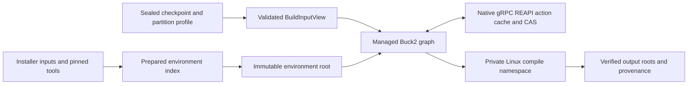

# Managed Rust and TypeScript build profile

The first v4 build profile uses a pinned Buck2 frontend for Rust libraries and
TypeScript compilation on Linux x86_64. It is a working, deliberately narrow
compile profile. Rudder's own repository keeps its existing Cargo/npm workflow;
the example's tracked [rudder.toml](../../examples/build-profile/rudder.toml)
does not opt every project into a new build system.

## Two indexes and one validity authority



`PreparationSpec` identifies installer inputs, lockfiles, scripts, patches,
installer commands/options, non-secret installer environment, compiler/runtime
closures, versions, configuration, platform/ABI and preparation policy. It
excludes application source. A source edit can therefore retain the same
prepared environment. Installer/lockfile changes cannot silently retain it.

`ActionContract` adds the source root, prepared environment root, pinned build
frontend, generated rule bundle/target mapping, command, declared environment,
output trees, toolchain closures and build policy. Its metadata key is an
immutable Rudder object. It is **not** the digest of an REAPI `Action` protobuf.
The actual native REAPI action digest and byte size come from Buck2's event log.
The [REAPI schema](https://github.com/bazelbuild/remote-apis/blob/main/build/bazel/remote/execution/v2/remote_execution.proto)
defines that separate wire identity.

`BuildIndex` stores prepared roots and successful build provenance. Action-index
lookups return `requires_frontend_validation=true`: they do not bypass Buck2's
graph or substitute arbitrary shell hashing for frontend validity. Buck2 tracks
the actual declared artifact inputs. The managed environment/policy descriptor
is an additional hidden input; source changes in one target need not invalidate
an unrelated target. The documented
[hidden-input API](https://buck2.build/docs/api/build/cmd_args/) adds dependencies
without putting them on the compiler command line.

One canonical index and lock directory serves a local CAS across projects.
Independent processes open that same directory. This SQLite index is local
authority; it is not a replicated fleet cache catalog.

Exact complete-contract misses use an interprocess file lock before invoking
the frontend. With the REAPI cache configured, a second fresh workspace waits
for the first complete upload, then obtains native cache hits. Without that
cache, separate cold workspaces can still execute separately. No writable
`target`, Buck2 output tree, compiler daemon or package-manager cache is shared
between independent workspaces.

## A complete checkpoint is required

`workspace::build_input_view(store, checkpoint)` validates a CheckpointV2 or CheckpointV3 and its
partition profile. Schema3 additionally validates the canonical hardlink topology
against actual file references and modes, retaining that separate identity in
Rudder's action key and Buck2's hidden native contract. Equal bytes do not imply
shared inode identity. The current eager frontend rejects nonempty link groups
before materialization; it cannot silently flatten a VFS snapshot's links. The
full VFS input adapter must preserve that identity before this gate is removed.
It derives the source complement from the full `view_root`
and requires exact agreement with `SourceManifest.directory`. It fingerprints
each declared prepared prefix against both the full view and the base
environment, including file modes, complete subtree references, symlink text
and explicit absence.

`Buck2Adapter::build` requires that validated `BuildInputView`. Dirty
`node_modules`, changed compiler files, added prepared directories and deleted
prepared paths are rejected before a frontend/cache lookup. Re-preparation must
publish a new environment identity. There is no fallback that quietly uses the
base environment merely because CheckpointV2 still references it. Scratch and
private VCS state remain recovery data and are not silently promoted to source.
The run receipt retains the checkpoint and its partition interpretation.
`BuildIndex::prepared_root` resolves that checkpoint's base environment only
through an exact index key, retained receipt and root match; copying a
`preparation_key` provenance label into another manifest grants no authority.

## The qualified execution contract

The engine generates private `.buckconfig`, `BUCK`, rules and launch scripts.
It does not load user-supplied Starlark or accept `hermetic=true`. The supported
profile requires ordinary source/tool files and rejects symlink input trees on
first use and reuse. Its rules invoke these fixed compiler entry points:

- Rust: `rustc --crate-type=rlib --edition=2021`, a generic CPU target, an explicit
  prepared sysroot and normalized `/workspace` paths. Cargo build scripts,
  external procedural macros and general Cargo workspace integration require
  another qualified profile.
- TypeScript: the pinned TypeScript compiler under the pinned Node runtime,
  strict checking, ES2022/CommonJS and a private declared output directory.
  Arbitrary compiler plugins and project shell scripts are outside this profile.

The prepared tool filesystem includes the compiler binaries, standard
libraries, TypeScript package, dynamic loader/libraries, namespace launcher,
Python interpreter and its standard-library/extension dependencies. The compile
launcher uses those prepared loader/runtime bytes, rather than resolving a
compiler through the caller's PATH. Compiler identities include their bytes,
not just version strings.

Each compile action runs in new user, mount, network and PID namespaces. The
prepared root and individually declared source artifacts are read-only. Writable
state is confined to a private output directory and disposable tmpfs scratch.
The host's home, `/etc`, sockets and package caches are absent. The runner sets
`no_new_privs`, locks root privilege behavior and drops namespace capabilities
before executing the compiler. The profile normalizes HOME, PATH, TMPDIR,
locale and timezone; additional non-secret build variables are explicitly
declared and keyed.

Before using results, the driver performs an uncached namespace probe. It
checks that host `/etc/passwd` is inaccessible and that an actually listening
host loopback socket cannot be reached. These checks qualify the specific
execution path, rather than treating a configuration flag as proof. The profile
also verifies materialized tool/source bytes and modes against their CAS roots.

Network, secrets, signing, deployment, unmodeled external state, clock-sensitive
and random-sensitive steps are uncacheable and are rejected by this compile
adapter. Authenticated or otherwise effectful acquisition must first produce
immutable verified installer inputs through a separate operation; it cannot
publish a reusable prepared environment by self-assertion.

The trusted machine engine owns index/workspace paths. Mode 0600/0700 protects
other users; it does not isolate hostile processes sharing the engine's Unix
UID. Worker/engine isolation remains part of the execution profile.

## Retention, failure and recovery

Preparation and builds hold staging retention while creating CAS objects.
Publication verifies and pins the complete result closure before committing
the local SQLite index. A crash or SQL failure after the pin can leave an
unindexed conservative pin; it cannot acknowledge a pointer whose bytes GC may
remove. Extending an already pinned prepared/action receipt reads its verified
metadata closure under the GC lock and validates only new bytes. That explicit
retention authority avoids rereading and syncing an entire compiler SDK for
each result; mere file existence is insufficient. Ordinary strict publication
is unchanged. External mutation of immutable CAS files violates this trust
contract and is detected when the affected object is read.

Staging starts before the preparation callback or build writes. A build renews
its live lease after the bounded frontend call; a lost or expired lease fails
publication rather than being silently replaced. Callers importing a tree
before `publish_prepared` must retain staging throughout that import as well.
Failed/cancelled builds never publish a successful whole-build receipt. Buck2
may retain individually successful actions from an otherwise failed build.
A repeated complete key
that produces different output bytes is rejected instead of silently replacing
the old result.

Prepared files are materialized once into an engine-owned cache; subsequent
uses verify them. Independent builds mount those files read-only and keep
their own source views and Buck2 output directories. Build-input/tool
materialization and validation costs are measured separately from frontend
compile/cache time. The initial exporter copies files; these numbers must not
be presented as a zero-copy VFS result.

An in-flight marker survives interruption. Before reusing an abandoned managed
workspace, the adapter stops that workspace's Buck2 daemon before changing
inputs. It never runs global `buck2 killall`. Explicit `stop` supports bounded
build-service cleanup. Persistent daemon state is an independently measured
layer, not shared state across divergent project roots.

## REAPI interoperability and its limits

`RemoteCacheConfig` emits native Buck2 gRPC REAPI cache configuration and Bazel
remote-cache flags. Buck2 performs the real protobuf AC/CAS requests. The
qualification workload uses checksum-pinned `bazel-remote` 2.6.4 listening only
on loopback; it does not require Docker or a Go toolchain. Buildbarn remains an
additional qualification target. Buck2's upstream
[Buildbarn example](https://github.com/meta/buck2/tree/9a1876786f32806f6b65fc51f4c1c3077efc38a5/examples/remote_execution/buildbarn)
and [remote-execution configuration](https://buck2.build/docs/users/remote_execution/)
describe the supported REAPI interface.

The managed executor sets `local_enabled=true`, `remote_enabled=false`,
`remote_cache_enabled=true` when configured, and permits successful local
uploads. It qualifies remote **cache** reuse; it does not claim remote
execution. See the upstream
[executor options](https://buck2.build/docs/api/build/CommandExecutorConfig/).
Rudder's separate authenticated REST CAS is not renamed REAPI.

Remote action caches publish trusted execution results. Content hashes verify
bytes, not that a compiler produced them. Production backends need authorized
writers and appropriate tenant scope; an instance name alone is not
authentication. Cache-service access credentials belong outside tracked
`rudder.toml`.

Buck2 and Bazel can address the same REAPI service while generating different
action keys. No cross-engine cache-hit claim is made. Stock Buck2 also does not
provide one globally shared warm DICE graph for divergent workspaces; the
workload uses distinct roots/daemons for its fresh-graph cache test.

## Run the real workload

On a qualified Linux x86_64 host, install the repository dependencies and have
the versions in [tools.lock.json](../../examples/build-profile/tools.lock.json)
available. The helper snapshots those compiler/runtime bytes, fetches the fixed
Buck2/cache binaries and verifies their published checksums. It performs no
global installation.

```sh
python3 examples/build-profile/run.py \
  --directory /workspace/owned-cache/rudder-build-profile
```

Use a fresh owned volume with at least 5 GiB free. Large toolchains, CAS data,
materialized views and Buck2 temporary files stay on that volume. The default
uses a release-mode Rust engine. `--debug-engine` is useful for development but
its hashing/validation timings are not comparable to the release measurement.

The workload records raw frontend reports and compressed event logs, cache
server logs and a machine-readable summary. It exercises cold cache, warm
same-graph reuse, a fresh graph's native REAPI hits, source edits with prepared
reuse, lockfile/compiler-byte/platform-contract/build-policy invalidation,
coalesced concurrent misses, dirty-prepared rejection, undeclared host-file
read failure and rejection of effectful steps. It verifies a real Rust archive
and runs the emitted TypeScript JavaScript as a separate uncached smoke check.
Cold means an empty action cache and frontend graph; OS page caches are not
flushed. The fixture is small and is not a Rudder repository build benchmark.

## Measured qualification

The final release-engine workload passed on 2026-10-30 at 11:58:45.790 UTC,
using Linux x86_64, glibc 2.36 and kernel `6.12.114-fly`. It used pinned Buck2
2026-10-15, Rust 1.99.1, Node 22.23.4, TypeScript 5.9.3 and bazel-remote 2.6.4.
The [final raw evidence](../../examples/build-profile/evidence/2026-10-30-final/README.md)
contains the executable checksum, actual native action digests, frontend
reports/logs and scope of each check.

| Case | Whole build | Buck2 command | Executed actions | Native cache hits |
|---|---:|---:|---:|---:|
| Cold graph/cache | 24.222 s | 1.370 s | 2 | 0 |
| Warm same graph | 2.460 s | 0.114 s | 0 | 0 (2 graph reused) |
| Fresh graph, populated REAPI | 2.651 s | 0.365 s | 0 | 2 |
| Rust source edit | 3.277 s | 0.718 s | 1 | 1 |
| Lockfile change | 4.268 s | 1.580 s | 2 | 0 |
| Actual compiler-byte change | 16.885 s | 1.324 s | 2 | 0 |
| Platform-contract change | 4.329 s | 1.423 s | 2 | 0 |
| Build-policy change | 4.138 s | 1.369 s | 2 | 0 |

Cold environment import/publication took 17.529 s; a warm prepared-index lookup
took 2 ms. Whole-build timing includes constructing/validating the checkpoint,
materialization and tool-byte verification, the uncached sandbox probe, frontend
work, output import and durable retention. It excludes that separate cold
preparation. First tool materialization/validation took 20.779 s; warm validation
still took 0.993 s. That remaining cost is a concrete target for immutable VFS
materialization, not an already achieved zero-copy result.

The [baseline](../../examples/build-profile/evidence/2026-10-30-baseline/README.md)
and [retained-publication run](../../examples/build-profile/evidence/2026-10-30-retained-publication/README.md)
preserve the bottleneck diagnosis and optimization evidence. In those runs,
the warm whole-build path changed from 4.563 s to 2.449 s and fresh-graph native
cache reuse from 9.296 s to 2.771 s. Timings vary on the shared host; these are
single observations rather than a statistical performance claim. All three
runs produced real compiler outputs and passed the invalidation/isolation
matrix. The final run additionally checked consistent cold/repeated source
symlink rejection.

The subsequent [topology-contract rerun](../../examples/build-profile/evidence/2026-10-30-topology-contract/README.md)
passes the same real compiler/cache matrix after that hidden-input change. Its
whole warm build was 3.560 s under concurrent development load; the raw samples
preserve the observed variance.
