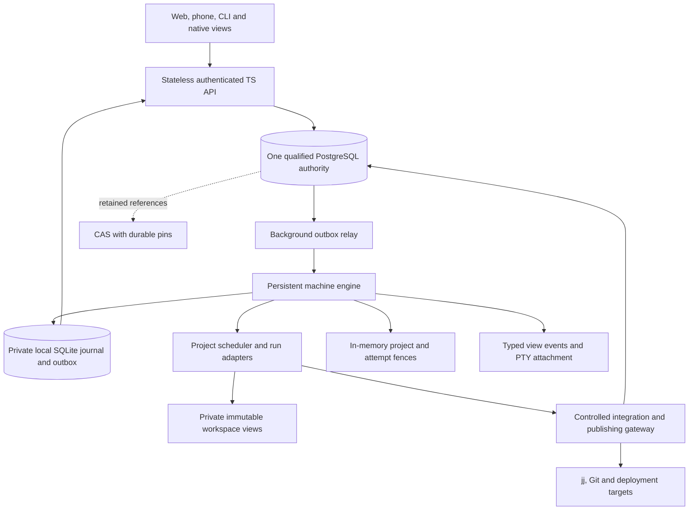
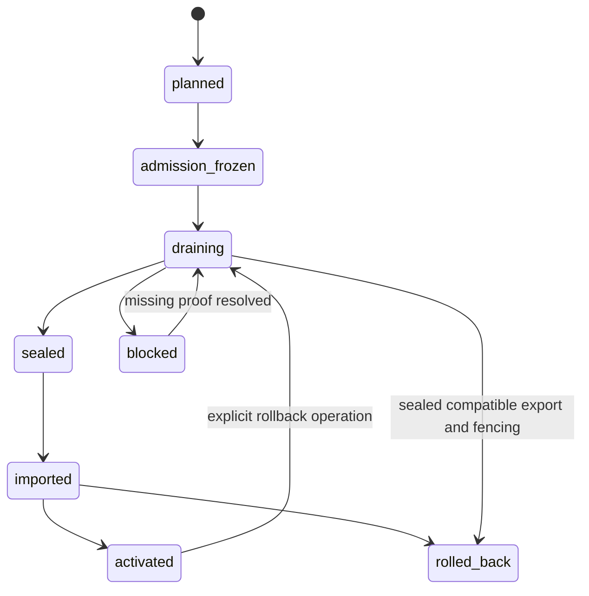

# Cloud project authority

Design and provider review, 2026-10-30. This specifies the next implementation;
it does not activate a database, change ownership, or qualify a provider.
The relational fixture is [schema.sql](../../examples/fleet-authority/schema.sql).
It creates a separate schema inside a transaction and ends with `ROLLBACK`.

## Authority boundary

For an explicitly opted-in Cloud project, one PostgreSQL writer is the sole
authority for ownership, assignments, accepted decisions, integration head,
ordered events, command receipts and durable mailboxes. A machine's SQLite
journal remains authoritative for its observed local execution and pending
outbound observations. A SQLite receipt alone cannot commit a Cloud decision.
Local-only projects retain their local authority. Offline work on a Cloud
project produces provisional branches and observations for explicit reconciliation.

This follows [PLAN.md sections 4, 10, 11 and 14](../../PLAN.md). Today,
[server.ts](../../cloud/src/server.ts) restores a control-plane SQLite file from
S3 and schedules its backup with a 750 ms debounce. Its home row owns a machine;
multiple `home-repo` rows share that machine, volume and worker token. Neither
the backup nor a home heartbeat establishes fleet scheduling authority.
[journal.rs](../../engine/src/journal.rs) already provides local WAL/FULL
durability, command receipts and owner/run epochs.
[engine_host.rs](../../native/src/engine_host.rs) currently owns one project,
takes an OS lock and refuses known live legacy writers. It explicitly does not
prove a complete handoff from an incompatible writer that races its scan.



The API authorizes and commits operations; it does not run another scheduler.
Each project has one scheduling owner, even when runs execute on other machines.
Views remain clients. Network renewal and relay work runs in background workers
or the existing TS Cloud helper. Typed results enter the App loop; the App loop
alone mutates native App/PTY state. It reads an in-memory fence before admission
or a privileged action and never waits for PostgreSQL or a network request.

## Provider qualification

The required property is preservation of every acknowledged authority transaction
across supported automatic failovers, plus exclusion of an obsolete writer.
A restored historical backup is a new authority incarnation, never transparent
failover. PostgreSQL transactions on a provider that can rewind acknowledged
history cannot guarantee increasing owner epochs or durable deduplication.

| Candidate | Primary engineering evidence | Decision |
|---|---|---|
| Traditional AWS RDS for PostgreSQL **Multi-AZ DB instance**, one standby | AWS documents synchronous replication to a standby in another AZ. | First preproduction qualification candidate. The existing AWS account and S3 region, `us-east-1`, make this a practical starting point; no database has been provisioned. [Current RDS documentation](https://docs.aws.amazon.com/AmazonRDS/latest/UserGuide/Concepts.MultiAZSingleStandby.html). |
| Fly Managed Postgres | Fly Support's October 2, 2026 answer describes asynchronous replication and possible loss of recent writes on failover. | Unqualified for this authority contract by default. A different documented synchronous configuration and its failover policy would need separate qualification. [Fly Support](https://community.fly.io/t/expectations-when-migrating-from-self-managed-to-managed-postgres/28742). |
| Neon | Neon documents commit acknowledgment after WAL reaches a safekeeper quorum; its protocol describes recovery and proposer fencing. | Credible alternative to qualify for the selected plan, region and endpoint configuration. Confirm deployed membership/failure domains and compute replacement semantics. [Architecture](https://neon.com/docs/introduction/architecture-overview), [safekeeper protocol](https://github.com/neondatabase/neon/blob/main/docs/safekeeper-protocol.md). |
| Aurora PostgreSQL | AWS describes six storage copies across three AZs, with four acknowledgments for a write. | Credible alternative, with a separate cost, compatibility and failure qualification. Storage quorum does not independently specify every PostgreSQL endpoint, restore or cross-region failover behavior. [AWS quorum design](https://aws.amazon.com/blogs/database/amazon-aurora-under-the-hood-quorum-and-correlated-failure/). |

The three-instance **RDS Multi-AZ DB cluster** is a different topology. Its
documentation describes semisynchronous replication and acknowledgment from at
least one reader. Do not silently substitute it for the selected DB instance
topology or infer that it is unsafe merely from that label; qualify its exact
commit and promotion behavior separately.
[RDS cluster documentation](https://docs.aws.amazon.com/AmazonRDS/latest/UserGuide/multi-az-db-clusters-concepts.html).

RDS is a candidate, not an unconditional zero-loss promise. AWS's older
engineering description explicitly discusses degraded operation with one current
copy when replication is disconnected. Confirm how the current service excludes
a stale standby and handles subsequent loss of that current copy before treating
partition recovery as monotonic.
[AWS implementation discussion](https://aws.amazon.com/blogs/database/amazon-rds-under-the-hood-multi-az/).
The RDS SLA specifies uptime credits and exclusions; it is not a blanket RPO
contract. Keep engineering claims, commercial SLA remedies and measured Rudder
evidence separate. [RDS SLA](https://aws.amazon.com/rds/sla/).

Before selection, obtain provider confirmation for the exact engine version,
topology and settings: acknowledgment durability during degraded operation;
stale-primary fencing and stale-replica promotion; partition policy; automatic
failover versus restore; and failure-domain limits. Run the drills below on that
configuration. Finite passing drills are evidence, not a proof of all failures.
If the required contract is unavailable, keep Cloud authority disabled or stop
admission during unqualified recovery. Do not build a second consensus algorithm
from S3 backups, heartbeat files or several independent SQLite databases.

Use the writer endpoint for every authority read and write, verified TLS, a
bounded pool and restricted network access. Require `fsync=on`,
`full_page_writes=on` and `synchronous_commit=on`; never accept an API-level
asynchronous commit option. The latter setting waits for WAL durability according
to PostgreSQL's configured replication, but does not itself provision a
synchronous standby or qualify a provider's promotion policy.
[PostgreSQL WAL settings](https://www.postgresql.org/docs/current/runtime-config-wal.html).

## Identities and relational contract

Every wire object has a format version. Tenant/project identifiers and principals
come from authenticated routing, not agent-supplied author or role fields.

| Identity | Meaning and lifetime |
|---|---|
| `authority_id` | Random incarnation of the production authority. Changes on historical restore or authority replacement. All receipts and fences include it. |
| `account_id`, `project_id` | Stable tenant and logical project. A checkout path or repository name is not identity. |
| `machine_id` / `machine_installation_id` | Provider resource / durable installation identity. Neither grants project ownership. Cloning a disk must create a new installation identity. |
| `machine_boot_id` | Trusted host boot-session identity, changes after a machine reboot. Distinct from a process restart. |
| `engine_instance_id` | Fresh UUID for every engine process start, including restart within the same boot. Registration binds installation, boot, protocol and authenticated engine key. Never recover a live fence from disk. |
| `owner_epoch`, `lease_id`, `renew_serial` | Increasing project ownership generation, random grant identity, increasing renewal generation within that lease. Reassignment increases the epoch; renewal does not. |
| `run_id`, `run_epoch`, `attempt_id` | Logical run, increasing run generation, unique backend execution attempt. Replacing or resuming an attempt allocates a new generation and UUID. A retry of one admission returns its existing attempt. |
| `operation_id`, `claim_id`, `event_id` | Durable accepted operation, one effect execution claim, immutable event. Transport retries retain their original IDs. |

The full execution fence is `(authority, account, project, owner_epoch,
engine_instance, boot, run, run_epoch, attempt, lease_id)`. A remote run's engine
may differ from the project scheduling owner's engine. Both identities are
checked. Project epochs, boot IDs and run attempts are never interchangeable.
Use decimal strings for bigint counters on the JSON wire; fail closed at signed
64-bit exhaustion. Object sizes retain their full unsigned range separately.

The fixture includes these relations:

| Relations | Required behavior |
|---|---|
| `authorities`, `projects`, `ownership_receipts` | Current incarnation, project mode, exact owner/lease, sequence, head/version, and immutable ownership history. The deferred history FK permits atomic owner changes. |
| `authority_credentials`, `project_principals` | Hashed authority ingress credentials and trusted user/service membership, exact privileges and access-version/revocation state. Legacy authentication SQLite is not their authority. |
| `engine_instances`, `runs`, `run_attempts`, `lease_renewals` | Authenticated process identities, exact current attempts, bounded execution leases and durable renewal retry receipts. |
| `events`, `idempotency` | Per-project committed order and stable acceptance receipts. One principal/key namespace covers commands, messages, decisions, integrations and cutover acts. |
| `capabilities`, `capability_targets` | Exact operation/scope/topic/recipient grants, owner and sender attempt, expiry and revocation. Store token hashes; never store bearer tokens in events. |
| `commands`, `command_effects`, `effect_observations`, `outbox` | Durable intent, claim/outcome state, immutable observations and at-least-once dispatch. |
| `messages`, `mailboxes`, `mailbox_deliveries` | Addressed envelopes, recipient-local delivery order and distinct transport/agent cursors. |
| `decisions`, `topics` | Immutable accepted versions and current topic pointers. |
| `retained_roots`, `verifications`, `verification_topics`, `integration_commits` | Admitted durable roots, trusted gate evidence and exact head/version transitions. |
| `cutovers` | Idempotent stop, export, import and activation progress with quiescence witnesses. |

DDL alone is not the authorization layer. Agents and views receive no database
credentials or direct DML access. The API uses narrow functions or an internal
transaction layer; table owners/migration roles are separate. Events, receipts,
decisions, verifications and committed integrations are append-only. All joins
include authority/account/project. CAS references require project access checks
as well as account ownership. Revocation and grant changes use the same project
serialization rule as acceptance. Raw credentials stay in private stores.

Cloud authority ingress checks credential hash, current expiry/revocation and
principal against PostgreSQL before checking project membership or run capability.
Trusted enrollment imports/creates eligible credential records; a restored legacy
login/token table alone cannot issue or reinstate one. Credential revocation
locks that credential row exclusively; acceptance holds it `FOR SHARE` after
the authority/project locks until commit. Revocation does not subsequently lock
projects, avoiding reversed lock order. In-flight accepted effects still require
reconciliation. App login can remain separate while its authority grants migrate.

For proxied agent operations, authenticate the engine transport credential and
the separate run capability. The capability supplies the agent principal; the
engine's identity does not replace that origin. Agents receive no machine-wide
credential. Credential/key revocation and stale run epochs remain separate checks.

## Transaction and retry rules

Use short `READ COMMITTED` transactions. Every project decision first locks the
active authority row `FOR SHARE`, then the project row `FOR UPDATE`. The shared
authority lock allows independent projects to proceed while an explicit global
freeze waits for already-entered transactions. A project freeze takes the same
project lock. Never hold a transaction during model work, network I/O, uploads,
Git operations, process shutdown or verification.

Within a project, all head, topic, owner, admission, effect-claim and capability
changes take that project lock. Additional rows use a consistent order: run IDs,
topic names, then mailbox IDs. Multi-project work uses separate sagas unless a
bounded transaction explicitly locks project IDs in sorted order. This makes
`READ COMMITTED` sufficient for these defined mutation paths; arbitrary queries
do not gain serializable behavior. PostgreSQL releases row locks at transaction
end and a waiting `FOR UPDATE` sees the updated row in this isolation level.
[Row locks](https://www.postgresql.org/docs/current/explicit-locking.html),
[isolation](https://www.postgresql.org/docs/current/transaction-iso.html).

The common acceptance procedure is:

1. Authenticate the principal and current tenant/project access. Validate the
   versioned envelope and payload limits. Begin, lock authority/project, and
   require the configured `authority_id`. Read current membership/revocation
   from PostgreSQL; a restored legacy session store is insufficient.
2. Look up `(authority, account, project, principal, idempotency_key)`. Identical
   canonical request bytes and original sender attempt return the original
   acceptance receipt, including after a target restart. Different bytes, kind
   or sender return `409 idempotency_conflict`. A receipt lookup does not grant
   new execution. A revoked caller still needs permission to read that receipt.
3. For a new operation, require ready authority and the operation's admissible
   project mode, then check current owner and sender/target attempts,
   capability, user authority, expiry, limits and expected versions. A peer's
   text cannot impersonate a user or expand its grants.
4. Increment `projects.event_seq` under the lock; insert the event, immutable
   acceptance receipt, operation row, pending effect/delivery and outbox in this
   transaction. Commit, then acknowledge acceptance. No successful response
   precedes commit.

Authorized receipt reads remain available while admission is frozen. They return
historical facts with the current frozen/fenced status and cannot renew a grant.

Canonical serialization is versioned, rejects duplicate/unknown fields and
unsafe numbers, and includes kind, payload, exact targets and expected fences/
versions. Compare stored bytes as well as SHA256; `jsonb::text` is not the
canonical format. Allocate sequence numbers from the locked project row rather
than a PostgreSQL sequence; aborted operations do not create committed holes.

Start with a 250 ms lock timeout, 1.5 s statement timeout and 2 s idle transaction
timeout, then tune from measurements. Apply a request deadline too. Roll back
the entire transaction on timeout, deadlock or serialization failure; retry with
the same key and bounded jitter. A failed/unknown `COMMIT` is an unknown result:
query/retry that key through the writer endpoint. Never manufacture a new key.
Return stale head/topic/epoch as a conflict with current versions; automatic
transport retry must not silently change a user's preconditions.

The acceptance receipt remains immutable. A separate read returns current facts
such as engine-received, adapter-written, backend-acknowledged, observed stop,
completed, integrated, pushed and deployed. No one status collapses those facts.

Proposed routes live under `/api/rudder/v4/projects/:project_id`; these names are
an interface proposal, not existing endpoints:

| Route family | Contract |
|---|---|
| `POST authority/{claim,renew,release}` | Exact owner/lease preconditions; claim/release operation key or renewal nonce; durable receipt and current fence. |
| `POST runs/:run_id/attempts`, `POST run-grants/renew` | Idempotent assignment to an authenticated engine; exact attempt generation and independent execution grant. |
| `POST commands`, `POST messages`, `POST decisions`, `POST integrations` | Common acceptance protocol with exact targets and relevant version preconditions. |
| `GET receipts/:operation_id`, `POST observations` | Authorized immutable acceptance/current facts; deduplicated observations of a specific effect claim, including a stale claim. |
| `GET mailbox`, `POST mailbox/dispositions` | Exact recipient attempt and bounded delivery cursor; explicit acknowledged/skipped disposition, never an arbitrary cursor jump. |
| `GET events?after=:sequence` | Bounded ordered replay. A reconnect deduplicates IDs and fetches missing pages. A projection snapshot and its sequence come from one `REPEATABLE READ READ ONLY` transaction. |

New accepted work returns `202`; an identical retry returns its existing receipt.
Use `409` for stale preconditions/key conflicts, `429` for bounded admission
pressure and `503` when authority cannot be established. No unavailable-Cloud
response claims durable acceptance. Freeze permits receipt reads, observations
and explicitly scoped stop/recovery operations while denying new execution.
Start with the local journal's limits: commands up to 256 KiB, messages up to
64 KiB, 256 pending entries and 4 MiB per target queue, maximum message TTL seven
days. Apply an additional per-project budget and bounded relay pages. Exact limits
are versioned policy; retries of accepted work do not consume another slot.

## Ownership and bounded execution fences

Claiming an unowned/expired project locks its row, checks ready mode and the
previous expected epoch, increments `owner_epoch`, sets a fresh `lease_id`,
authenticates the new engine instance, and inserts ownership/event/idempotency
receipts atomically. Two candidates cannot both win. An explicit transfer or
release requires a recorded handoff/quiescence witness; it also advances the
epoch. Expiry permits a new authority owner but is not proof that an old process
or external request stopped. A release retry uses the original receipt and
cannot advance the epoch again.

Renewal never revives an expired lease. Under the project lock it requires
ready mode, the exact owner engine/boot, epoch, lease ID and expected renewal
serial, and an unexpired grant. Sample `clock_timestamp()` **after** acquiring
the row lock. PostgreSQL's `now()` is fixed at transaction start and is unsuitable
for this expiry check.
[PostgreSQL clocks](https://www.postgresql.org/docs/current/functions-datetime.html).
For example, named parameters below denote bound values, and every missing row
or failed assertion rolls back:

```sql
BEGIN ISOLATION LEVEL READ COMMITTED;
SET LOCAL synchronous_commit = on;
SET LOCAL lock_timeout = '250ms';
SET LOCAL statement_timeout = '1500ms';
SET LOCAL idle_in_transaction_session_timeout = '2s';
SELECT authority_id FROM authorities
 WHERE authority_id = :a AND state = 'ready' FOR SHARE; -- require one
SELECT owner_epoch FROM projects
 WHERE authority_id = :a AND account_id = :acct AND project_id = :p
 FOR UPDATE; -- require one; authenticate engine and check renewal nonce first
SELECT clock_timestamp() AS db_now; -- bind this returned value below
UPDATE projects SET lease_until = CAST(:db_now AS timestamptz) + interval '15 seconds',
                    renew_serial = renew_serial + 1
 WHERE authority_id = :a AND account_id = :acct AND project_id = :p
   AND mode = 'ready' AND owner_epoch = :epoch
   AND owner_engine_instance = :engine AND lease_id = :lease
   AND renew_serial = :expected_serial AND lease_until > CAST(:db_now AS timestamptz)
 RETURNING owner_epoch, lease_id, renew_serial, lease_until; -- require one
-- Insert lease_renewals(request_id, canonical request, exact returned grant,
-- issued_at = :db_now, ...). Duplicate nonce returns its ORIGINAL grant.
COMMIT;
```

Renewal nonces have a separate transport namespace. Reusing one with different
bytes fails. Retain renewal receipts through the retry window; never recompute
a later expiry when returning a duplicate. An owner renewal does not itself
authorize an unassigned run. Run admission/renewal locks the project and exact
current attempt, checks its assigned engine and current owner epoch, and issues
an independent grant whose expiry is at most the project lease expiry. It is
renewed by that authenticated run engine through the API, not asserted by the
scheduler. Reassignment invalidates all old grants by the project epoch join,
without a large synchronous update of every run row. Materialize retirements
in bounded batches; old attempts remain historical, never silently retargeted.

Proposed starting limits are a 15 s maximum grant, renewal every 5 s, bounded
network requests and one outstanding renewal per grant. Qualification determines
the final clock margin. The renewal task records a suspend-aware monotonic
timestamp `m0` at the **first** send of that nonce. On success, it computes the
local deadline from `m0` plus a conservative duration, never from response arrival
or the machine's wall clock. With bounded fractional rate errors `rho_engine`
and `rho_db`, maximum positive database clock discontinuity `J` during a grant,
and scheduling margin `S`, one conservative duration is:

```text
safe_duration = (grant_duration - J) * (1 - rho_engine) / (1 + rho_db) - S
local_deadline = first_send_monotonic + max(0, safe_duration)
```

Reject late responses, older serials, changed IDs, nonpositive duration or a
deadline already reached. A response to a fenced attempt cannot resume it.
Restart, boot change, sleep/resume uncertainty or an unqualified clock anomaly
invalidates local grants before further work. Keep deadlines in memory only;
persisting a lease timestamp never grants permission after restart. If bounds
on clock behavior across database failover cannot be established, expiry is
insufficient evidence of physical exclusivity; require observed quiescence for
replacement execution. Database epoch/head fencing still applies.

The engine checks its project and attempt fence immediately before scheduling,
spawning, mailbox injection, shared publication and privileged tool dispatch.
An independent watchdog marks the fence expired and requests controlled backend
interruption, child-process shutdown and workspace sealing. A resumed paused
thread checks the deadline before its next action. Only the App loop performs
App/PTY changes. Bounded watchdog latency and observed termination are measured
facts, not guarantees furnished by an epoch number. Preserved private workspace
writes may remain recoverable after a fence expires; no new shared effect is
authorized. A late stop acknowledgment cannot revive an intentionally stopped
task.

## Commands, effects and outboxes

Command admission persists its exact target attempt and accepted owner epoch.
The relay claims a small `outbox` batch with `FOR UPDATE SKIP LOCKED`, a random
claim ID and short claim expiry; it commits before sending. A completion update
must match that claim ID. An expired relay claim can be retried without granting
a second effect execution. This transport bookkeeping does not allocate project
decisions or change a command's outcome.

The engine commits an inbox record keyed by operation/event ID, original bytes,
authority fence and a pending local effect in one SQLite transaction before
acknowledging receipt. Repeated frames return that receipt. This is an
at-least-once protocol with durable deduplication, not an exactly-once network.
Local SQLite stays on private local storage with WAL, `synchronous=FULL`, checked
foreign keys and the engine's OS single-writer lock. It is never a shared
filesystem database. A Cloud projection must not call the existing
`Journal::create_project` path and accidentally create a local authority.

Before an effect, the authorized executor claims `pending -> started` under
the PostgreSQL project lock and exact current fence, storing a unique claim ID.
It then commits the matching local claim before invoking its adapter. A crash
between these steps is conservatively uncertain. No model, Git or provider call
runs inside either transaction. Local completion plus an outbound observation
is one SQLite transaction. Observation ingest deduplicates its ID; authoritative
completion checks the operation, claim and current reconciliation policy.

A stale owner may submit authenticated immutable observations for its old claim.
It cannot accept decisions, renew, move the head, start a new effect or declare
itself current. New owners reconcile these observations instead of rejecting
potential evidence about effects that actually occurred.

| Recovered effect state | Required action |
|---|---|
| Pending and never claimed | Retire stale targets or admit explicitly authorized replacement work. Do not replay into a new attempt by changing the target. |
| Started / uncertain | Query the backend/provider by operation and claim identity, inspect process trees and exact remote revisions, and retain a scope blocker. Retry only with proof of no effect or effective remote deduplication of this exact operation. |
| Completed with evidence | Preserve the original result. Check whether it satisfies current intent and history before using it. |
| Outcome cannot be determined | Keep it uncertain; block conflicting integration/delivery or replacement execution and surface the missing evidence. |

Interrupt-then-steer serializes stop request, backend acceptance, observed turn/
tool outcome, replacement delivery and resume. A written interrupt or closed
socket proves none of the later stages. Inspect dirty files and background
tools before replacement; stopping a model turn does not undo a deployment.

All shared integration/publishing paths must enforce epochs at their actual
commit boundary. Ordinary agents receive no unmediated credentials capable of
changing the shared head or deployment. A gateway first records a claim and
uses target CAS or a remote idempotency key where available. An already-issued
request cannot be retracted by lease expiry: the claim remains a blocker until
reconciled. For Git, compare the remote ref with the expected prior and desired
commit; a different value needs reconciliation, never a force push. For a
provider without fencing/deduplication, wait for confirmed old-owner shutdown
and resolve in-flight effects before permitting conflicting new publication.
Uncontrolled credentials invalidate an exclusive-move claim.

Retain immutable receipts/dedup keys for the promised project history or replace
them with durable tombstones before deleting payloads. Transport queues and
renewal receipts may be compacted under explicit retry limits; compaction cannot
make an accepted operation executable again. Apply bounded batch sizes, per-run
queue limits, retry backoff and admission backpressure rather than unbounded RAM.

## Mailboxes and accepted decisions

A send transaction validates sender identity, exact recipient attempt, delegated
intent/scope, expiry, payload and transactional count/byte quotas. It allocates
both a project event and the recipient mailbox's next delivery sequence, then
persists envelope, delivery, receipt and outbox before acknowledgment. Preserve
conversation/request/reply IDs, topic vector, artifact refs and supersession
links. A message cannot itself accept a decision or escalate user authority.

`engine_cursor` means contiguous durable engine receipt. Adapter write is another
fact. `ack_cursor` advances only over contiguous terminal delivery dispositions:
explicit authorized agent acknowledgment, recorded skip or expiry. Never advance
past an unresolved earlier message. Terminal disposition and quota decrement
commit once together. Record expiry/skip events with reasons. Transport delivery,
an inbox read and model compliance remain distinct. Apply per-intent/priority
limits so urgent messages cannot bypass all backpressure. On attempt replacement,
old deliveries remain addressed to that attempt; an explicit reissue creates a
new operation with provenance and current targets.

Decision acceptance checks delegated topic/scope and `expected_version` under
the project lock; zero means no existing topic. It inserts an immutable decision,
updates the topic pointer to exactly the next version, and records event,
idempotency and outbox together. Concurrent proposals against one version yield
one winner and one conflict. Supersession preserves prior versions; it does not
rewrite history. Cross-cutting decisions require the project's authorized role,
with the user's applicable instructions retaining highest authority.

## Integration head and retained evidence

Compose and verify outside database transactions in private jj metadata. Before
admitting a candidate, acquire durable CAS pins for source/environment roots,
gate evidence and build contract. `retained_roots` records trusted admission of
existing pins, not an upload promise. Hold staging retention until the final
project references and durable retention ownership are confirmed. Failure after
pinning leaves an orphan pin to reconcile; it must not expose an unretained root
or collect content because an API response was lost.

Trusted gate admission records the exact base head/version, tested candidate
head/source/environment, complete applicable topic/build-policy vector and
gate receipt. Agent-supplied JSON cannot create a verification. The gate policy
itself is a versioned topic; changes to the applicable dependency set must change
that policy version, preventing a newly relevant topic from escaping an old
vector. An absent expected topic has version zero.

The final transaction locks authority/project, deduplicates the request, then
checks the exact epoch, live lease, prior head **and integration version**, tested
candidate identity, admitted roots and every required topic version. For example:

```sql
-- Within the common locked/authenticated transaction; bind the new values.
UPDATE projects AS p
   SET head_vcs_commit = :new_head, head_source_root = :source_root,
       head_environment_root = :environment_root,
       integration_version = integration_version + 1,
       event_seq = event_seq + 1
 WHERE p.authority_id = :a AND p.account_id = :acct AND p.project_id = :p
   AND p.mode = 'ready' AND p.owner_epoch = :epoch
   AND p.owner_engine_instance = :owner_engine AND p.lease_id = :lease
   AND p.lease_until > clock_timestamp()
   AND p.integration_version = :expected_version AND p.head_vcs_commit = :old_head
   AND EXISTS (
     SELECT 1 FROM verifications v
      WHERE v.authority_id = p.authority_id AND v.account_id = p.account_id
        AND v.project_id = p.project_id AND v.verification_id = :verification
        AND v.owner_epoch = p.owner_epoch
        AND v.base_version = p.integration_version AND v.base_head = p.head_vcs_commit
        AND v.tested_head = :new_head AND v.tested_source_root = :source_root
        AND v.tested_environment_root = :environment_root
        AND NOT EXISTS (
          SELECT 1 FROM verification_topics vt LEFT JOIN topics t
            ON t.authority_id = vt.authority_id AND t.account_id = vt.account_id
           AND t.project_id = vt.project_id AND t.topic = vt.topic
           WHERE vt.authority_id = v.authority_id AND vt.account_id = v.account_id
             AND vt.project_id = v.project_id AND vt.verification_id = v.verification_id
             AND COALESCE(t.version, 0) <> vt.expected_version))
 RETURNING integration_version, event_seq; -- exactly one row, otherwise rollback
-- Insert matching integration_commits, events, idempotency and outbox rows.
-- Deferred/ordinary FKs and trusted gate admission are mandatory, not omitted gates.
```

A head/version/topic conflict invalidates affected evidence and requires
recomposition/reverification. Reusing a successful operation's key returns its
existing receipt instead of attempting this update again. PostgreSQL head commit
does not prove Git export/push or deployment. Those use separate authorized
effects and record exact target, artifact/revision, provider, UTC verification
time and smoke evidence.

## Physical migration and rollback

Project authority migration is explicit, project-scoped and resumable by
`cutover_id`. Use a compare-and-set transition of the recorded stage; return
completed stage receipts on retry. A changed export under the same identity is
a conflict. Keep original source workspaces, run records and recovery paths.



1. **Shadow and plan.** Create a shadow projection with no owner/scheduler.
   Inventory all launchers and writers: native dashboards/attach owners, TS
   daemons, board schedulers, worker supervisors, hooks, queued commands and
   external credentials. Record exact process start identity, boot, executable,
   namespaces and protected paths. Compare imported projections read-only.
2. **Freeze admission.** Persist the cutover and deny new work on old and new
   ingress. Disable old supervisors/autostart routes before asking processes to
   stop. New compatible clients honor the registry; incompatible clients need
   physical exclusion. A new `engineAuthority` flag, stale PID check or empty
   attach socket does not fence an old binary.
3. **Drain and stop.** An explicit migration authorizes the scoped handoff, not
   an unrelated machine reboot. Request backend interruption/checkpointing;
   observe outcomes and process-tree/PTY exit, reconcile outstanding effects,
   then confirm the scheduler has stopped. Persist intentional Paused status
   and remove live process handles. Repeated stop requests report the same
   operation's observations; they never target a new PID/attempt by accident.
4. **Establish physical quiescence.** Hold compatible OS owner locks and prevent
   incompatible writers from reopening the retired namespace. Use isolation or
   a new private workspace with old write access removed, retire launcher access
   and revoke old publication credentials/routes. A read-only rename or chmod
   under the same unrestricted UID is not sufficient. Include escaped children,
   queued hooks and external requests. If exclusion cannot be established, keep
   the cutover blocked; do not activate a competing scheduler.
5. **Seal.** Produce a versioned, immutable export after quiescence: exact head,
   dirty source deltas, legacy identities, runs/sessions, accepted command IDs
   and canonical bytes, pending/uncertain outcomes, message cursors, decisions,
   evidence and retention roots. Preserve intentionally stopped intent. Pin the
   export and a quiescence witness; record their hashes and source origin.
6. **Import.** A versioned importer stages bounded pages with stable source-ID
   mappings. Keep `mode=importing` and no owner while partial. Verify counts,
   hashes and references, then commit the final import receipt. Uniqueness of
   `(legacy_origin, export_sha256)` prevents importing the same seal twice.
   Unknown effects remain uncertain. Historical events retain origin order;
   new authority events get new project sequences. No imported acceptance is
   blindly executed. The local SQLite projection records this import lineage.
7. **Activate.** In one short transaction check the final import/quiescence
   receipts, no unresolved conflicting effects, expected mode/epoch and pinned
   roots; install the first owner/lease, advance the epoch, switch the project
   routing mode to ready and record the activation/event/idempotency receipt.
   Loss of the response returns that receipt on retry. Newly admitted attempts
   get fresh run epochs and engine-bound grants. Preserve compatibility exports
   while migrating clients.

All legacy API paths consult the authoritative project route and reject/reroute
opted-in scheduling writes; they must not fall back to restored/stale Cloud
SQLite when PostgreSQL is unavailable. Server rejection fences remote ingress,
but cannot stop local old binaries holding filesystem access or raw provider
credentials. Both forms of exclusion are required. Copy keeps a new project/run
identity and allows the original to continue. Move requires this full handoff.

Rollback is a new recorded operation, not restoration of the pre-cutover SQLite
file. Freeze new admission, fence/drain the new owner, reconcile effects, seal
all post-cutover source and state, and validate a compatible export. Resume
through an adapter that honors current PostgreSQL authority and fresh epochs.
If only an incompatible legacy scheduler is usable, explicitly deactivate Cloud
authority after physical exclusion of all new writers; record the final sequence
and deactivation receipt and hand sole control to that isolated legacy owner.
Never run it alongside a ready Cloud owner. Preserve the Cloud history; a later
reactivation is another explicit import with fresh fences. An unexportable
feature or unproven shutdown leaves the project frozen with recovery artifacts.

## One engine, many projects

The machine engine owns a map of project state/fences and per-attempt process/
PTY/workspace handles. Each project has its own epoch, lease, scheduling queue,
credentials, limits and pause/drain state. A failure or migration for project A
does not stop B, rotate B's credentials or release B's owner. Machine identity,
volume possession, a home heartbeat and project presence are separate facts.

The current home worker token is shared across repositories. It can bootstrap
authenticated machine registration, but cannot serve as an unrestricted project
execution or publishing grant. Introduce scoped project/attempt credentials and
registrations before enabling mixed-authority homes. Isolate engine private
SQLite/keys from agent filesystem access; a shared unrestricted UID is not an
authorization boundary. Namespace workspaces/caches and enforce tenant ACLs.

A project command cannot stop/reimage/delete its shared home machine. Machine
lifecycle remains an account infrastructure operation: enumerate all resident
projects, freeze admissions, drain each, confirm their stop/effect witnesses, then
perform the machine action with separate authorization. Idle means every relevant
project is confirmed idle; a stale aggregate heartbeat is insufficient. Releases
wait for safe adoption and do not restart live agents. A reboot creates a new
boot and new engine instance; all projects independently reacquire authority.

## Database disaster recovery

Normal provider failover must retain the same authority incarnation and every
acknowledged receipt. API/pool errors produce unknown outcomes resolved by the
original operation key. Engines stop new privileged work when their local
deadlines expire. Reconnect never silently switches to an async replica, restored
snapshot, test branch or local SQLite authority. Persist observed authority/
epoch/event high-water marks and reject regressions, while recognizing that
these checks cannot detect every missing write seen only by another client.

Historical restore follows an operator-controlled recovery procedure:

1. Freeze/disable all authority ingress and publication gateways outside the
   restored database; fence old endpoints/credentials, and quiesce or wait for
   grants plus reconcile in-flight effects. A database's own restored `ready`
   flag is not permission to serve traffic.
2. Restore into an isolated endpoint with no production writer access. Reconcile
   surviving engine outboxes, previously issued receipts and external target
   facts. Acknowledge any lost accepted history explicitly; never invent success.
3. Generate a fresh `authority_id` and an activation manifest/witness outside the
   historical snapshot. Re-key the imported rows or use an isolated new schema,
   create new ownership receipts and keep all old-incarnation references as
   provenance. Allocate fresh event/attempt IDs where global uniqueness requires
   them and retain origin mappings. No old grant, capability or deadline transfers.
4. Pin the new incarnation/endpoint in authenticated API, engine and gateway
   configuration; rotate credentials and prove old endpoints cannot publish.
   Activate only after reconciliation and a new admission handshake. An endpoint
   rename alone and the fixture's one-ready-row index cannot fence two databases.

Keep the activation manifest in the existing protected recovery store with
versioned retention. It is recovery evidence, not a second automated election
service. Cross-region restore/promote remains this explicit procedure unless
that exact topology separately satisfies the authority contract.

## Implementation order and required evidence

Implement the restricted PostgreSQL transaction/API layer and versioned wire
types first, then engine local inbox/outbox plus in-memory fences, then the
controlled effect gateway, shadow importer and project-scoped cutover. Replace
home lifecycle assumptions only when per-project engine ownership is available.
Existing local journal methods remain local until explicitly routed through a
Cloud-authority adapter. No product file is changed by this design fixture.

Before enabling the first opted-in project, keep reproducible evidence for:

- Two concurrent claims, claim versus renewal, release/claim response loss,
  capability revocation races and stale owner/run/boot/attempt rejection.
- Duplicate requests before/after owner replacement, changed-byte key reuse,
  ambiguous commit, outbox redelivery/claim expiry and local crash at every
  accept/claim/invoke/observe boundary. Unknown effects never blindly replay.
- Concurrent topic/head CAS, a newly relevant gate-policy dependency, missing
  retained content, lost pin-transfer response and verification of the exact
  tested candidate rather than only its base.
- Mailbox ordering, expiry/skip/ack races, exact quota accounting, attempts
  replaced during delivery and interruption with a still-running child tool.
- Database primary restart/failover while monotonically numbered transactions
  are acknowledged to an independent witness. Check every acknowledged receipt,
  epoch and head survives. Exercise stalled commits and reconnect to old pooled
  connections. Record provider topology/version/config, UTC time and latencies.
- Worker-to-authority partition, relay/API restart, delayed/reordered renewal,
  wall-clock jump, process suspension/resume and engine/VM reboot. Show bounded
  local fencing, no shared publication from a stale owner and recovery of private
  edits. Provider-internal partition scenarios need provider-supported evidence
  and drills; an API-network partition does not test replication partitioning.
- An incompatible old dashboard/TS scheduler and escaped child attempting to
  write after freeze; a crash after every stop/import/activate/rollback stage;
  blocked cutover without quiescence proof; and a two-project home where A moves
  while B remains live without machine restart or credential disruption.
- A historical restore behind closed ingress, explicit new incarnation,
  reconciliation of newer receipts/external effects, refusal of old credentials,
  and a rollback that preserves all post-cutover work.

Schema execution and isolated protocol tests are necessary but do not constitute
provider qualification or production delivery. Shipping evidence must identify
which of these gates actually passed and which remain open.

Local fixture validation on 2026-10-30 used PGlite 0.5.13 (PostgreSQL 18.6): schema
creation, 21 negative relational-constraint checks and nine branches of the two
documented SQL examples passed; rollback left no schema. This isolated in-memory
check exercised no concurrent server sessions, application API or provider.
