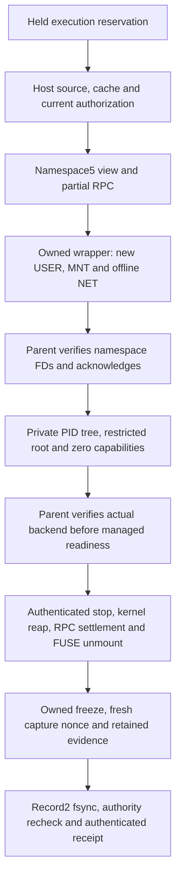

# Rudder v4 implementation and restart record

Updated: 2026-11-01. Read with [the plan](../../PLAN.md),
[research](research.md), [gates](experiments.md) and repository `AGENTS.md`.
This file preserves the working agreement across context compaction. An entry
here is not deployment proof; record exact checks and delivery identities below.

## Current state, 2026-11-01

The shipped Cloud release is alpha.33, Fly release176, product revision
`50771f8964f4ad2e04ee9533be0d9db56b64da7b`. Both npm `next` packages
passed fresh installation, executable, revision and cross-platform manifest
checks. Their package metadata is identical apart from the package name. [Release evidence](verification-alpha33.json)
records those distinct facts and the unchanged original live home. The full v4
rewrite remains incomplete. Entries below describe earlier checkpoints and
unreleased work; their older version numbers are historical.

Latest continuation: alpha.32 remains unpublished. All three native builds,
JavaScript qualification and its actual stock Fly worker smoke passed. macOS
Rust qualification run 41323038312 then passed 102 cases and failed one fixture
that assumed a 10ms releaser thread would close SQLite inside the original
100ms startup window. The five related fixture scheduling assumptions are now
separated from post-release API semantics. Actual contention, original callback
deadline decisions, marker/epoch refusal, restored ordinary policy and zero
mutation remain checked. Run 271 passed all eight cases with normal parallel
execution. Production startup policy is unchanged. Alpha.33 subsequently passed
all three native platforms and complete final-source release qualification;
no alpha.29 through alpha.32 tag was pushed or retagged.

Alpha.33 connects the genuine optional Root runtime
client to the original task barrier before the independent seed acknowledgment.
It retains the same helper, clock and cancellation through off-App enrollment,
App adoption and recovery. The inherited service FD snapshot occurs before any
constructor allocations. The actual post-exec transport uses SO_PEERPIDFD and
a new protected connection. Default absence preserves existing paths; selected
baked genesis still refuses the old host-imported environment until genuine
backed preparation exists. Normal runtime retirement remains unavailable.

Current local checks passed: engine/native libraries run 262, 503 cases; full
native binary run 266, 1,318 cases; JavaScript run 268, 928 with ten skipped;
fresh-binary TUI run 272, all 59; full workspace compile 273. Full Rust run 274
stopped on the managed handoff fixture opening `/proc/self/environ` after the
receiver's required non-dumpable protection. The fixture was corrected to
retain actual pre-handoff proc descriptors and assert both descriptor CLOEXEC
and unchanged protection. Focused run 275 passed all five handoff cases, then
complete run 276 passed 2,365 tests with zero failures and 65 ignored across 65
suites at 16:43:15Z. The original failed full run remains retained. These results
qualify their stated local scopes. Final-source CI run41327838616 then passed
the Linux, Apple Silicon and Intel macOS builds and full release qualification.
Tag run41331075052 authenticated and reused those exact artifacts for npm.
The actual stock worker smoke and deployed control checks are recorded in the
alpha.33 evidence; configured runtime-floor qualification remains separate.

The uncommitted batch now connects retained baked preparation and a shared
Environment boundary through initial source, selected task resources, checkpoint
retention and accepted successors. Its nine storage cases pass. The original full
Rudder-history composition failed because 597MB of reconstructed Git history
exceeds the old 384MiB raw importer. The explicit PackedHistoryV2 path now passes
the actual full-history plus 1.975GB runtime component: 12,260 Git objects become
51,047,059 encoded bytes, with 724,831,675 bytes of bounded verification work.
Source/seed/runnable preparation takes 11.866s inside its original 30 seconds;
typed capture, environment preparation and dependency derivation are separately
bounded phases, not one combined startup measurement. Eleven selected format,
process, Git and jj tests pass. The explicitly selected repetitive-history
debug stress test expires its original deadline; that failure and the original
raw-history refusal remain in [composition evidence](verification-environment-dependency-working.json).
The optimized full-repository result does not qualify 50 forks, cold storage,
actual agent launch or normal filesystem retirement.

Automatic mailbox notices now use the existing durable effect ledger and wake
only qualified idle sessions. Thirteen Journal tests and six Native checks pass;
notices do not acknowledge mail. Native library regressions pass 245 cases with
21 ignored. The new SDK Cloud code compiles, its 23 protocol checks pass, and
the [actual PostgreSQL SDK-role qualification](verification-sdk-role-pg-working.json)
passes again with the SDK semantic v2 schema at 19:36:41Z, with restricted roles,
TLS, commit loss, socket closure, expiry and exact
owned cleanup. Root/compiler evidence in that database run is explicitly fixture
data. The actual C1 [artifact](verification-compiler-c1-working.json) and
[CAS producer](verification-compiler-c1-cas-working.json) built successfully;
the current A6 bake produced 6,430 objects / 1,174,586,558 bytes in 24.299s.
After adding only the signed-package public CA bundle, the actual disposable
Linux VM passed C/C++, Rust executable, offline Cargo build script, SQLite,
TypeScript and Buck2 C++ action/output checks. Exact owned VM cleanup and the
unchanged live home were verified at 19:30:42Z. [Functional evidence](verification-compiler-c1-functional-working.json)
is separate from actual Root SDK admission and normal daemon retirement.

A source review found two concrete SDK cache-input gaps: compilers can read
unkeyed job metadata and kernel `/proc` values. Local SDK warm reuse is now
disabled. Per-run artifacts/evidence remain retained; their receipts include the
execution nonce and explicitly prohibit reusable-cache admission. Enforced
hermetic reads/effects are required before reuse can return. The review and
new cache guard still require full integration/physical regression qualification.

Successful per-job resource disposal is locally connected through the existing
canonical worker pool. Run 356 compiles all Native targets; runs 357/358 pass
eleven new Child, socket, descriptor, actual thread/TLS join, real CAS and serial
component cases. Full genuine SDK disposal/capacity reuse is unverified. Routine
terminal helper failures still need a separate authenticated failed-job outcome
and disposal path. That v2 is now integrated without inventing artifact success;
run 364 passes 25 SDK component cases, including bounded real diagnostics and
terminal-failure retention. Runs 365–367 pass ten current-source policy, actual
Engine/Journal/Git/jj owner and two-worker/TLS cleanup cases. Actual ordinary
SourceOnly trigger wiring and positive SDK execution remain unverified.

The first payload-read isolation implementation required Landlock. Actual
`6.12.114-fly` kernel configuration has `CONFIG_SECURITY_LANDLOCK` disabled;
the real syscall refuses with ENOSYS. Two Linux filesystem tests therefore fail
and two descriptor/policy tests pass. This is an unsupported mechanism on the
current Fly kernel, not physical SDK readiness. Cache reuse stays disabled while
an explicit proc-less view and compiler-only seccomp replace it. The five actual
Fly kernel component tests now pass, including fresh-PID proc-FD isolation,
recursive mounts, read-only inputs, writable private outputs, descriptor closure,
ordinary threads/forks and x32 refusal. Two Rust policy checks pass after adding
the missing PermissionsExt trait import. Actual SDK Python/Rust/TypeScript
execution still requires the newly built configured worker. No unconfined retry
or live-home restart occurs.

The complete Native binary run 353 passed 1,351 cases with 21 ignored before
the subsequent catalogue/isolation changes. C1 catalogue Engine run 354 passes
nine cases, Cloud compiles, and fourteen catalogue/protocol/semantic Node cases
pass. These do not qualify the later configured worker or its compiler role.

Canonical gate production is locally connected; run 348 passed sixteen selected
Native canonical/legacy cases, including twelve new policy/repository/worker
checks. The new Journal and retained-input tests remain a separate check.
Complete SDK execution qualification, enforced cache inputs, actual multi-agent execution,
restart recovery and normal runtime drain remain unfinished. These working checks are separate from alpha.33's
deployed revision and default-absent bootstrap smoke.

The new compiler CAS producer passed all seven real Root0 Bookworm tests and
baked the actual pinned 852MB A2 compiler artifact in 14.466s under its unchanged
300s budget. The complete CAS verification and two-pin acknowledgment produced
1,320 objects and 853,092,522 encoded bytes. An initial Fly exporter 403 failed
after successful bake; an exact immutable build-graph retry pushed digest
`sha256:fdb88bde30c78585e9c932c434bf8ed5c82f47ceac41c0ff23fbe9962147860f`.
This proves the build-only compiler data producer, not mounted compiler
execution, REAPI hits or production activation.

The new same-source runtime image contains its four freshly built executables
before baking its complete immutable graph. Digest
`sha256:f26ab1dda848fc41a5b1305ad1058083fbe52347966328cee32f302fce341336`
is a working-source component image, not stock alpha.32. The first physical
default-absent verifier stopped before launcher execution because it read the
checksummed retention envelope at the wrong level. Its exact VM was destroyed
and two inventories confirmed absence. The corrected verifier checks actual
`state`/`checksum`, raw inventory/manifest/pin bindings and installed executable
records. A provider inventory timeout in the next attempt also left no qualified
guest result; that owned VM was destroyed and absence checked. The subsequent
run passed the actual installed default-absent bootstrap, all four fresh ELF
bindings and original process custody, with exact VM destruction and two absence
checks in 15 provider calls. [Evidence](verification-managed-runtime-bootstrap-working.json)
keeps the failed attempts separate. No configured-ready result is inferred from
these data checks.

The independent [communication and product-flow audit](communication-status.md)
keeps the rest of v4 explicit: automatic mailbox delivery and interruption
settlement, unified durable task routing/command migration, and trusted previews
with sequenced terminal recovery and real-device qualification remain open.

Current working source is unreleased. The full JavaScript run passed 928 with
zero failures and 10 skipped at 12:20:28Z. The complete Rust checkpoint 225 passed
2,257 tests and TUI 226 passed 59; these precede the later image backing components.
After that integration, engine/VFS 241 passed 385 with zero failures and 13 ignored,
native source-owner 242 passed 9, and VCS/projection 243 passed 57 with five ignored.
The full native binary 220 passed 1,306 with zero failures and 21 ignored before
these last changes. The complete release matrix must qualify the final versioned
source before publication. Full repository run 245 passed cold preparation,
accepted edits, unchanged warm reuse and two private logical CoW views. Cold was
10.73s, acceptance 3.31s and warm reuse 46.8ms with zero seed file payload reads.
The two logical forks took 14.6/15.9ms. This is not Cloud agent launch latency.

Alpha.29 candidate `05eef52` failed its release check before publication: both
Mac builds found three comparisons between captured u32 modes and Darwin's
u16 file-type constants. Linux native compilation passed. The lossless u32
normalization passed 27 focused seed tests with three large fixtures ignored;
the next complete release candidate is alpha.30. Alpha.29's tag stays local and
unchanged. Origin/main, npm and the production deployment still contain alpha.28.

Alpha.30 passed all three native builds and its actual stock-worker Fly smoke
check, including original process/pipe settlement and exact VM destruction plus
absence. Release qualification then found one portable test calling the
Linux-only managed registry factory on macOS. The configuration assertions now
run on every platform; Linux constructs/closes the lazy factory and other
platforms assert its expected refusal. All five cases pass locally in the real
Linux branch and a separate simulated Darwin negative branch. Real macOS and
the full final-source matrix must still pass. Alpha.30 stays unpublished;
the next candidate is alpha.31.

Alpha.31 also stays unpublished. Its three native builds and JavaScript checks
passed, but macOS Rust qualification run41320051819 failed with 20 retained
preparation failures and one startup-budget test failure. The index canonicalized
its root but retained a lock-directory path through macOS's temporary-directory
ancestor alias. Both child paths now derive from the same canonical root. The
existing redirect and actual SQLite replacement checks remain required. Focused
Linux run 252 passed 26 cases with one subprocess fixture ignored; new cases cover
successful preparation through an ancestor alias and refusal of a replaced lock
directory. Run 254 also passed all 14 build-index regressions.
The startup-budget callback keeps its original absolute deadline. The failing
test inferred renewal from a scheduler-sensitive elapsed-time assertion. Its
replacement observes the actual installed callback on two real contended SQL
statements and requires the later statement to use the same expired deadline,
request zero sleep and leave no mutation. Callback observations are test-only;
the original 100ms policy and maximum 1ms sleep are unchanged. Engine library
run 255 passed all 302 cases with zero failures and 12 ignored, including the
real two-statement callback observations. macOS qualification remains pending.
The next candidate is alpha.32.
No candidate 29, 30 or 31 has been published, deployed or retagged.

The final alpha.31 Linux workspace run 249 passed 2,331 tests with zero failures
and 61 ignored at 15:35:28Z. Its preceding run 248 stopped at the original disk
floor and is not a passing result. Fresh-binary TUI run 250 passed 58 and failed
one transient `working` screen observation after both workers had already merged.
The unchanged isolated run 251 passed. Test-only run 253 then passed the revised
journey that binds both actual node/run/workspace identities, exact worker output
bytes, completion and both durable merges. Approval keystrokes and all existing
deadlines remain unchanged. These results do not waive macOS qualification.

The actual-scale readonly image VFS component passed on an owned Fly VM at
15:20:51Z. Metadata admission took 5,979ms for 22,175 baked objects representing
1,974,041,724 encoded bytes and an 18,990-file manifest. Five complete verified
file reads took 237ms, including the pinned 20.7MB Git FileNode and genuine hardlink
aliases; the local CAS remained empty. The first attempt selected Debian's Git
instead of the recipe's pinned Git and remains failed evidence. The corrected
attempt retained actual original-process exit/pipe/pidfd proof and verified exact
VM cleanup. This qualifies the readonly DATA component; it does not prove a
runtime mount, compiler execution, agent launch or production enablement.

The real S3/OIDC cache probe and all three physical Root FUSE metadata component
tests pass, with original child/IO settlement and exact local/VM cleanup. The new
complete runtime image built from frozen source 4d0 and printed its actual four
ELF hashes and full-image pins. Installed full-tree/kernel qualification remains
pending; neither component result enables the production managed runtime.

The large 4,096-object history fixture failed its read-reuse assertion after both
original 30s seed phases succeeded. Investigation confirmed that the production
projection and mandatory verifier rewrite identical loose Git blobs, changing
their inode/stamps and correctly invalidating the source cache. A bounded verified
Git-object reuse producer fix and stronger fixture witnesses are integrated.
All five new actual Git/CAS checks and 50 library/projection/provider regressions
pass. The large rerun passed at 12:12:47Z with all 4,097 actual FileId/inode/full-stamp
witnesses, >4,096 skipped file reads, retained old pins and isolated private writes.
Its 507.806s whole debug fixture includes setup and is not launch latency. [Evidence](verification-managed-git-object-reuse-working.json)
keeps these post4d0 sources distinct from the already-built qualification image.
Do not weaken the assertion or claim production warm acceptance from a fixture
that merely supplies a prior projection record.

The former JavaScript 189 MCP startup failure is retained below. Its stdin EPIPE
hid the original stderr; diagnostics now retain actual process/pipe completion.
A separate bounded 100ms SQLite WAL startup fix passed eight real lock/expiry
cases and twelve concurrent startup pairs. Both later full JS runs passed.

## Authorized scope and accepted direction

The user authorized implementing the plan and shipping to main, with tighter
Tailscale integration and smoother Cloud terminal text/buffering. The full
rewrite is Rudder v4 and spans multiple engineering milestones. Preserve the
main checkout and unrelated changes; do not restart live production agents to
force image adoption. Follow the version/tag/CI npm workflow and the separate
Fly worker/control-plane workflow.

Accepted architecture:

- Rudder owns immutable source/environment roots, persistent workspace metadata,
  private writes, checkpoints and distributed CAS/hydration. Qualify actual
  materializers before selecting or forking a VFS implementation.
- Keep jj history/conflicts/Git exchange behind a pinned adapter; a narrow fork
  is acceptable if required. CoW alone does not require a new VCS.
- Prefer a supported Buck2 Cloud profile, with REAPI interoperability for Bazel.
  Stock Buck2 does not automatically share one graph across divergent branches.
- One persistent Rust machine engine owns execution; SQLite is local journal,
  transactional project authority is the fleet truth. Fenced ownership and
  version-checked integration protect source and accepted knowledge.
- Direct durable agent mailboxes, first-class Codex app-server and Claude
  Channels adapters, authenticated provenance, active steer/interrupt/resume and
  explicit acknowledgments. Messages and accepted decisions are distinct.
- Native Mac remains supported. Filesystem/source snapshots, build actions,
  conversation forks and process-memory snapshots are distinct contracts.
- Ordinary input chooses discussion, direct work or decomposition automatically.
  Decisions is an optional bounded classifier, not a planner or authority.
  Sunset standalone `/gam` and `/nudge`; retain `/plan` only as compatibility.
- Private previews reuse Tailscale identity and live project/process attribution.
  The existing relay remains available; direct networking does not replace
  authorization. Responsive terminal transport has bounded queues/recovery.

## Execution efficiency, 2026-10-31

Read the independent agent-efficiency README and session report in the research
worktree (research/agent-efficiency, local commit e684468). Apply short edit/check
loops, bounded output, scoped fresh worker briefs and one result handoff. Avoid
repeated unchanged-input checks, polling-only turns and speculative expansion.
Finish the current integration batch before adding another lane. The research
worktree stays on its own branch and is not edited by this implementation owner.

## Current local batch after alpha.15

The combined pre-join Rust check passed 1,276 tests with zero failures. Context2
passed 12 focused tests after using a joined refresh owner only during fixture
startup. StopV4 carries the original parent deadline through queueing, framed I/O
and finalization phases. The verifier uses one status decision; its 16 regression
cases passed.

## Owner change and launch policy, alpha.17

At 07:19 UTC on 2026-10-31 the user moved this job from the Codex owner to a
Claude owner. The Codex owner stopped at a clean checkout with `39ca500` and
`3179f71` unpushed and the local `v4.0.0-alpha.16` tag unpushed. Its unapplied
binding4 readiness patch and interrupted managed-source preparation stay outside
the checkout; Runtime5 remains refused. Alpha.17 ships those two commits plus
the single Codex launch policy (PLAN.md section 20): effort `high` when unset,
compaction at 150K tokens and tool output at 6K tokens. These shipped before
E14 and are unproven; E14 decides whether each value stays.

The next merged changes add an opaque provisional source receipt, actual helper
exit custody and a fresh off-App issuer query. They also add a local build DATA
helper/client using the retained RunnableRoot, snapshot profile, preparation
index and existing Buck2 adapter. Their 62 focused Rust checks and 22 TS/client regressions passed. The actual-source qualification passed for `src/agent-attention.ts`: cold execution1,
fresh-scratch REAPI restore1 with no execution, identical outputs and independent
compiler/behavior checks. Debug walls75.502s/71.689s expose setup/verification
costs; this is neither a full-app nor production-speed result. Runtime5 is still refused; do not
count these interfaces as default migration or complete v4 delivery.

## Release gate and wait rule, alpha.18

Alpha.12 through alpha.17 built their native binaries but failed the macOS
release tests, so npm `next` stayed at alpha.7. Alpha.17 failed only because
macOS adds `__CF_USER_TEXT_ENCODING` to every process environment; the build
client test now ignores that key on macOS. The Release workflow also runs on
`release-check/**` branches with publication skipped, and a version is tagged
only after that run passes. Alpha.18 adds one wait-and-read rule to every agent
prompt (PLAN.md section 20) and fixes Codex session pinning: a `session_meta`
line is about 22 KB because it carries the base instructions, and the old 8 KB
head read could not parse it, so current Codex runs did not record a session id.

## Resumed ownership after alpha.18

Opus handed the checkout and unfinished runtime patches back to Sol. Alpha.18
commit `243728b` contains the launch policy, wait/read prompt rule, full Codex
session pinning and the release-check branch gate. Release run41189571495 passed;
both npm next tags now resolve to alpha.18. Both registry packages also passed
isolated installation, CLI/native/jj checks and archive/manifest verification at
2026-10-31T10:21Z. Cloud release168 passed fresh app,
health and authentication smoke checks on 2026-10-31T10:12Z. The live home was
not restarted. See [delivery](delivery-alpha18.json) for exact identities.

## Owned source execution, alpha.19

This milestone adds Binding4 readiness and helper custody, source preparation,
context2 writer/runtime APIs, bounded startup and grant expiry, and explicit
owned Runtime5 dispatch. The source-preparation checks
cover endpoint authority layout, broker projection/validation order and pending
activation. One original startup budget bounds preparation and activation;
the source grant covers execution plus finalization. The combined affected
suite passed 69 tests with zero failures, including an actual parent/helper
source exchange. The normal Native helper also builds successfully.

Binding4 readiness passed on a fresh Fly worker with actual private USER/NET
descriptors, a live backend pidfd, all five capability sets zero, no-new-privs,
and old-family rejection. Machine destruction and independent absence checks
passed. See the [kernel evidence](../../examples/execution/evidence/2026-10-31-readiness4/README.md).
Generic helpers still refuse Runtime5; the explicit owned entry requires the
current managed controller and separated source services. Actual HTTPS/FUSE,
mapped-write checkpoint readback, StopV4, successful helper exit, fresh issuer
join and source callback settlement passed on Fly at 12:21:58.470Z, including
a four-second idle source-freshness window. The actual
test machine and temporary credential were removed with independent absence
checks. Twenty inventories retained the same live home instance and image.
See the [source5 evidence](../../examples/execution/evidence/2026-10-31-source5/README.md).

Bounded local probes corrected the harness CLI entrypoint (`dist/index.js`),
its executable file mode, and a legacy flat-directory fixture. The passing
graph has eight objects with current paged directories. The stage diagnostics
retain trusted startup names while removing private error causes. Captured
delta/evidence retention was checked locally before VM destruction; remote
publication and stronger consistency are not established by this case. The
default App path, connected models and accepted jj history remain separate gates.

Final review found that source preparation after helper activation could outlast
the original startup allowance. Spec5 now carries that original suspend-aware
deadline and wall-clock bound through helper preparation, namespace entry,
actual exec and parent readiness. The child exec guard uses an immutable clock
snapshot and clock syscalls. No handoff renews the allowance or extends a grant.
The first immediate-stop proof is preserved as historical evidence; the current
case runs the carried constraint and idle window.

Full Rust verification passed 1,752 tests with zero failures and 28 explicitly
ignored cases. Earlier attempts stopped at the disk guard; unused incremental
state and debug symbols in inactive generated executables were reclaimed while
retaining runtime bytes and dependency caches. The JavaScript suite encountered
the known cold broker-fixture compile timeout. After one serialized prebuild,
the full JavaScript suite passed 762 tests with zero failures and nine skips.
The real Native terminal suite passed 59 tests with zero failures. TypeScript
checking and the Cloud build also passed. The pre-tag release-check matrix
passed. Cloud release169 runs the tagged alpha.19 control image and pins the
verified stock alpha.19 worker. Its seven UID1500 smoke commands passed and
the test VM was destroyed with two fresh absence checks. The canonical app,
health, authentication boundary, runtime code hashes and database passed at
13:35:07.936Z. The live home instance and alpha.7 image stayed unchanged.
The tag release matrix, Mac, iOS and TUI workflows passed. Both npm next tags
name alpha.19; stable stays 3.9.13. Both packages passed isolated fresh installs,
CLI/native/jj smoke and all-platform artifact/revision checks at13:55:43.717Z.
See the [delivery record](delivery-alpha19.json).

## Owned checkpoint DATA durability, alpha.20

The opt-in source5 fixture now prepares retained checkpoint DATA from its actual
joined Record2, persists the original Q/template/intent, reconciles a lost local
ACK and supplies the actual managed CAS to the normal transfer RPC. A lost
successful Cloud publication response reconciled with GETs and zero uploads.
After producer destruction, an independent readback continuation verified all
14 objects, original evidence, mapped write and inherited file bytes through
HTTPS at14:14:46.837Z. The first readback failed without a useful diagnostic;
its original run remains unqualified and the successful continuation is recorded
separately. Both synthetic credentials were removed with independent absence
checks. The live home stayed unchanged. See the
[evidence](../../examples/execution/evidence/2026-10-31-source5-publication/README.md).

The affected Rust build and RPC tests passed. All 30 local transfer, checkpoint,
Cloud validation and HTTP recovery tests passed with the current native helper.

This is current working-tree qualification, not a product deployment or default
launch change. The normal RPC uses the same session loop with a host-selected
store; no request can choose a store. Connected model execution, App adoption,
accepted jj history, fleet and migration remain open.

The next run exercised production source records in one complete case at
2026-10-31T14:29:47.174Z. It persisted assignment2, original recovery inputs and the opaque
current-DATA receipt, then passed upload/reconciliation, producer destruction,
independent HTTPS readback and credential cleanup. The original source DATA is
portable to macOS recovery; only Linux can execute this profile. Managed-state
verification passed76 tests with zero failures and four explicit ignores. The
normal native helper also built successfully. The full local release gate passed:
1,762 Rust tests, 762 JavaScript tests and 59 terminal tests, with zero failures;
TypeScript and Cloud build also passed. The full pre-tag and tag matrices passed; Cloud and both npm packages are
verified. See [verification](verification-alpha20.json).

Cloud release170 runs tagged alpha.20 revision85168a9. The exact stock worker
passed seven UID1500 smoke commands and was destroyed with independent absence
checks. Canonical app, health/auth, database and code-hash checks passed at
15:41:34.918Z; the active home instance and image stayed unchanged. The full tag
matrix, Mac, iOS and TUI workflows passed. Both npm next tags name alpha.20;
stable stays 3.9.13. Both packages passed isolated installs, CLI/native/jj smoke
and all-platform artifact/revision checks at 2026-10-31T16:11:35.964957Z. See
[delivery](delivery-alpha20.json).

## Source ownership in App, alpha.21

The explicit Linux source App adapter retains preparation, helper, Journal and
checkpoint ownership through bounded worker and join supervision. Two reserved
lifetime slots survive cancellation, lost notifications, stale rows, failed
cleanup and thread-local teardown. Actual joins run off App; the App alone owns
and reaps PTYs. Guest revocation and callback settlement use the original StopV4
budget. A shutdown guard refuses to discard unresolved source ownership.

Capability issuance now has a retained one-shot owner before the Journal write.
A lost issuance acknowledgment can be inspected and retired with its original
custody; a current database observation cannot reconstruct the original ACK.
The source writer opens the actual held database without CREATE, migration or
permission repair. Broker admission reaps actual completed request threads and
bounds currently unjoined handlers instead of imposing a lifetime request cap.

The original checkpointed Record2 is canonical, immutable and fsynced before
source retirement. This recovery DATA remains separate from join authority,
retention acknowledgments, publication and accepted history. Completed worker
results retain the actual exit packet and checkpoint through supervisor
adoption, including queue refusal and stale rows.

Real App qualification exposed a race that unit coverage had missed: source
activation saw a PENDING helper witness before descriptor transfer completed.
App now observes the successful handoff receipt before requesting activation.
Two real PTY regressions exercise delayed transfer and early child exit without
extending the original startup constraint.

The corrected disposable UID1500 source5 run passed actual App readiness,
StopV4, durable checkpoint readback, helper exit, source retirement, off-App
joins and Cloud transfer. Its first independent reader refused a stale harness
module pin. The original run remains unqualified as a whole; a separately
recorded continuation verified the same retained publication after two fresh
producer-absence checks at 2026-10-31T16:54:26.760Z. All 14 objects, mapped write,
inherited file and original Q matched. Both credentials were removed with
independent checks, and the live home stayed unchanged. See the
[App evidence](../../examples/execution/evidence/2026-10-31-source5-app/README.md).

The local release gate passed 1,797 Rust tests, 762 JavaScript tests and all 59
terminal tests, with zero failures. TypeScript and the Cloud build also passed.
The JavaScript run first exposed a fixture socket-readiness race; its connector
now waits for the actual WebSocket connection under the original five-second
bound, and the focused and full reruns passed. See
[verification](verification-alpha21.json).

Alpha.21 shipped at `20942911a060e41bb97e480b5177ae147db7992e`. The exact-tag
Release workflow passed on attempt2 after the first attempt exposed the legacy
broker cancellation fixture's fixed-delay race. Both npm names are available on
`next`; fresh private Linux installs, CLI/native/jj smoke checks and all three
platform manifests passed at 2026-10-31T19:01:24.735285Z. Alias binaries and
metadata match apart from the package name. Registry availability was delayed
after CI publication; a later local verifier attempt refused low disk space.
Both earlier outcomes remain in the private release receipts.

Rudder Cloud is deployed on Fly.io at https://rudder.exla.ai/app, release171,
deployment `1RNM1g3ppxjNQHy7eORBepwq`, verified 2026-10-31T18:18:27.326Z. App,
health, unauthenticated state/Fabric boundaries, runtime hashes, database
integrity and the disposable UID1500 worker smoke passed. The active alpha.7
home retained its exact instance and image; it was not restarted. Image digests
and the complete delivery checks are in the verification record.

Normal managed-project startup still requires its explicit migration and
ownership gates; the legacy startup guard remains.
The qualified source profile is offline-command-v1 with Immediate startup.
Connected Codex/Claude execution, authenticated transport attachment, accepted
jj history, normal source selection, fleet and full shutdown/recovery routing
remain open. The independent CONNECT prototype still needs a trusted inventory
covering public/NAT addresses and an expiry-bound authorization interface before
managed model activation.

## Retained CONNECT authority, alpha.22 working batch

CONNECT validation now retains the exact Engine query created before its callback,
the actual authority guard, and the original grant, inventory and producer bounds.
A late callback cannot renew those bounds. Engine admission remains bounded at
200 ms and staleness at 500 ms; the native adapter preserves its stricter original
250 ms producer cutoff. The accept worker independently closes sockets when
validation expires, including when an authority callback stalls.

The native adapter holds the original prepared capability issuance and actual
Engine lease. Its dedicated finite grant binds project, owner/run epochs, attempt
and network identity. A database observation cannot recreate the original issue
acknowledgment. Normal clock-mutex contention serializes the short clock read;
poison, clock regression and expired authority remain failures. The trusted
inventory type deliberately has no production constructor yet.

Proxy startup installs an owner in the caller's retained slot before spawning.
Partial resolver/relay startup keeps every actual worker. Settlement observes
actual joins under one deadline, retains the same observer on timeout and keeps
panic uncertainty explicit while attempting cleanup of the other workers. The
standalone qualifier now also attempts settlement after failed startup/readiness.
Owned broker handlers join their nested API workers, including TLS teardown,
before releasing capacity. Shared backend command preparation preserves selected
credentials, Codex host-key startup and Claude's Immediate startup contract.

Focused checks passed: 181 Engine tests, ten native authority tests, seven owned
broker tests and five relay lifecycle regressions. The full Rust workspace gate
then passed 1,828 tests with zero failures and 29 ignored across 60 suites. Its
first attempt stopped at the disk floor; that outcome and the subsequent generated
debug-symbol cleanup remain audited. The successful retry uses local dev/test
debug-symbol level0 and one compiler queue. JavaScript passed 762 tests with nine
skipped, and all 59 terminal tests passed against the sealed release native.

The frozen-input release build and disposable CONNECT canary passed. The actual
UID1500 worker qualified public certificate-verified TLS, guest/resolver reaping
and proxy settlement at 2026-10-31T19:33:37.227Z. Its two independent cleanup
inventories passed. The exact base-plus-patch reconstruction matches all 272
compiler inputs after restoring the recorded file modes. See the
[transport evidence](../../examples/execution/evidence/2026-10-31-alpha22-connected/README.md)
and [verification](verification-alpha22.json). This remains standalone transport
evidence: physical expiry/fencing, native App execution, managed connected models,
normal source startup and accepted history remain unqualified.

The first macOS qualification failed when a completed Status was followed by a
Diff that found the canonical writer still busy. The server briefly duplicated
the writer with an inheritable FD; a concurrent CLI fork could retain that lock
after the intended child exited. The duplicate is now atomically CLOEXEC in the
parent and cleared only in the designated child immediately before exec. Actual
process regressions reproduce the old leak, exclude unrelated execs after the
fix, and preserve the fence through synchronous descendants. The full VCS package
checks passed, including the original failing RPC case. The initial CI failure
remains recorded. Renewed complete qualification passed at `b78fd62`; main and
`v4.0.0-alpha.22` were pushed at `d660d32bc308e65f03fc9f1ad63c69d4e7a79067`.
Cloud alpha.22 is deployed on Fly.io, release172, deployment
`nRqjnzJmmaOq8HzPvDL29bk26`, at https://rudder.exla.ai/app. Runtime hashes,
health/auth boundaries, database integrity and the actual UID1500 stock-worker
smoke passed at 2026-10-31T21:07:15.681Z. The live alpha.7 home retained its exact
instance/image. Exact-tag Release CI passed on its first attempt; both package
names are available on npm next. Fresh private Linux installs, CLI/native/jj
smoke checks and all three platform manifests passed at
2026-10-31T21:37:08.560356Z. Alias binaries and package metadata match apart from
the name. Initial registry lookups lagged successful publication; no republish
was attempted. The full v4 rewrite remains incomplete.

## Cloud session ownership and exact-source reuse, alpha.23

Home-control RPCs now retain their authenticated home and exact live socket
session. A stale or foreign socket cannot acknowledge another session's request
or update its state. Replacement and close fail only their own pending calls
with an unknown-effect result. Serialization finishes before the final original
deadline/current-owner check; expired requests are not dispatched. The existing
worker7/BYOC wire and bearer authentication remain unchanged, with no automatic
mutation replay or new native/Fly attestation claim.

The Machine-lease module retains the trusted transport, private acquisition nonce
and original session deadline. Short provider leases can renew within that fixed
cap; older observations keep their own expiry. Lost acknowledgments stay
uncertain. A direct late release acknowledgment records cleanup without restoring
custody. This module is not wired to a production transport/clock and grants no
egress permission. The kernel inventory similarly retains actual current process,
boot, NET and address-dump custody without claiming Fly outer-VM, public/NAT or
routing authority. These components still need a real combined bootstrap owner.

The release workflow qualifies the final local version commit before tag push.
A tag may reuse only a complete successful qualification at that identical SHA.
Producer archive digests, qualified native seals and source revisions are checked
before certification and again at publication. Missing or uncertain eligibility
runs the full pipeline. The older native/test origin remains explicit in artifact
provenance. All three native builds passed in the first Actions attempt, but
qualification failed before its test steps. The output validator rejected the
required `proof_sha256` key because its name contained digits. The correction
permits digits after the first character and adds an output-file regression;
all nineteen release fixtures pass. Corrected commit
`ca3eb6ce2c663b6c5069ce2adc094c8b64f8af87` passed the complete qualification in
run `41246904136`. Its immutable tag reused those exact artifacts in publication
run `41249990378`; the second matrix and qualification were skipped. Both npm
aliases are available on `next`, and fresh Linux installs, all three platform
manifests and CLI/native/jj smoke checks passed at 22:57:17 UTC. The stable
`latest` tag remains 3.9.13. Mac, iOS and TUI CI passed.

Cloud release **173**, deployment `l8w0PB4QQoOwMT9eKM3O3MONj`, is verified at
22:52:53 UTC on [the canonical app URL](https://rudder.exla.ai/app). Running
revision/image and ten source/emitted runtime hashes match the frozen source;
health, unauthenticated-route refusal and SQLite integrity passed. The active
home retained its original instance/image. The stock worker and a separate
[root-storage canary](../../examples/execution/evidence/2026-10-31-alpha23-root-storage/README.md)
passed with exact owned VM cleanup and independent absence checks. The latter
proved global-namespace read-only storage works before the existing UID/capability
drop; it did not implement or qualify a production seed producer.

The local combined gate passed 1,841 Rust tests, 812 JavaScript tests and all 59
terminal tests, with zero failures. Cloud compilation passed; thirty Rust fixtures
were ignored and nine existing JavaScript cases skipped. Earlier private review
found and fixed concurrent kernel fencing, archive-substitution, dispatch-deadline
and late-cleanup-ACK defects before integration. See
[verification](verification-alpha23.json).

The next product milestone is one actual Codex or Claude agent completing a task
through v4, then two agents sharing caches, steering each other and safely
integrating verified changes. Production bootstrap/routing custody, connected
model profiles, accepted jj history/current source selection, fleet migration and
measured normal-path distributed-cache performance remain required. This release
does not switch normal agent startup to v4 or complete the rewrite.

The shorter opt-in milestone uses the existing managed-local Spec3/Binding2 path
with ordinary worker networking. Task admission, immutable preparation reuse and
checkpoint-to-jj acceptance remain private and are not wired into startup. Their
combined managed-runtime suite passed 124 tests, zero failures and five existing
ignored fixtures. Internal seed export passed seven tests, exact Git import eight
and selected-profile pipe handoff eight. A local prototype measured fresh manager
prepare/fork versus validated cached fork at 10,000 files: median 1,684 ms versus
36 ms, with eleven independent live views. That excludes source import, mounts,
backend/VCS setup, remote transfer and builds; it is not launch latency or a
production speed claim. Next is the retained seed producer and actual bootstrap.
Current selected user profiles use OAuth; this path currently accepts only API
keys and must not silently switch billing. Hosted ChatGPT-plan support needs the
separate [Sign in with ChatGPT integration](https://developers.openai.com/siwc);
the user confirmed that Rudder has no registered client ID yet. This external
dependency does not block engine/cache implementation, and local/OSS CLI auth
has a separate adapter and refresh/writeback qualification gate.

## Managed task composition, alpha.27

The reviewed task admission, preparation cache, checkpoint acceptance, exact Git
import, internal seed export, selected-profile handoff and actual worker joins
are included in alpha.27. Default startup still follows the legacy path.
Main TypeScript checking, eight actual-pipe handoff cases and the targeted VCS
seed/import suites pass. The latest full native binary regression suite passed
1,234 tests with zero failures and 18 ignored. The combined managed task suite
passed 178 focused tests. The full Linux engine and native library suites also
passed 198 and 58 tests respectively. Full release qualification passed;
enabled managed startup remains a separate gate.

The new initial-source producer preserves exact Git object/history preimages,
sets and verifies the private Git HEAD, creates the jj integration bookmark and
operation, materializes and verifies source bytes/modes, and pins runnable and
VCS seed closures. Seven tests pass, including original owner/budget loss, missing
environment retention, and overlapping/aliased export refusal. These are source
preparation facts; the caller still needs its held Engine/Journal authority.

The frozen root seed producer passed on a disposable Fly VM at 23:17:50 UTC:
Root and UID1500 EROFS, two independent metadata forks, actual child reap,
live-reader/EBUSY cleanup refusal, normal unmount, owned pin removal and exact VM
destruction with two absence checks. That fixture uses synthetic valid history
identities. A second exact-source disposable Fly run passed at 23:44:30 UTC with
real accepted Git/jj history: two UID1500 forks reopen the same baseline and
operation, only the first writes a new private commit/operation, and the second
stays unchanged and cannot read that new object. Root/UID1500 EROFS, actual reap,
EBUSY retention, normal unmount and all fixture pins/VM cleanup also passed. The
run does not provide Engine/Journal acceptance, production IPC, Spec3 or model
execution evidence. Its frozen source/ELF/image identities are recorded below.

The Native initial-source owner now captures the actual Fabric source lease,
held Journal writer, managed namespace and current accepted head. It retains
CAS/project/integration directory descriptors and rejects replacement or owner
retirement. Six real Git/Fabric tests pass, including unknown final ACK retaining
the actual workspace/pins without readback promotion. Initial capability issuance
and active peer/expiry refresh now share the retained projection owner. Unknown
publication or retirement retains both grants and refuses a third issuance.
Those cases pass locally; actual guest refresh still needs physical qualification.

[Real-history Fly evidence](../../examples/execution/evidence/2026-10-31-real-history-seed/README.md)
binds the exact working source, libtest ELF, derived image, history/kernel receipt
and owned VM cleanup. It is component qualification, not a new product release.

The explicit managed App constructor now takes supplied display/selection DATA
without reading legacy tasks, config, session files or implicit checkout state.
Its pane loop drains selected/bounded background PTY output without legacy
hooks, discovery, scheduling, filesystem housekeeping or process-exit completion.
Three Linux checks pass, including actual inotify watches and real PTY output.
The normal run loop still uses the legacy constructor/guard; this is not enabled
managed startup or backend lifecycle proof.

The managed task lifetime supervisor now retains actual preparation, broker,
control, runtime and TLS joins. Worker admission remains held through actual
join, and transferring a completed task to acceptance keeps the supervisor
shutdown hold. The checkpoint acceptor can own that genuine joined capsule and
requires its exact durable Published intent before task cleanup. The retaining
PTY path, closed helper start barrier and acceptance bridge compile together.
The borrowed enrollment hook, genuine Root ACK adapter and shared immutable
template Arc are integrated. The combined 178 managed checks, seven PTY checks
and seven activation checks pass.
Root storage IPC passed 11 transport/codec/cancellation tests;
five actual helper pidfd tests also pass. These do not qualify cross-process
Root bootstrap, the closed helper start gate, typed actor-drain retirement or
normal storage cleanup. No connected model run is claimed. The Cloud
Docker build now includes the fixed root storage executable with root ownership
and mode 0555. Its existing native build/package suite passes all 38 checks; the
updated image itself has not been built or deployed.

The separate Root IPC component passed on a disposable Fly VM at 00:50:37 UTC
on 2026-11-01. Actual Root service/UID1500 engine bootstrap authenticated original
pidfds, proc-exe witnesses and SCM credentials. Verified transfer published an
independent Root CAS/seed pin and one read-only mount. Two actual enrolled helper
children reopened real history, made isolated private forks and successfully
reaped with pipe EOF; Root observed the first exit without releasing its sibling.
A cancelled second preparation retained original owners. The successful run used
17 provider calls, destroyed only its exact-owned VM and verified absence twice.
The first attempt's polling-limit failure and successful VM cleanup are retained.

This does not qualify the production launcher, managed App activation, Spec3,
models or accepted Journal authority. Normal retirement remains blocked: actual
service/engine storage owners remained alive until VM teardown. The
[Root IPC evidence](../../examples/execution/evidence/2026-11-01-root-storage-ipc/README.md)
binds the frozen source, ELF, image, actual receipt and bounded harness.

The first combined release candidate, alpha.25, remains unpublished. All three
native builds passed, but macOS JS qualification failed eight pipe tests because
the credential writer deliberately supports Linux while the fixture used Linux
`os.pipe2`. Those integration cases now run in Linux CI; portable metadata and
unsupported-host refusal remain macOS checks. A separate broker cancellation
test exposed an eight-connection saturation/drop edge. Its correction must
preserve bounded connects and actual worker/TLS ownership before a fresh release
candidate is qualified. Alpha.25 images and the stock worker smoke passed, but
neither image was deployed. Production remained alpha.23 at that checkpoint.

The correction reserves the original eight broker connection slots before
accept, keeps each slot/socket through actual worker/TLS join, and uses bounded
nonblocking ordinary/cancellation connects. It adds no capacity/time and does
not reinterpret an uncertain disconnect as busy. All 19 broker Rust tests pass,
including three actual socket/TLS/backlog regressions. The full Linux JS suite
passes 822 tests with zero failures and 10 skipped. The following candidates
qualify these changes on the complete release matrix before publication.

Alpha.26 passed all three native builds and the macOS JS suite, then failed
three `initial_source` integration tests. Its temporary directory used an
aliased ancestor, which the production source API correctly refuses. The same
failure was reproduced on Linux with a symlinked TMPDIR. The fixture now
canonicalizes its root before deriving destinations; all seven cases pass both
normally and with that aliased TMPDIR. The added case verifies that explicit
private-directory and seed-parent aliases are still refused before any jj
initialization or new pin. Production validation is unchanged. Alpha.26 remains
unpublished and undeployed. Alpha.27 passed fresh complete qualification.

Alpha.27 revision `59d59ddb4045584908d4671a6756c37ce9ab4d44` and its immutable
tag are pushed. All three native builds and the full macOS JS/native/jj/TUI
qualification passed, as did the tag Release, Mac and iOS workflows. Fly release
174 runs the exact control image and pins the stock alpha.27 worker. The seven
UID1500 worker smoke commands passed; its VM was destroyed and absence checked
twice. Canonical app/health/auth, ten running code hashes and database checks
passed at 2026-11-01T02:49:47.939Z. The live home instance/image stayed unchanged.

The legacy npm package passed an isolated fresh install, real postinstall,
CLI/native/jj checks and all-platform artifact/revision checks at
2026-11-01T03:01:16.405137Z. Its `next` tag names alpha.27; stable remains3.9.13.
The primary `@exla/rudder` publish job succeeded while its explicit version
returned404 through03:09:30Z. Registry visibility resolved without another
publish. Its isolated fresh install and all CLI/native/jj/platform checks passed
at03:16:26.784450Z. Both `next` tags now name alpha.27, both packages' native pairs
and package metadata apart from name match, and both private fixtures were
removed. Stable remains3.9.13. Original pending observations are retained.
See the [verified npm and Cloud record](verification-alpha27.json).

Task startup/cleanup composition, Root IPC/image bootstrap and the actual
connected model run remain activation gates. The profile loader currently accepts explicit API-key profiles only.
Hosted ChatGPT subscription registration and OAuth refresh/writeback remain
separate dependencies. See the [working verification record](verification-managed-launch-working.json).

## Machine entry and durable retirement, alpha.28

The checkout now contains the fixed native root launcher and FIRST managed
entry, with a retained off-App client worker and typed project/seed/helper cells.
Its five entry tests and seven bootstrap tests pass. The Docker packaging source
installs the launcher and storage service with root ownership and mode0555;
all38 existing native build/artifact checks pass. These changes are not in
alpha.27 and do not enable the default managed project/task path.

Three disposable probes preserved a real startup failure: mixed real/effective
IDs with NNP became all-root IDs across exec while capabilities stayed zero.
The correction enters fixed native code with only SETGID/SETUID/SETPCAP, requires
actual safe dumpability policy0 and drops all IDs/bounding/capabilities before
config or threads. Its fourth physical probe passed at03:01:14Z: two actual
same-user ptrace/proc-FD refusals, original-main/single-thread checks, three
actual child reaps/pipe EOF, exact VM destruction and two absence checks.
This qualifies the privilege component, not the installed production launcher,
machine worker readiness, project authority or model execution. Original failed
source, ELF bytes and VM cleanup evidence remain retained.

The actual Rudder native Codex adapter now also passed against the official
Codex 0.166.0 executable and a synthetic loopback provider, with zero paid model
calls. The case covers a real file edit, exact thread/turn binding, typed peer
steering, stale/wrong-target refusal, interruption and actual child/reader joins,
reaping and pipe EOF. Holding the real interrupted notification proved that the
empty interrupt RPC acknowledgment alone does not confirm interruption. A real
multi-client initialization exposed an originator/version parsing error; the
corrected parser accepts Codex's first-client originator while preserving the
minimum version and malformed-version refusals. The passing run took 23.63s and
finished all cleanup. This qualifies the existing native adapter with a simulated
provider, not managed guest execution, real authentication or model quality.

Private task forks retain Git alternates into the shared seed even after a task
joins. Safe seed reuse therefore also requires original fork ownership and
verified, durable localization of every object needed by retained jj history.
Thread joins alone cannot release those mount references. The integrated fork
owner/localizer and never-linked recovery passed 20 real local Git/jj history,
original-intent and recovery tests. Its current
durability fallback copies all shared objects before removing the alternate;
that is not a constant-cost fork or the final distributed-cache design. The real
read-only mount fixture passed on Fly at 2026-11-01T04:18:35Z: after durable
localization, normal unmount with flags0 and shared mount removal, the private
fork still read Git/jj status and old history and created a new commit. The exact
named Rust test passed with actual child exit0 and all pipe EOF. Seven stock
commands and exact VM destruction/two absence checks also passed in 15 provider
calls. The [physical VCS record](verification-vcs-localization-working.json)
binds source, ELF, image and cleanup evidence. This does not establish Root
service retirement, third-seed capacity reuse or representative build speed.

The seed-use ledger and normal retirement path are integrated with original
factory/helper ownership, retained fork identity, explicit discard or whole
published acceptance, durable localization and distinct Root retirement/release
acknowledgments. The host acknowledges readiness from the actual retained client
worker before publishing Serving. Original dispatch/fork/helper/enrollment permits
and whole unused-App custody now support settlement of proven never-started
tasks. Uncertain activation, enrollment and partial alternate installation remain
retained. The native library containing the new ledger gates passed 89 tests
with zero failures and 13 ignored; the updated full application passed 1,254
with zero failures and 19 ignored at 2026-11-01T04:18:01Z.

The combined native application suite passed 1,251 tests with zero failures and
19 ignored at 2026-11-01T03:55:11Z. The native library passed 82 with 13 ignored;
the local fork/history suite passed 12 with one physical mount case ignored.
The application run used the required explicit Node/profile-helper paths and
serial execution. These results do not replace the ignored physical gates.

Frozen working source manifest
`90f02b7339e2690de0b7743012b2248bc67905359e70c3fbd2d37d92bcfa1260`
built successfully at 2026-11-01T04:01:32Z as a qualification image derived from
the immutable alpha.27 worker, replacing all four production native executables.
The qualification image digest is
`sha256:f531105ae9cc80c7bc6603104fb008cd6599f724599069936b44ba3ab97f58e5`.
This is an uncommitted development snapshot, not a release or deployment.

The real installed production bootstrap then passed on a disposable Fly VM at
2026-11-01T04:14:24Z. An inherited package metadata mode0664 first failed the
artifact guard before startup; explicit Docker mode0644 corrected packaging.
The passing snapshot manifest is
`310404b9590ab264b504d95eac1076acfe2653827c2468c06ff0b91ed5b11be5`,
image digest `sha256:dddb3a94710114039d29bf51955db24cb5ea6b3adbefef8384562415747333e9`.
All four compiled native executable bytes are unchanged from the first image.
The actual original launcher Child/pidfd/executable witness, root storage service,
UID1500/capabilities-zero/NNP1 engine, authenticated client and non-main worker ACK
were checked live. Seven stock commands passed; exact VM destruction and two
independent absence checks passed in 15 provider calls. Both earlier failed VMs
also have verified destruction/absence. See the [focused verification record](verification-machine-bootstrap-working.json).
This snapshot predates the later never-started follow-on; its physical proof
does not qualify those changes or any model/project/source/retirement authority.

Normal Root unmount/third-seed reuse and trusted machine control ingress remain
open. The default startup path is still legacy.

Alpha.28 also passed TypeScript checking, all 822 JavaScript tests
with 10 optional skips, and all 59 real terminal tests using the newly built
normal native executable. All four native executables built from the integrated
source. The isolated Codex provider fixture passed four checks. CI dependency
caches restore external dependencies only, clean every local workspace crate
and retain the full release qualification; cache restoration is never evidence
that a release passed.

### Alpha.28 delivery

Revision `c04997dcd7b23be83257268f34ebb4bcd1da7519` and tag
`v4.0.0-alpha.28` were pushed together after the exact final SHA passed
[all three native builds and full Mac qualification](https://github.com/exla-ai/rudder/actions/runs/41273492190).
Mac JavaScript passed 813 tests with 19 skips; the Mac native application passed
1,082 with 12 ignored. The actual stock worker then passed seven commands plus
installed Root/native/storage/client startup and real non-main worker ACK at
2026-11-01T04:44:38Z. Its exact VM was destroyed with two absence checks.

Fly release **175**, deployment `jp1QZVeBBN01OTAaeAOgBzY1O`, runs the tagged
control image and pins the tested alpha.28 worker. App/health returned 200 and
unauthenticated state/CAS returned 401. Runtime hashes and database integrity
passed at 2026-11-01T05:11:09Z. The protected live home's original instance and
alpha.7 image were unchanged. See [the delivery record](verification-alpha28.json)
for exact image digests, checks and scope.

The [tag publication workflow](https://github.com/exla-ai/rudder/actions/runs/41275825138),
Mac and iOS jobs passed. The primary `@exla/rudder` package passed a fresh
unprivileged installation with its real postinstall, CLI/native/jj commands and
all three platform artifact manifests at 2026-11-01T05:25:01Z. Its `next` tag
names alpha.28; stable `latest` remains 3.9.13. The legacy `@viraatdas/rudder`
package became available and passed the same fresh unprivileged installation,
real postinstall, CLI/native/jj commands and all-platform verification at
2026-11-01T06:57:33Z. Both packages have identical native manifests and package
metadata except the package name. Both `next` tags name alpha.28; stable `latest`
remains 3.9.13. No republishing or retagging was attempted.

The default path remains legacy. Authenticated host ingress, a durable machine
receipt store, fresh logical project/engine enrollment, immutable managed
runtime packaging and isolated per-home app/vault/network provisioning are the
next private implementation batch. Its separate compile checks do not qualify
those features in alpha.28. Normal Root retirement/reuse, real managed models,
distributed cache/build performance and fleet/migration gates remain open.

### Unreleased managed ingress integration

The next working batch connects authenticated host transport, immutable runtime
packaging, original Root engine registration, durable machine command receipts,
prepared-local App/task ingress and fresh Cloud provisioning. The original
worker now stages the host capability after HostServing and registration; an
early pending registration can no longer leave ingress permanently absent.
Only the App loop adopts that capability, using a nonblocking handoff.

The frozen registration library passed 103 tests with zero failures and 13
ignored. The combined native application passed its 204 managed tests with zero
failures and six ignored; 1,077 unrelated tests were filtered out. Cloud compiled
and its 23 focused provisioning, operation and HTTP tests passed. Another 79
existing home transport, packaging and Fabric HTTP regression tests passed. The exact
managed-runtime source-prefix test also passed. These are component checks,
not physical registered-engine, PostgreSQL durability or model qualification.
The initial application compile found two mutable-fixture errors, which were
corrected before the passing run. Original failed receipts remain retained.

The lean managed image was pushed from a separate, earlier frozen snapshot as
`sha256:6aa9ba078b75bc55e39a7b1e3f21a65d8970eef570156cf6518365efe7be42f9`.
Its first registry push failed with HTTP403; the identical-source cached retry
succeeded. Its disposable Fly VM passed at 2026-11-01T05:48:56Z: all four native
executables, the complete runtime and sidecar closure/permissions, real pinned
Codex version execution, Node/ws loopback and original Root/storage/client
startup were verified. Seventeen provider calls included exact VM destruction
and two independent absence checks. See [the physical image record](verification-managed-runtime-working.json).
The offline harness first omitted a Python fixture; a separate corrected copy
passed all 12 injected scenarios before any provider call. This image predates
registration and App integration and is not deployed. Fresh source initialization, verified S3 root publication followed
by PostgreSQL admission/assignment, real backend execution and default migration
remain open. S3 remains the content data plane; PostgreSQL holds fleet metadata
and ownership, rather than introducing another blob store.

The actual Claude 2.1.316 CLI also passed the production TypeScript protocol
actor against a synthetic loopback provider after a real interoperability fix.
Its official binary checksum and detached manifest signature were verified
using [Anthropic's published signing-key procedure](https://code.claude.com/docs/en/setup#verify-the-manifest-signature).
Synthetic peer commands emit an exact `command_lifecycle` started UUID before
model output, without necessarily replaying a user message. The adapter now
accepts that exact-session/active-input event; queued, unrelated, other-session
and nested-tool events do not acknowledge the input.

The passing run performed a real tool file edit, preserved typed non-human peer
input, refused a wrong turn and confirmed two interruptions. Holding the actual
terminal notification after its interrupt RPC receipt proved that the receipt
alone does not confirm interruption. Three loopback requests made zero paid
model calls; 29 focused unit/bridge tests passed. The actual CLI exited1 after
its interrupted print session, with observed exit and both pipe closures and no
forced stop. The original failing run and forced fixture cleanup remain retained.
See [the scoped Claude record](verification-claude-protocol-working.json).
This is host protocol evidence, not Rust adapter, managed guest, real provider
authentication or full process-tree drain qualification. Claude is not yet in
the qualified managed image.

The later production Rust Claude actor also passed its real official-CLI
loopback qualification with a fixture-only RPC relay importing that same
production protocol. It performed a file edit and typed peer steer, refused
wrong/stale turns and kept interruption pending through both an actual CLI
receipt with terminal held and an actual RPC ACK with the Rust event held.
Actual actor, pipe-reader and relay joins, original child reaps, both EOFs and
kernel ECHILD passed, with zero paid model calls. The first run exposed a test
assumption about JSON key order; comparing the exact prefix and parsed complete
peer value corrected the fixture without changing production behavior.
See [the scoped native Claude record](verification-native-claude-protocol-working.json).
Managed guest/profile, real authentication, production launch wrapper and normal
Root retirement remain separate gates; managed Claude is still unsupported.

The actual PostgreSQL storage component also passed all 14 stages at
2026-11-01T07:01:45Z on a disposable PostgreSQL 17.11 instance. Production
factories used verified TLS/SCRAM and restricted roles. Real transactions
exercised row-lock overlap across independent factories, lost COMMIT replies,
RLS, authenticated registration, streamed CAS image/source/environment
publication, service admission, fresh bootstrap and original owner acquisition.
The conditional object service was in memory; Fly/Root enrollment was synthetic.
This qualifies neither physical Root registration nor fleet HA/RPO or models.
Original registry carriers remained held until the actual fixture child exited;
PostgreSQL stopped and its cluster was removed, then the exact VM was destroyed
and absence checked twice. The first attempt exposed a fixture waiter-chain
assumption and missing failed-proof retention; both were corrected before the
passing run. See [the scoped PostgreSQL record](verification-managed-storage-pg-working.json).

The later renewal integration also passed the real-PG fixture at
2026-11-01T07:09:01Z. A real FabricCas/S3-adapter publication stayed held for
18.58 seconds while the same owner renewed ten times, advancing serial 1 to 10.
The original lease expired while the current lease remained live. Historical
request retries returned the original ACK, and a wrong owner was refused.
All 15 stages and exact VM teardown with two absence checks passed. This uses
synthetic Root/clock admission and the memory conditional object service;
physical Native watchdog, real S3 and clock continuity remain unqualified.

### Fresh broker admission and image boundary, unreleased

The working tree now connects the fresh agent broker to the actual retained
source, task projection, worker Journal and assigned owner lease. SQLite
authorizer, execution-progress and commit hooks restrict shared writes using
that same lease. Status observation remains read only after admission closes;
inbox polling still needs write admission because it expires deliveries.
Uncertain effects retain their original call and connection and prevent normal
retirement. The ten engine tests passed against actual SQLite transactions,
cached statements, commit cutoffs, cancellation, capability authentication and
retained read-only observation. These use a synthetic admission restriction;
they do not establish a genuine assigned lease or physical Root readiness.
The native broker compiled and passed 28 tests, including the two new
refusal/wire tests and the existing worker/join ownership regressions; one
fixture-export test was ignored. All eight actual agent API integration tests
also passed, with one fixture export ignored. A first API regression command
selected zero library tests and supplies no behavioral evidence. The normal
native CLI built from unchanged recorded Main inputs. Genuine Root/PG broker
qualification remains open.

The full immutable userspace image built and pushed successfully with strict
hardlink deduplication. Its disposable Fly boot verification failed: Fly adds
kernel modules under `/usr/lib/modules`, including files with hardlink aliases
outside the captured userspace roots. The topology check remains intact. The
next change must separate provider kernel data from both immutable userspace
capture and the guest execution view; excluding it from hashing alone is
insufficient. The working tree now implements that exact protected-directory
boundary and mandatory empty guest mount; four engine policy tests and all ten
image-import tests passed, preserving the external-hardlink refusal. A new
canary copy passed fourteen offline scenarios and still needs a fresh image,
boot verification and actual restricted-guest observation. The failed VM was
destroyed and two independent absence checks
passed at 2026-11-01T08:07:09.762Z. This image is not deployed or qualified.

The broader Rust workspace run passed on the earlier connected-flow snapshot
at 2026-11-01T08:13:00Z: 2,130 tests passed, zero failed and 49 were ignored
across 65 suite reports. This run predates the broker hooks. The previous full
JavaScript run passed 871 tests, skipped twelve and
failed one Docker command contract after adding the private image helper. That
contract was corrected and its 38 focused tests passed; a new complete run is
still required. No full-suite success is inferred from that focused correction.

Authenticated transport recovery is also integrated. A new socket must complete
the original Root/native/server generation handshake before replacing a serving
session. Reconnect does not reset operation or lease clocks, replay an uncertain
send, or retire the original process/source owners. The Cloud build and all eight
new transport tests passed, alongside 41 existing Cloud regressions. The native
library passed 139 tests with fourteen ignored after correcting a test-only
socketpair constructor that incorrectly required Root. The first failure remains
retained. Sidecar-core packaging is now integrated: 26 manifest entries and a
strict four-field pin include both script hashes. Four native reader tests,
twelve script tests and 21 Python packaging tests passed; two Root filesystem
tests skipped. Installed-image and configured physical reconnect/isolation proof
are still pending. The PostgreSQL audit found missing row-lock permissions and
renewal read access. The unapplied transport migration now grants UPDATE only
on four otherwise unused lock columns and SELECT on renewal receipts, preserving
readiness, credential and revocation restrictions. Reconciliation explicitly
casts its UUID/text parameter. Actual PostgreSQL qualification passed at
2026-11-01T08:58:21Z: all ten transport checks and sixteen base stages passed,
including forced RLS, forbidden credential/readiness writes, actual revocation
blocking behind the auth row lock, lost COMMIT acknowledgments and unchanged
historical ACK reconciliation. Twenty-two provider calls included exact VM
destruction and two absence observations. The HMAC fixture calls registry methods
directly and uses real loopback sockets, memory S3 and synthetic clock admission;
it does not qualify configured Root/native/sidecar wire or production activation.
See [the scoped database evidence](verification-managed-storage-pg-working.json).

Accepted-source generations and the physical kernel qualifier are integrated.
Six real jj/CAS generation tests passed, including parent history and unchanged
object reuse. Their deep-directory regression first found a production stack
overflow; moving the recursive import's I/O buffer to the heap preserved the
depth guard and corrected it. The combined native test binary compiled after
correcting an owned cancellation Arc argument, then passed 214 managed tests
with six ignored and three kernel mechanics tests with one physical test ignored.
The actual registered startup consumer, explicit probe cleanup and disposable
kernel execution remain separate gates.

The later full Main JavaScript run passed at 2026-11-01T08:39:55Z: 889 passed,
zero failed and ten skipped, with all 1,942 recorded source inputs unchanged.
Its native CLI artifact came from the earlier broker integration build; newer
Rust scopes above have their own compiled-test evidence. Later generation,
kernel and PG-fixture changes are not included in that JavaScript run.

The image-preseed source audit found a warm-VM cache gap: BeginImage repeated
inventory and verification before finding an existing publication. The new
exact-root, current-registration reuse path passed the actual PostgreSQL fixture
at 2026-11-01T09:40:10Z: two root-receipt GETs, zero CAS payload reads and zero
object/staging/root PUTs. S3 was simulated through the actual FabricCas adapter;
this does not qualify physical Native/Root or real S3 performance.

The next cold-image batch integration is in Main, default off. Client/server
framing, retained SDK work, protected config and the separate frozen migration
were reconstructed from both exact source seals. TypeScript passes after
splitting the two Begin discriminants into separate union members. All 100
selected Node storage/transport/client regressions pass. The actual PG batch
variant passed at 2026-11-01T10:17:28Z: frozen migration/refusal, restricted grants,
three batches/five objects, exact lost-ACK reconciliation, unknown Started with
zero dispatch, expired-original refusal and full tiny-image publication. Its
22 provider calls include destruction and two absence observations. It uses
fixture Root/clock/provider and simulated S3, not physical Native or throughput.
Per-object S3 staging-lease reads remain, so fewer HTTP and
PG requests do not establish the original 300s whole-image bound. A separate
nonrevocable retention class and actual S3 qualification are still required.

The e57 immutable image built successfully and its complete CAS graph contains
22,175 objects / 1,968,404,726 bytes. Its Bookworm qualification child reproduced
all four production executable hashes and executed its test list. Physical runs
remain unqualified. After correcting a checker-only canonical key-order error,
the strict filesystem check found that Fly replaces `/usr/sbin/swapon` with a
hardlink to `/.fly/swapon`: baked 51,512 bytes, observed 459,224 bytes. All three
disposable VMs were destroyed and independently absent twice. The current
unreleased fix retains the actual protected host file, captures an empty0444 CAS
node and mounts a sealed read-only/noexec empty file in the guest. The existing
external-hardlink rejection remains. The combined native test executables
compiled; affected test execution, fresh image and physical mask verification
must pass before claiming this boundary qualified.

The later source43 image and its Bookworm test child built successfully. Review
also caught and corrected the missing fixed `/sbin` guest alias. The fresh Fly
run passed topology with zero unexpected hardlink groups, then its `--verify`
child exceeded the original300s window and was killed by the305s observer.
Actual exit/signal/EOF and exact VM destruction plus two absence checks are
recorded at 2026-11-01T10:47:54Z. The kernel probe was not reached. The verifier
rebuilds a fresh1.97GB CAS: current code performs roughly88,696 per-object sync
calls for22,174 refs, besides repeated hashing and metadata checks. This source
audit identifies work to remove; it does not attribute the exact Fly stall.
The retained bulk-import implementation must preserve full hashes, closure,
durability and source custody under the unchanged300s deadline.

The new immutable batch-hold core passed TypeScript and 56 selected Node tests.
It requires an actual role-bound S3 adapter's own versioning/lifecycle/policy
readbacks; ordinary constructors and saved JSON cannot qualify it. A distinct
nonrevocable hold removes per-object staging-lease reads while PG admission,
expiry, unknown effects and both root publications remain guarded. The explicit
startup caller and separate new PG fixture are integrated and typecheck; they
are not production activation. Minimal bucket/IAM changes extend only this
hold prefix and the workload role's retention guards/read permission. Admin
readback passed10:31:39Z and actual existing control-plane OIDC role readback
passed10:34:48Z. Old policy versions and operator recovery remain. The actual
new backend capability and real tiny object/publication probe passed at
2026-11-01T11:22:53.731085+00:00. The actual role-bound factory performed
its own three reads, three hold writes, conditional object conflict/readback and
both root publications under one original 30s window (24,940ms remaining after
effects). Closed/expired owners issued no new SDK calls. Original child exit0,
both EOF and explicit parent-owned local cleanup passed; all S3 holds remain.
[Structured proof](verification-managed-batch-cas-s3-working.json) preserves the
failed setup attempt and corrected transfer. Full-image throughput, physical Root
and production startup remain unqualified.

The separate immutable-retention PG attempt failed at the cold-image producer
with `effect_unknown` after nine preceding database stages passed. Its exact
failing cache operation was not recorded, so the fixture now captures bounded
operation and backend-counter diagnostics without changing positive assertions.
The owned VM was destroyed and independently absent twice at 10:56:43Z.
The diagnostic second attempt reached the intended lost-ACK publication refusal.
The fixture incorrectly expected a signed error ACK where production deliberately
throws `effect_unknown`; only that assertion was corrected. Fresh attempt A3
passed at 11:07:01Z: three batches/five objects, immutable holds, zero per-object
lease GETs, unknown-effect refusal, original expiry and tiny-image publication.
Its VM was destroyed and independently absent twice. Real S3, physical Root and
whole-image throughput remain unqualified; both failed attempts are preserved.

## Paged workspaces and durable image import, unreleased

The V2 workspace slice is integrated from its exact 36-file source seal. It adds
paged metadata, shared read-only Git objects, private metadata CoW and history
archives that graft existing CAS objects without copying packs. Review corrected
archive admission to reserve capacity for all live/partial cows before creation.
The managed boot path already preserves Root ownership; an initial concern from
the legacy bootstrap was withdrawn. V1 remains the default. Full V2 Root/task
execution, restart recovery and large cold-import timing remain open gates.

The seven-file bulk image importer is also integrated. Fresh objects stay private
until file barriers; bounded batches settle shard/tmp publication. A separate
nonexpiring hold protects shared CAS data through crashes, and one transaction
commits both pins before releasing retention. Full SHA and typed closure checks
remain. Review corrected the actual runtime's final export checks to use the
same bounded import clock and to refuse late success after staging the export.
Individual fsync calls remain uncancellable; no full-image speed is claimed yet.

The combined library run passed 440 tests with 28 ignored at 11:20:13Z. This
includes all 11 engine import tests and three native bulk fixtures. The actual
native binary initially passed 1,297 tests with nine auth fixture failures from
missing required Node/helper paths. The focused ten-test rerun passed; the later
complete run with actual fixture paths passed 1,306/zero failures with 21 ignored
at 12:30:50Z, including the post4d0 Git reuse fix and path-specific diagnostics. JavaScript196 passed 928 with zero failures before this
Rust integration. The fresh normal native binary passed all 59 TUI checks.

The actual new Bookworm engine test ELF passed all three Root FUSE cases at
11:36:37Z: normal-unmount/TLS ordering, cancellation during the real handshake,
and UID1500 shared read-only access with independent writes in two CoW views.
All original exits/EOF, raw logs and exact VM teardown plus two absence checks
passed. The first canary never ran tests because image CMD600 was appended to
its supervisor argv; the corrected exact init.exec preserves all test checks.
[Component evidence](verification-managed-paged-metadata-working.json) keeps
Native/Root IPC/full-source launch and production enabling unqualified.

The complete image from frozen source
`4d0a3e6203938cd11b7b0460e2aae8889ec071a29d4c7332aa4044292846ae74`
built and pushed at11:36:25Z with actual four-ELF/full-pin prints. Its digest is
`sha256:a2e3e4f7011f2597afe4a29dc774b1893836c22e1e16e1e2417990d20b050cdd`.
The new V12 canary failed the capture-consistency check: the real full-tree
helper exited1 with `captured image filesystem changed`, and original exit plus
both EOF were observed. It was not timeout-killed. The same-image V13 diagnostic
also failed consistency, with original child settlement at 289,383.816ms. Both
metadata walks completed with 22,954 entries and zero errors; 2,207 paths changed.
All 50 retained samples are directories with only inode number changed. The
bounded sample does not establish the types of unsampled changes or prove a held
descriptor changed identity: postwalk follows helper exit and descriptor closure.
A separate same-image diagnostic then verified OverlayFS and actual soft/hard
FD limits of 10,240. All eight held directory samples retained their full
metadata and named identity across cache eviction; all eight unheld directories
changed only inode numbers. After releasing the handles, all 16 directory inode
numbers changed. [Physical diagnostic evidence](verification-managed-image-directory-identity-working.json)
records the original child settlement and exact VM destruction plus two absence
checks. Neither full-image attempt reached the kernel probe. Exact VM destruction and two absence checks passed for both.
No deadline or filesystem-stability check is relaxed.

## Current implementation track

Base: `91579cf631b1d9d78afbbd786a6dc1f8120cc1ca` on `origin/main` at start.
All edits are in the user's main checkout. No product edits predated this track;
the three architecture documents already contained this session's planning work.

| Track | Concrete scope | Gate and state |
|---|---|---|
| Planning/commands | Shared deterministic routing with an optional Decisions helper; read-only intent; home Cloud ingress; retired public pair/nudge entries | E11/E12 subset implemented and CI verified; legacy sail limitation below |
| Private previews | Persisted Tailscale login, actual readiness, bounded async probes, exact project ownership, ready links and local open | E13 subset implemented; real userspace/Serve check passed; laptop/phone access remains untested |
| Terminal stream | Shared home/sail helper, short output batching, bounded backpressure, connection fencing, UTF-8 and repaint recovery | E13 subset deployed in the worker image; real WS/PTY VM checks passed; existing homes adopt when idle |
| Startup/download caches | Background CLI update, persistent account-local npm/pnpm/uv cache defaults, explicit overrides retained | Behavior tests pass; no distributed action-cache claim |
| Full storage/engine rewrite | Milestones below | Cloud release170 / worker alpha.20 is deployed and verified; its stock worker smoke and full release matrix passed. Both npm next tags name alpha.20; both packages passed isolated installs and all-platform artifact verification. Captured checkpoint DATA passed independent HTTPS readback after producer destruction. Default workspace integration, connected models, history, fleet and migration gates remain open |

The current native simple-execution path remains an isolated worker; explicit
main-checkout mode remains available. The initial automatic DAG path retains
the existing approval gate. This first change does not establish the eventual
single persistent task owner through every v4 engine operation. The standalone
TS board/CLI and old installed clients need separate migration checks.

Home web/phone task ingress uses native routing. Legacy task sails have a
different finite TS lifecycle: discussion/planning fail closed with a
home/dashboard alternative until that adapter migrates. Starting a permanent
dashboard in its place without task identity/approval/completion tracking would
misreport completion. Local `/cloud` task forwarding still reaches that legacy
path, so this is a stated alpha limitation, not complete Cloud routing parity.

## Latest delivery and next implementation, alpha.15

Main/tag `v4.0.0-alpha.15` is revision `a048aad42734dcb87b6c3ccfecabba1377b19764`.
Fly release166 is deployed: canonical app/health/authentication, exact runtime
hashes and SQLite integrity pass at2026-10-31T06:24:56Z. Active home instance/image
are unchanged. Fresh stock15 S3/Native-CAS DATA restore passes06:26:25Z; a separate
digest-pinned exact-source qualifier passes actual UID1500/FUSE/offline-source
finalization and historical reopen at06:26:33Z. Both canaries and the synthetic
credential row are independently absent at06:27:15Z. These are synthetic
source/grant qualification cases, not managed-default or model-provider claims.
See [delivery](delivery-alpha15.json),
[local checks](../../examples/execution/evidence/2026-10-31-alpha15-foundations/README.md)
and [runtime proof](../../examples/execution/evidence/2026-10-31-alpha15-runtime/README.md).

Local verification:1,204 baseline Rust tests,82 final affected tests,25 separate
execution compatibility cases, JavaScript739passed/9skipped and real-binary
TUI59passed. The local production build stamped candidate30658fa; the final tag's
only later change is the Fly image pin. Exact-tag CI/Fly builds are separate.
The original unpublished local15 tag was corrected before any push. All three
native release builds passed. Release run41176059172 then failed seven tests
at the same macOS rpc_view fixture assertion: `/tmp` was compared against its
canonical `/private/tmp` form. Both npm publication steps were skipped. The
fixture now creates its short root under canonical `/tmp`; verify the next
release before claiming registry availability. Cloud release166 stays verified.

The next local batch implements the Spec5 / Binding4 codec, a parent-clocked stop protocol and host context2 with separate guest and source lifetimes. Runtime5 remains refused while shutdown and launch ownership are connected. The verifier also replaces redundant full-patch generation with one status check. Remaining integration starts with joint Spec5 /
Binding4, protected context2 and actual host-source client/controller witness;
separate guest ingress from source finalization, carry the original parent
stop deadline, and join provisional receipt +successful helper exit +fresh
issuer authorization. Then compose the qualified connected transport and run
physical/model checks before default migration. Private-jj partial projection /
acceptance, a production build-cache caller with independent speed trials,
fleet authority and real-device Tailscale continuity remain open. Do not mark
the full v4 goal complete at this release.

## V4 foundations and current continuation, 2026-10-31

Cloud alpha.14 is live as release 165 from tagged revision
`13889d1e0860b5a806f5513d32cf0f215747759f`. Canonical app/health/authentication,
database integrity, source and compiled runtime hashes pass at
`2026-10-31T04:43:15Z`. The active home retains its original instance/image.
The actual S3 checkpoint DATA publication and fresh stock14 native-CAS restore
pass at `2026-10-31T04:51:07Z`: nine new uploads, thirteen exact objects/12,953
bytes, opaque high-u64 values, zero-upload same-ID retry, and retention across
two settled Native helpers. All three alpha14 canaries and both synthetic
credential rows are independently absent at `2026-10-31T04:53:47Z`.
See [delivery proof](delivery-alpha14.json) and
[tagged runtime evidence](../../examples/execution/evidence/2026-10-31-alpha14-runtime/README.md).

All three native alpha.14 platform artifacts pass CI. The first publish
attempt passed JavaScript checks, then failed one Darwin fixture setup race:
994 Native tests passed, one failed and11 were ignored. Peer rejection can
close the client before the test server sets its read timeout. Managed jj/TUI
and publication were skipped. The single failed-job retry failed on the same fixture against the unchanged
immutable tag. No more retries are planned; the next source release adds the
server-ready barrier that passes the local merged Native suite.
Registry publication and isolated npm installations remain open. Both npm
`next` tags still name alpha.7; `latest` remains 3.9.13. Do not retag or
hand-publish. See the runtime evidence ci.json and registry.json.
The real S3 controller needed an exact archived-source exception and a
top-level-await correction. Its failed canary/credential were removed; the
corrected serialized-preload negative control and subsequent real run pass.

After the alpha.14 source boundary, main has the following uncommitted work.
These changes are absent from the deployed immutable tag:

- Host-only Journal source authorization uses a distinct purpose, operation and
  domain-separated exact-binding scope. Its non-Serde result is identity/expiry
  DATA from one read transaction. Thirteen actual SQLite/golden/expiry tests,
  five guest-partial compatibility cases and one current-attempt case pass.
  The Native issuer must still hold actual EngineOwnership and clamp expiry
  against fresh post-query and original sent time.
- Actual Fabric EngineOwnership now supplies an opaque source lease retaining
  the real checkout lock through callback settlement. Retirement revokes before
  fallible writes; stopping retains existing leases and denies new acquisition.
  Thirty-three focused cases pass, including nine new lifetime tests and ten
  fresh-process OS-lock probes. This is local held custody, not a source grant
  or active remote session.
- Six Native CLI/prompt files provide five primary slash choices, shared help,
  truthful historical Gam notices and one conductor contract. Focused coverage
  passes 170 unique tests with one pre-existing simulation ignored. Legacy
  dispatch/recovery and combined nudge behavior are retained; source-authorizer
  module wiring is deferred until the transport review settles.
- The accidentally tracked legacy Native `.ledger` session is removed from
  future source, with an exact mode0600 private copy retained outside the repo.
  The directory was already ignored. Tagged source/history are unchanged.

The Native source-authorizer transport is now applied and compiled. Its
24 actual Unix fixtures pass, including request/reply MAC authentication, exact
post-query expiry clamping, issuer-peer checks, conservative pathname retention,
callback panic retirement and an actual TLS-destructor timeout/retry. The fixed
join coordinator retains actual workers and only reports their real settlement;
its own final teardown is excluded from that endpoint-only receipt. Independent
source review passes. A merged Native test executable passes1,054 tests with
13 explicit ignores; its proof binds the exact compiled foundations and does
not claim the later budget module was linked into that executable.

A shared finalization budget now provides one suspend-aware host deadline,
original-deadline adoption constraints, per-phase remaining-time caps and
absorbing expiry/cancellation. Four library tests pass, including actual stalled
Unix I/O and exact decimal nanoseconds above JavaScript's integer range. This
is a time constraint, never shutdown or checkpoint authority. New managed stop
wire dispatch and phase plumbing remain to be integrated.

The controller witness and actual Journal source issuer are integrated. The
SQLite-owned keeper passes70 focused cases, including cross-process writer
exclusion, checkpoints and fresh writes; the unsafe raw-descriptor preparation
and two fixture/compiler failures are retained privately as superseded evidence.
The real cleared-environment child composition passes: authenticated3FD
handoff, retained controller witness after control close, actual guest token
rotation/broker closure, continuing host authorization and sticky denial after
host revocation. Its first fixture attempt blocked on the retired guest probe;
that probe now runs after the active source exchange.

The integrated foundations pass1,204 library/Native tests with15 explicit
ignores. Final source-lifetime and live-fleet patches are applied;82 affected
checks pass with one explicit child-helper ignore. The13 source-lifetime cases
include actual blocked callbacks, observer-first spawn failure, source loss
around fsync/packet delivery, original deadlines and an unslept27-query burst.
The endpoint uses a bounded token bucket: default16 requests/second with64 burst
credits, fixed workers/admissions unchanged. Legacy helper-observed finalization
starts one30s budget and does not renew for duplicate packets; original parent
queue time still needs the new stop wire. Fleet notes no longer start unavailable
workers, and deferred Enter is bound to the same terminal instance. Explicit
resume is preserved. Production build, Node/TUI verification, versioning and
actual delivery are next. No new user feature flag is added. Source authority,
guest ingress closure, provisional shutdown packet, successful helper exit,
fresh final authorization and accepted history remain separate facts. The new
managed family must join them before default adoption.

Cloud alpha.13 was deployed as release 164 from
`030ebeff621089649c0cfb50e55f8fc9c7642d61`, verified at
`2026-10-31T03:13:36Z`. The canonical app, health/authentication, database and
unchanged active home pass. Its stock worker boot and S3-to-fresh-native-CAS
restore pass. A directly derived image adds only the tagged qualifier and
provenance; the actual offline remote guest, partial checkpoint finalization
and historical reopen pass. All seven alpha.13 canaries, including the four
candidate attempts, and the temporary credential row were independently absent
at `2026-10-31T03:17:30Z`. The tagged config now names the actual alpha.13 worker.
See [delivery proof](delivery-alpha13.json) and
[tagged runtime evidence](../../examples/execution/evidence/2026-10-31-alpha13-runtime/README.md).
The active home retains alpha.7 until idle. This does not activate remote launch
by default or qualify connected inference, accepted history or faster builds.

All three alpha.13 native platform artifacts, publication JavaScript checks and
separate TUI CI pass. Publication then stopped on four Mac socket fixtures:
Darwin reports an exhausted accept queue as ConnectionRefused, one fixture path
exceeded SUN_LEN, and another dropped its peer before the oversized-frame parser
completed. Both npm publish steps were skipped. Next-tag corrections preserve
the exact authentication, 8,193-byte rejection and deadline assertions without
production changes. Both npm `next` tags remain alpha.7 as of
`2026-10-31T03:18:20Z`; actual publication and fresh installations remain gates.

Post-alpha.13 main contains the verified completion/prompt cleanup and retained
Plan/reviewer resume-mode correction in `6ef9e41`. The alpha.14 candidate adds
[partial checkpoint DATA publication](partial-checkpoint-publication.md) and
[bounded connected networking](connected-network-transport.md). Neither path
enables managed remote execution by default. Both are absent from the frozen
alpha.13 images. Full v4 remains the active objective.

Checkpoint publication retains the exact new source-complement bytes, plan and
freeze/drain audit documents without hydrating inherited content or the private
accepted seed. Rust, opaque native RPC, TypeScript and Cloud share the canonical
fixture with above-JS-integer counters. A DATA bundle remains distinct from an
accepted source/history or live execution grant. Transfer readers settle before
their exact clone is released. Lost acknowledgment cleanup preserves uncertain
retention rather than adopting a newer pin generation by name.

The connected transport transfers an actual guest loopback listener to a host
supervisor, validates its namespace and process witnesses, and dials only sealed
public IPv4 pins. DNS workers, accepted connections, buffers and lifetimes are
bounded. Settlement waits for actual owned workers and sockets. The standalone
no-key TLS qualifier has a source-bound disposable Fly VM result below;
transport tests do not establish provider inference or managed launch qualification.

Candidate `96c7b25` passes the fresh production build and native checkpoint RPC,
737 JavaScript tests with no failures, and all 59 TUI journeys. Two worker cases
initially skipped for missing archive dependencies pass separately, leaving nine
optional skips. The earlier coordinated Linux library/dashboard run passes
1,139 tests with 12 explicitly ignored fixtures; the later network correction
passes 17 units and five integration cases, including a failing old-code control.
This is composed coverage, not one final successful full-workspace Rust command.
See [local evidence](../../examples/execution/evidence/2026-10-31-alpha14-foundations/README.md).

At `2026-10-31T04:18:26Z`, the corrected candidate passes the actual disposable
Fly connected transport case: separate USER/NET, socket-namespace ioctl,
loopback-only networking, zero capabilities/NNP, verified TLS1.3 HEAD with
HTTP200, one DNS job/upstream and actual worker/process/socket settlement.
The canary is destroyed and independently absent. Its derived image uses stock
alpha.13 plus the exact candidate release qualifier; this remains distinct from
an alpha.14 tag/deployment or provider inference. See
[physical transport evidence](../../examples/execution/evidence/2026-10-31-alpha14-connected/README.md).

The immutable archive test setup needed the shared Cargo target and SQLite/PTY
native dependencies. Failed/stopped setup runs remain private; final checks bind
the unchanged source and fresh binaries. Tagged Fly images, deployment and the
real S3 checkpoint DATA smoke now pass as recorded above. Mac test CI, both npm
publications and isolated installs remain the alpha.14 delivery gates.
Host-only Journal authorization and Native CLI cleanup are applied/tested after
the tag; the source transport remains private pending corrections. Managed
defaults, private-jj acceptance, production
build-cache adoption, fleet/migration and the remaining command cleanup remain
full v4 work.

The previous Cloud checkpoint, alpha.12, deployed as release 163 from
`f609730d27ee7d02b1886eb343477d1c09aa7255`; the canonical app, health,
authentication, database integrity and unchanged active-home instance were
verified at `2026-10-31T01:28:36Z`. Its complete worker image passed an owned
Fly bootstrap/runtime smoke, including packaged CLI/native/buddy, changed-remote
Git/jj fetch and auxiliary tool entrypoints. A fresh worker restored the synthetic
RunnableRoot from deployed S3 into its native CAS and retained it across helper
restart. Six separate network primitive modes and five local execution plus
four RPC cases passed on the explicitly supplemented qualification image.
All seven canaries, including three earlier refused/failed fixture attempts,
and the temporary credential row were independently absent at
`2026-10-31T01:34:09Z`. The frozen Fly config still names alpha.11; the deployment
explicitly overrides its worker image to alpha.12, verified in runtime config.
See [exact delivery evidence](delivery-alpha12.json) and
[runtime provenance](../../examples/execution/evidence/2026-10-31-alpha12-runtime/README.md).
The active home keeps its running alpha.7 image until idle. This CAS-format
round trip does not establish filesystem materialization or agent-launch latency.

Both npm `next` tags still point to alpha.7, verified at `2026-10-31T01:34:20Z`.
All three alpha.12 native artifacts and separate TUI CI passed. The board host
preflight passed on both actual Mac platforms and Linux, and publication's
JavaScript checks passed. Native tests then found one more Mac path fixture:
the journal getter returns canonical `/private/var`, while the test expected
lexical `/var`. The next tag canonicalizes only that expected temporary path.
Both npm publish steps were skipped. The alpha.13 candidate has since passed
the affected full Rust targets under a symlinked TMPDIR, 712 JavaScript tests
and all 59 terminal journeys against its newly built production pair. Actual macOS CI,
registry availability and fresh installation remain separate release gates.

All three alpha.11 native artifacts and separate Mac/iOS and TUI CI passed.
The publication job failed four macOS board fixtures before either npm publish
step: three assumed a short socket path and one mocked only Linux's opener.
A controlled long-TMPDIR run reproduces the old fixtures' three path failures;
the corrected fixtures pass all ten cases, including an explicit long-home
case. The Darwin opener selection also passes an isolated branch check on
Linux; actual Darwin qualification remains the next tag's CI gate.
See [fixture correction evidence](../../examples/board/evidence/2026-10-31-ci-fixtures/report.json).
Registry availability and fresh installs remain separate gates.
All three alpha.10 native platform builds, Mac/iOS and TUI CI passed. Its
publication job then stopped on two managed-guard test path assertions. A
symlinked TMPDIR reproduces both failures on Linux: child process.cwd() resolves
the parent while the fixture compared its original spelling. Canonicalizing only
the disposable fixture identity preserves exact refusal checks and changes that
controlled run from 1 pass / 2 failures to 3 passes. The correction is in the
alpha.11 tag; alpha.10 remains unpublished. Alpha.9 publication failed twice in
the macOS remote-root HTTP fixture before npm publication. Darwin inherits a
listener's nonblocking flag, while the fixture assumed blocking full-body
writes. Alpha.10 normalizes accepted streams and adds forced
backpressure tests, including the real engine-control handler. Do not retag
alpha.9, publish by hand or treat its Cloud deployment as npm availability.

The shorter startup context from alpha.4 is included. Partial-capture namespace4,
the inactive PostgreSQL authority adapter and explicit internal managed App
composition are included in Cloud alpha.12, alongside private managed storage,
writer floors, board capabilities and paired native build artifacts. Alpha.13
main-checkout work joins logical freeze, distinct partial RPC and Record2 data
with physical execution drain; it is included in the frozen alpha.13 images. CLI publication,
configured worker image and live adoption remain separate facts. The active
objective remains the full plan.

The deployed alpha.12 adds the
[execution workspace ownership contract](execution-workspace.md), strict
source-only remote selection and explicit network configuration/kernel
primitives. It also corrects the Mac board fixtures and runs them before native
compilation in each platform release job. Cross-review caught and closed a late
checkpoint-custody gap: State now verifies its actual lock/directory/sidecar
before and after checkpoint retention. Production build, all 1,466 Rust tests, 712 JavaScript tests and 59 terminal
journeys passed; 19 Rust cases and 9 optional Node cases were skipped.
[Exact local evidence](../../examples/execution/evidence/2026-10-31-alpha12-foundations/local-checks.json)
keeps host-unsupported qualification separate. Npm availability remains blocked
by the Mac journal fixture above. Remote activation and the new partial
checkpoint/transfer protocols remain open.

The alpha.13 tag implements the offline physical composition in
source: jointly versioned Spec4/Binding3, separate partial RPC1, namespace5
whole-effect admission and actual frozen-view ownership, Record2's explicit
complete/partial families, and one-shot partial finalization after real kernel,
RPC and FUSE drain. The host checks actual namespace descriptors against owned
pidfds before guest launch and checks all five backend capability sets. The
frozen guard and exact retained capture/evidence remain owned through the final
authenticated receipt. Saved records expose historical data rather than new
execution authority.

The Native source factory uses a protected context, actual Node transport and
fresh root admission. Its in-memory current-authority check is separate from
bounded broker I/O and permanently fences failed/expired attempts. Full
workspace compilation passed. Under a symlinked temporary directory, 61 execution
units, 4 handoff and 7 RPC integrations passed; partial RPC/journal checks passed
18 cases, Native source factory 9 cases and broker 16 cases (one existing ignored
exporter). Corrected test-only file modes, missing imports, temporary-directory
helpers and HTTP fixture routing retain their original failure logs. No product
authorization checks were weakened. Aggregate Rust coverage now passes 1,540
unique tests with 17 existing ignored cases. The original full commands found
two test-only timing/path assumptions; controlled corrections and full affected
target reruns pass. This is composed coverage, not one successful full-workspace
command. Production TS/board and the paired native build pass, along with 712
JavaScript tests (nine optional skips) and all 59 real terminal journeys. These
checks use a symlinked TMPDIR. [Local check identities and coverage](../../examples/execution/evidence/2026-10-31-alpha13-foundations/local-checks.json)
remain separate from tagged CI and delivery.

One actual offline remote guest passed on Fly at `2026-10-31T02:44:05Z`, from
the frozen candidate `c04b4c632206068900df9717b51c4120516e268e`. It scanned
100,101 names, statted a shared 208 MiB logical File, kept a changed file open
and mmap-held in a descendant, then returned the authenticated partial Record2
after real process/RPC/FUSE drain. No unchanged payload or accepted seed was
fetched. Five capture objects and two evidence objects survived GC; complete
local pins remained zero. A second helper returned historical data without
another factory or current shutdown authority. The caller's namespace/status
witnesses stayed unchanged. All four owned canaries, including three earlier
controller fixture failures, were independently absent at
`2026-10-31T02:46:57Z`; the active home's instance/image stayed unchanged.
See [candidate source, image, exact proof and limitations](../../examples/execution/evidence/2026-10-31-alpha13-candidate-remote/README.md).
This derived image uses the stock alpha.12 worker plus the pinned candidate
qualifier. It is not tagged alpha.13 delivery or a build/agent-start benchmark.

Current composition:

This candidate does not enable Native remote launch by default. Next composition
gates are a separate host source authorizer during guest ingress retirement,
remote stop budgets, partial checkpoint transfer/publication, private-jj
projection/history acceptance, connected provider networking and physical legacy
retirement. A replicated byte-data candidate and accepted versioned history are
different facts. A future publication must retain the proof closure as well as
the RunnableRoot graph; uploading a few extra unreferenced Blobs is insufficient.

Alpha.11 includes:

- [Private managed storage](managed-storage.md), explicit journal schema5 opt-in,
  receipt-scoped recovery and pre-startup Native refusal. Focused checks cover
  55 managed cases, 24 owner cases, 11 Runtime cases and 41 journal cases. The
  exact tagged alpha.10 Linux CI artifact refuses the floor without rewriting
  ownership. [Component proof](../../examples/execution/compatibility/evidence/2026-10-30-alpha11-floor/README.md).
  TypeScript/alternate-home physical retirement, same-run retry and activation
  remain unimplemented.
- [Private board sessions](board-access.md), authenticated reads/control/SSE and
  a bounded native browser callback. A disposable real Chromium run passed
  bootstrap, reload, usage, live updates and daemon-restart behavior with
  synthetic data. A subsequent Rust test-only temp-path correction keeps all
  fixture endpoints within their disposable root on macOS too.
- One native Cargo graph and complete, source-bound manifests for all three
  release platforms. Frozen alpha.10 inputs qualified the graph with one
  engine/bridge compilation each; that warm-cache run took 599.8s with two jobs.
  It is not a controlled speedup measurement. Local candidate checks passed:
  350 engine, 1,030 native, 32 bridge and 711 Node tests (9 optional skips), all 59 real
  terminal journeys, production/Cloud builds and the context audit. The prior
  full-workspace command exposed an obsolete test that bypassed production's
  EOF-aware PTY wait; its summary assertion was retained and the corrected
  Native/unit suites passed. Cloud rollout is verified; registry/fresh-install verification remains pending.

The separate owned NEWNET/TUN observation is in
[the networking gate](managed-network-isolation.md). It changes no product
network defaults and does not establish egress, packet-helper or preview support.

Alpha.10's mounted partial-capture proof passed
as root and UID1500, retaining dirty chunks across lost replies, later FD writes,
mmap and collection without creating a complete pin. Capture through data ACK
took 711/724 ms in those individual loopback samples. The owned VM was deleted;
[frozen source, failures and checksums are archived](../../examples/vfs/evidence/2026-10-30-partial-capture/README.md).
Complete remote checkpoint/observation and accepted-source publication stay
closed until their separate consumers are integrated.

Local release checks passed: engine baseline 338 (before the subsequent auth
control edits) plus 11 affected execution/control tests afterward; native 1,002;
VCS bridge with CLI 32; JavaScript 650 passed/9 explicit skips; real terminal 59.
TypeScript/Cloud compilation, optimized paired build, context audit, public
artifact checksums and the inactive infrastructure validator also passed.
These local checks are separate from the linked Cloud proof and pending npm gate.

The inactive Cloud PostgreSQL adapter passed 19 actual Node/pg transaction and
crash/recovery tests on PostgreSQL17.11. A new native process-local lease guard
passed 18 tests and the shared duration vectors. Neither activates a project,
connects the production control plane nor qualifies provider failover/RPO.
[Adapter evidence and remaining enrollment/provider gates](../../examples/fleet-authority/evidence/2026-10-30-node-adapter/README.md).

The managed App path now has bounded preparation, fsynced reservation/assignment,
actual backend process binding and authenticated stop/checkpoint receipts. It
is an internal API without a public/default caller. Selected Codex key bootstrap
passed against actual 0.166.0 with ephemeral storage and no model calls; its
mandatory private v2 frontend gate, current TS consumer refusal and old-client
recovery qualification are implemented/tested. See [auth evidence](../../examples/agent-runtime/evidence/2026-10-30-managed-auth/README.md)
and [released-client refusal and its missing-owner limitation](../../examples/execution/compatibility/evidence/2026-10-30-alpha9-refusal/README.md).
Default activation additionally needs a separate managed record namespace and
durable protocol floor under the real owner/quiescence boundary.
A new marker cannot physically fence an older native client.
[Managed launch contract and open gates](managed-launch.md).

Source review also found a concrete managed-network activation gate: the helper
shares host TCP loopback, while the normal board serves its browser token to
loopback clients. Filesystem/PID isolation cannot authenticate that raw HTTP
client. No live exploit was attempted. Keep managed launch inactive until
controlled guest networking and board access close that path. Cloud worker
control and CAS retain their separate bearer/account checks.

Next implementation contracts are [controlled networking and board access](managed-network-isolation.md),
[remote launch and quiescent partial publication](remote-managed-launch.md),
and [public provider caches with private CoW state](provider-runtime-cache.md).
The last addresses a measured fresh-home finding: Codex populated roughly 87 MB
across 5,502 public plugin-cache files without inference. Its supported
catalog-free policy is a proposed selected profile, not a change to installed
user plugins or a demonstrated cold-start speedup. The [provider rollout](authority-provider-rollout.md)
and default-disabled RDS foundation are unapplied; no database or new persistent
provider spend was created. Full fleet ingress/activation and migration remain open.

The alpha.11 build-pipeline changes unify native and its jj companion under
`rudder-vcs-bridge/cli` and validate exact-source paired prebuilt manifests.
Forty-seven focused JS cases pass. A read-only frozen alpha.10 build compiled
each workspace library/binary once in 599.79 seconds with two jobs and reused
dependencies. That run qualifies the command/outputs, not a controlled speedup;
integrated current-source tests and all three release platforms remain pending.

- `engine/` provides typed immutable roots, local checksummed CAS, staged
  publication, retained closures and conservative collection. Source,
  environment, full private view and hardlink topology have separate identities.
  Checkpoint v3 retains the topology; validated build inputs include it in both
  Rudder and native frontend action contracts. Local retention cannot assert
  remote durability by itself.
- The opt-in persistent native host owns one checkout after its terminal views
  disconnect. It fences compatible owners with an OS lock and journal epochs,
  refuses known live legacy schedulers, and exposes authenticated control and
  existing attach views. This extracts the existing App; it is still one project
  per host process. Fleet authority ingress/activation and the final machine-wide
  multi-project actor have not been implemented; the inactive tested PostgreSQL
  adapter is a foundation for that work.
- The SQLite WAL journal records capability-scoped commands, effects, mailboxes,
  explicit acknowledgments, topic versions and exact-root integration evidence.
  Retries by the original sender return historical receipts after a recipient
  restart; they never route into its replacement. Started effects recover as
  uncertain and require reconciliation. Exact live thread/turn observations gate
  controls; a pending command rechecks its original grant and both run epochs
  before dispatch. Retired pending targets receive a rejected receipt; started
  effects remain uncertain. Real Claude 2.1.314 and Codex 0.166.0 engine/dashboard
  steering passed, including attributed peer input and explicit same-thread
  resume. Ordinary mail still requires inbox/ack; automatic wake is not shipped.
  Codex model-turn interruption can leave a yielded shell running until process
  cancellation or engine shutdown. See [actual provider evidence](../../examples/agent-runtime/evidence/2026-10-30/README.md).
- Rudder's Rust VFS has immutable prepared directory indexes and private
  persistent inode/namespace deltas. Actual mounted Fly tests cover inherited
  directory rename, raw names, hardlinks, shared mmap/fsync, atomic saves,
  open-unlinked files, strict busy unmount and server-abort recovery. A 100,000
  child directory rename visited no children. A rootless UID1500 self-mapped
  user/mount namespace can open a boot-delegated `/dev/fuse` without a custom
  privileged broker. The explicit restricted execution helper also passed the
  real `TerminalPane` path with Node/gcc, private roots, external broker auth,
  credential/CAS/peer denial, Ctrl+C and witnessed crash teardown. Its owned VM
  was deleted and absence verified at `2026-10-30T13:19:39Z`. Default launch,
  managed view/VCS integration and uncertain-run reconciliation remain open.
  [Execution proof and limits](worker-execution.md), including uninterruptible
  I/O limits, are separate from [VFS qualification](vfs-qualification.md).
- The next unshipped storage track adds 4 MiB immutable chunks, bounded radix
  directory shards and ancestry-free SourceRoot/EnvironmentRoot descriptors.
  A frozen optimized Buck2 workload using those formats returned actual Rust
  and TypeScript results: 6.322 s for a fresh graph and 3.261–3.872 s warm,
  reusing an existing local prepared CAS/SDK. SDK verification remains a large
  repeated cost; these are not download or agent-launch timings. See the
  [exact build inputs and stage reports](../../examples/build-profile/evidence/2026-10-30-runnable-v2/README.md).
- Scoped lazy remote sessions authorize objects through verified parent paths,
  with bounded cache/source workers and stale-attempt rejection. Mounted Fly
  root and UID1500 cases fetched only two data chunks from a 208 MiB file while
  exercising private writes, mmap, rename/link/unlink and strict cleanup.
  Constructor/fork measured 49–55 ms after fixture preparation. The source was
  authenticated loopback HTTP, not production S3 or cross-machine latency.
  [Frozen mounted evidence](../../examples/vfs/evidence/2026-10-30-remote-ranges/README.md).
- The bounded remote directory pager now passed actual mounted `getdents64`,
  tiny-buffer cookies, seeks, rewind across mutations and reopen on Fly as root
  and UID1500. Both listed 100,101 names without File/Blob reads; first listing
  took 24.564–25.579 s. This is a cold metadata cost to improve, separate from
  root construction/private fork (70–115 ms in those samples). The final helper
  matched all 182 qualified inputs and its VM was deleted. See the
  [exact paging evidence](../../examples/vfs/evidence/2026-10-30-remote-readdir/README.md).
- Individual-object retention and partial delta plans now preserve new bytes
  across collection without hydrating their inherited closure. Transfer clones
  only its own retention and preserves native receipt generations as opaque JSON.
  The scoped upload path sends new units and lets Cloud validate the complete
  resulting directory before issuing a replicated data receipt. Eight partial
  retention cases, the real native wire case, 20 transfer/download cases and 51
  Cloud CAS regressions pass. Producer checkpoint/journal integration and the
  default launch path remain separate gates. See [partial retention](partial-retention.md).
- The native v3 helper now composes its own protected VCS service and real
  external capability broker, then settles its writers before finalization.
  Mounted local-root cases exercised jj status/diff/log/new/edit, open-FD writes
  and real journal epoch revocation. The revoked attempt produced no checkpoint;
  all owned process descriptors settled. These were debug/stripped binaries,
  not optimized latency or real-model/default-launch proof. See
  [native helper evidence](../../examples/vcs/evidence/2026-10-30/native-v3/README.md)
  and the [managed-launch next slice](managed-launch.md).
- A pinned Buck2 profile builds real Rust and TypeScript against a real native
  REAPI cache. Archived whole-build warm samples range from 2.45 to 3.56 s.
  The latest topology-aware matrix measured a fresh-graph remote hit at 3.216 s
  and a source edit at 5.287 s under concurrent development load. Prepared-index
  lookup is 2 ms; initial preparation/materialization remains substantial. This profile does
  not yet build arbitrary Cargo/build scripts or prove cross-engine action
  interoperability. See [build profile and raw samples](build-profile.md).
- The new remote store has a retained/versioned S3 bucket and a Fly OIDC workload
  role. CloudFormation `rudder-fabric-v1` completed at
  `2026-10-30T11:29:29.573Z`. Workload-role conditional-write, no-overwrite,
  immutable-delete denial and staging-renewal checks passed at
  `2026-10-30T11:38:28.450Z`. Default-profile admin credentials remain outside
  application configuration; the app uses temporary workload credentials. The
  cache-miss policy update completed at `2026-10-30T13:01:57.637Z`: the dedicated
  bucket allows the role to distinguish missing keys (404) from denial (403).
  At `2026-10-30T13:09:26.122Z`, the actual Fly OIDC role passed a loopback test
  of the current HTTP handler: fresh miss, conditional upload, hit, root
  publication/read, identical download and immutable-delete denial. Deployed
  login/worker authentication subsequently passed against the deployed API on
  two independent workers at `2026-10-30T14:40:53.368Z`.
  [Safe reports](../../examples/fabric/evidence/2026-10-30/README.md).
- The Cloud CAS API streams large downloads and spools uploads privately before
  checksum-verified conditional S3 writes. A real 70 MiB S3 round trip and strict
  root publication passed at `2026-10-30T12:14:20.550Z`: upload 964 ms, download
  745 ms, publication 884 ms, peak process RSS 126,623,744 bytes. That check used
  the admin default profile; deployed worker authentication is a separate gate.
  Blob limits are 256 MiB; directory metadata remains bounded at 4 MiB. Large
  flat directories in that deployed baseline are not a general scale claim;
  bounded sharded metadata is in the unshipped track above.
- One persistent framed native helper supplies pinned source and staged target
  transfer adapters. The actual HTTP handler, 70 MiB blob and an independent
  fresh native CAS are tested together, including loss/corruption and u64
  checkpoint cursors. Two fresh alpha.4 Fly workers restored the same
  767,656,523-byte prepared environment through the deployed API, then built a
  Rust library/dependent library and compiled/ran TypeScript. Cold download was
  132–152 s; eager export took about 49 s. This is the full-transfer baseline,
  not a lazy-launch claim. Both VMs and temporary credentials were removed.
  See [transfer contracts and proof](fabric-transfer.md).
- Startup prompt and generated guidance now request relevant context on demand.
  The main role contract is 1,167 bytes, worker contract 915 bytes, and Rudder's
  own always-loaded `AGENTS.md` is 5,820 bytes, down from 193,536. Full reference
  material remains linked. Current context audit has no findings. See
  [prompt context](prompt-context.md).

Both npm `next` tags now resolve to alpha.7, and fresh isolated Linux installs
ran the packaged CLI and native binary. Alpha.7 fixes the Mac PTY teardown,
inherited checkout-lock and broker response problems that blocked alpha.4/5/6
publication. The full release workflow passed on all three native platforms,
including 931 Mac dashboard tests, 27 library tests and all 59 terminal journeys.
The stable `latest` tag remains 3.9.13. See [current delivery proof](delivery-alpha7.json).

The alpha.4 release candidate passed the production and Cloud builds, 1,063
Rust tests (16 ignored), 577 Node tests (8 additional optional skips), and all 59
real-terminal tests. The final output changes also passed the focused Cloud
home and PTY regressions: completed command output remains readable, failures
include drained final text, and a managed backend still needs typed completion.
The context audit has no findings. Source/evidence inspection found no matches
to the configured AWS, Claude or Codex secrets, including compressed sources.
These are local checks; the tag workflow, registry and rollout remain separate.

## Dependency-ordered continuation

1. Finish and ship the current verified track with actual npm/Fly identities,
   installation/runtime smoke checks and a truthful rollout record. Reserve a
   complete stable-v4 claim for the full launch gates.
2. Reproduce E0 baselines on representative TS/Rust, dependency-heavy JS, Python
   and native Apple workloads. Publish workload manifests and raw samples.
3. Ratify serialized source/environment/checkpoint/command contracts, durability
   levels and ownership transfer. Build filesystem/crash/recovery fixtures first.
4. Qualify E1/E2 candidate materializers on disposable Linux views and two Fly
   workers; compare entry-count/byte scaling, copy-up, lazy hydration, publication
   pins and GC races. Do not mount experiments over user checkouts.
5. Extract the persistent Rust engine with one authority flag and legacy attach
   adapter. Prove surface-close survival, restart deduplication and old-owner
   quiescence before giving it scheduling control.
6. Implement durable roots/CAS, private workspace views and checkpoint export,
   then remote publication/retention/restore. Meet E5 fault and filesystem gates.
7. Convert one canonical build workload to the Rudder Buck2 profile, compare
   Bazel/REAPI, prove action-key invalidation and measure completed builds.
   Branch-aware graph/compiler reuse is a separate qualified extension.
8. Extract/generalize adapters and add transactional mailboxes, decision/topic
   versions, scope authority and active peer controls. Prove E6 races and real
   Codex/Claude behavior; PTY output is never an acknowledgment.
9. Embed/bridge pinned jj, implement fenced exact-tree/version integration and
   migration/export/undo. Complete E7/E8, including offline Mac behavior.
10. Add cache-aware fleet placement, migrate each surface to engine projections,
    retire duplicate schedulers/file fan-out/command machinery only after caller
    migration, and complete E9/E10/E11 recovery/scale/release drills.

Workstreams may overlap after shared contracts and dependencies are stable.
Keep one editor per file and one integration/release owner. Do not let parallel
implementation turn independent journals into competing project authorities.

## Verification and delivery record

Current checks: root production build, Cloud TypeScript build and typechecking
pass. Alpha.3 Node suite: 483 passed, 8 skipped, 0 failed (491 total); native suite:
859 dashboard tests plus 19 library and 1 terminal-color integration test pass
(10 documented ignored tests). Persistent cache/boot behavior, shared terminal
and private-preview fixtures pass. A 1,000-write burst coalesced into one WS
frame in the loopback fixture; this is not a production latency measurement.
Real release-binary terminal end-to-end suite: 53 passed, no failures/skips.
It exercises natural automatic planning through approval/workers/merge,
discussion scope and command retirement. Final Node suite includes the added
legacy sail guard. Alpha.3 CI also passed on the release runner: 481 Node tests
passed with 10 optional skips, 880 native tests passed with 10 ignored, and all
53 real-terminal tests passed. All three native platform artifacts built.

Before closing this implementation track, replace pending entries with exact
revision, version, CI workflow result, published npm dist-tag, worker image
digest, Fly release/deployment identity, canonical URL, UTC verification time,
checks and active-home adoption state. A pushed commit is not a Cloud rollout.

### Earlier alpha.7 CLI and Cloud delivery checkpoint

[Cloud release 159](delivery-alpha7.json) runs alpha.7 revision
`a24bc4171d55ce9554068cdeb1b6e228b461d54d`. The canonical app/health returned
200 and unauthenticated app/CAS access returned 401. The deployed process reports
the alpha.7 worker pin, SQLite quick-check is `ok`, and the existing active home
record survived deployment. Exact UTC times and image digests are in the report.

The actual alpha.7 worker image passed CLI/native/provider checks as UID1500 on
a fresh Fly VM; that VM was deleted and absence verified at
`2026-10-30T16:23:00.385Z`. Fresh installs of both npm packages passed at
`2026-10-30T16:29:09.114Z`. Existing active home `8edd225a7d0378` remains started
on its original 3.9.12 instance; no live agents were restarted. Full fleet adoption
and local Mac installation are not claimed.

The deploy used the frozen tag source with an explicit alpha.7 worker-image
override. Tracked `cloud/fly.toml` still pins alpha.4; update that pin as part of
the next versioned product release before redeploying from the checkout.

The next uncommitted slice adds bounded File chunks, paged directories, explicit
V1/V2 streaming tree adapters and ancestry-free RunnableRoot metadata. New roots
require SourceRoot v2 with a projection policy and EnvironmentRoot v2 with
content-only installer inputs. They cannot pull checkpoint/source ancestry into
launch; history pins stay explicit. Rust/Cloud validators and a real
native→HTTP→native round trip cover these formats, but default consumers and
deployment remain open. Private block writes/live observations and the embedded
jj provider/journal publication bridge are being integrated in separate owned
files. These are not yet the qualified default agent-launch path.

### Earlier alpha.3 delivery checkpoint

Runtime source: `f1403d43b739a4ef61caa7c76ce7cee6fcab0eec`, tag
`v4.0.0-alpha.3`, on `origin/main`. The
[release workflow](https://github.com/exla-ai/rudder/actions/runs/41034639170)
succeeded, including both npm uploads with `next` and signed provenance.

Fly.io control-plane release **157**, machine instance
`01M663AJSZP0492409NN1YEXP4`, runs that revision. The canonical
[Rudder Cloud app](https://rudder.exla.ai/app), health endpoint and app asset
returned HTTP 200; unauthenticated state access returned 401. Verified
`2026-10-30T10:02:07Z`.

- Control image: `sha256:32dac353e59cf60a9434881d836794927a3c154710f762b71db1281a974c30da`.
- Worker image: `registry.fly.io/rudder-workers-exla:4.0.0-alpha.3`, digest
  `sha256:6dc1d1fbbc30bee1ff18365e1332bf2124d0c92b8e946d7d51a380f680e1c2dd`.
- Seven checks passed inside a disposable VM using the actual image, including
  native Unicode/control keys, packaged routing/ownership, real WebSocket/PTY
  roundtrip and output/control ordering. All temporary canary VMs were removed.
- Real private HTTP Serve returned the exact fixture body through `tailscale nc`.
  The temporary listener/route were removed and all seven prior routes preserved.
  This was same-host userspace/Serve proof, not a laptop/phone latency result.
- Existing homes were left on their running images. The configured idle updater
  adopts the new image without interrupting active agents; full fleet adoption
  is not claimed.

Npm accepted both uploads but initially reported package processing. At
`2026-10-30T10:06:35Z`, `@viraatdas/rudder@4.0.0-alpha.3` was available with
the correct Git revision; an isolated install, CLI version, Linux native smoke,
new modules and all three platform files were verified. Primary
`@exla/rudder@4.0.0-alpha.3` still returned **404**. A later registry check
confirmed both packages resolve alpha.3 through `next`; that blocker has
cleared. No republishing or retagging was needed.

[Structured evidence](delivery-alpha3.json) contains the machine, image, CI,
registry, canary, preview and cleanup checks. Refresh provider/registry state
before making a later claim that it is available everywhere.

### Storage restart point

[The Linux E0/E1 report](phase0-linux-evidence.md) and its exact runner/raw archive
are the first measured storage evidence. Warm view construction worked on the
ext4 volume, with empty initial uppers and scoped parent/sibling write isolation;
native reflinking did not. Namespace startup, agents, jj, real compilation,
network, remote hydration and durability are outside these mount timings.

This earlier baseline has since been extended by the custom VFS, persistent
project engine, real peer adapters, build-profile and two-worker restore
evidence above. Next: finish the Mac release gate, qualify private block writes
and lazy remote hydration with the VCS provider, wire managed agent launch and
exact-tree publication, then complete fleet authority, migration, representative
build workloads and scale/recovery gates. A project-local engine is not yet the
final machine-wide/fleet architecture.

Release preference was asked asynchronously: v4 prereleases on `next` versus
3.x foundations or waiting for all gates. The user confirmed continuing to
publish even unstable increments. Use the established v4 `next` channel.
An alpha must not move npm `latest` or masquerade as complete stable v4.

The first alpha CI run built all three native artifacts, then caught a macOS
test-fixture assumption about GNU `timeout`. Publication was stopped; no alpha.1
package reached npm. The fixture now supplies its own command wrapper. Keep
the original tag and cut alpha.2, then verify the complete release workflow.

Alpha.2 passed all CI gates and was accepted by npm with signed provenance.
Fly control-plane release 156 and the alpha.2 worker image passed deployment
and disposable-VM checks. Npm reported asynchronous package processing: the
legacy name became visible while the primary name remained pending.

The next incremental fix, alpha.3, tightens legacy preview ownership so `foo`
cannot capture `foo-bar`'s sibling workspace. Modern nested workspace paths,
exact legacy group/hash boundaries and ambiguous-owner rejection have focused
regression coverage. Current source creates workspaces under the repository's
excluded managed directory; earlier guidance about a sibling default was stale.

The user confirmed continuing to publish even unstable increments. Keep the
implementation/deployment facts distinct from the still-planned v4 engine,
distributed CoW storage, build graph and durable coordination workstreams.

## Retained image directory identity, unreleased

The current image importer and runtime selector/importer owners retain bounded
original O_PATH directory descriptors through later export/task custody. Full
held and named metadata must still match; no inode change is ignored or adopted.
Exact paths share one owner, incomplete captures remain refused, and actual
process limits are checked without raising them. Import directories are checked
once per deep validation instead of retaining duplicate unheld stamps.

The affected library run passed 21 tests, including seven real directory/FD
fixtures. Runtime capture passed eight tests, including five new anchor cases.
The first compile failed because native has no tempfile dev dependency; the
tests now use UUID-owned standard-library fixtures. The earlier complete native
1,306-pass run precedes this change. The new frozen 30d source image built at
12:53:08Z with digest `sha256:779f0d447371f232e51dac92abf3dbc8556272d2d97f3566842fff2fb5c40b15`.
Its full manifest is `7ef992b11aac3e77df3661969ab67398ab1d67396a0786d8622f719e2d4417fc`.
The matching Bookworm test-image build is still active. Installed full-tree and
kernel verification remain pending. The original frozen-source metadata inherited
an older capture timestamp; the actual raw source manifest supplies the correct
capture time, with an explicit private correction preserving the original receipt.

A separate compiler artifact constructor now exists under
`cloud/worker/managed-compiler-v1/`. Eight offline tests pass. Its first actual
remote build installed declared snapshot prerequisites and reached Rust input
capture, then refused source file ownership/mode. The failed construction is
retained. The explicit isolated-source metadata normalization keeps original
byte hashes and the strict output verifier. All ten offline tests pass. The
fresh A2 build and complete verifier agree on 1,047 entries/852,319,618 logical
bytes and manifest `add56ea6ade5411145b026094f63d8d5838e38b58d397d09749027090d346d0c`.
Its separate image digest is `sha256:88d25bcd2d359fa6c829a9126d96011b17d197b23307f997e2406e00bc5d562f`.
[Construction evidence](verification-managed-compiler-artifact-working.json)
keeps installed execution, compiler preparation custody, REAPI hits and the
production App caller unqualified. The current managed runtime image and its size limit remain
separate from this compiler artifact.

The actual V14 full-image run failed at a later baked-file guard at
13:07:24Z. The original helper exited1 after288,674.56ms with
`image DATA verification file identity differs`; the prior filesystem-consistency
error did not recur. This checks baked-file regular type, UID/GID, mode, link
count and installed/rebuilt length, so the precise mismatch remains unproved.
No kernel probe was reached. Original child/pipes settled and exact owned VM
destruction plus two absence checks passed. A read-only same-image manifest
comparison is being prepared before another complete CAS import. The helper
now reports the actual guard fields and lengths; its criteria are unchanged.

The full current Rust run224 was stopped by the disk guard before completion,
with no test assertion failure reported beforehand. A private hash/identity plan
removed1.21GB of obsolete Root-generated debug ELF/rlib artifacts, preserving
current outputs and original receipts. Run225 repeats the complete suite with
two test threads and the original disk floor. Neither incomplete run is green
release proof.

The complete Rust225 run passed2,257 tests with zero failures and57 ignored at
13:21:58Z. TUI226 then passed all59 checks against the freshly compiled native
binary. These precede integration of the new retained-preparation API. Its
first targeted run passed23 and exposed one fixture using the wrong FileNode
import API. The corrected actual StagedContentStore fixture passed all24 normal
cases, with one subprocess-only probe ignored standalone. The SQLite regression
invokes that probe explicitly and verifies main-file lock preservation.

The V14 metadata-only diagnostic passed every installed baked-file guard and
canonical/pin binding. The namespace-only diagnostic then examined all18,989
expected regular files,2,096 required parents and22,949 namespace entries in
1,958ms without reading payload bytes. Exactly one extra empty regular file was
present: `/usr/bin/swapon.original`. All expected types/lengths matched.
[Diagnostic evidence](verification-managed-baked-image-namespace-working.json)
keeps raw payload hashes, full directory CAS and the old rebuilt length unproved.
The managed Docker recipe now declares that exact empty backup before image
pinning; no filesystem exclusion or validation criterion was weakened. Its
16 asset tests passed with two explicit skips. A fresh full-image run is pending.

The actual compiler component image built after correcting a missing verifier
COPY in its native builder. Both first VM attempts stopped in the complete
artifact verifier before compiler workloads. Both exact VMs were destroyed and
independently absent. The first recovery omitted verifier streams; corrected
recovery retained empty before-verifier streams from the bounded observation.
No compile/isolation/cache-hit success is claimed. Immutable runtime CAS
composition is the next performance slice: current full-image imports take
about289s and should not become a per-machine startup copy requirement.

## Immutable image backing and bounded Git imports, unreleased

The new build-only `rudder-image-preseed --bake-cas-v1` path writes a complete
immutable image CAS directly to its fresh output, with the original two-pin
import acknowledgment, exact object inventory and protected files. Its reader
passed 14 component tests; the emitter compiled but has not yet run against a
complete worker image. A composed local/image reader passed 16 tests. It falls
back to the image only for a proved missing local object, and refuses corrupt
or replaced local content. These are data components; they do not enable the
managed execution path or establish a complete writable workspace checkpoint.

The repository-sized source fixture uses the exact 2,011 frozen Rudder files
plus explicitly generated reachable Git history. Its first cold import failed
the original 30-second limit while writing loose Git objects, before projection
or seed publication. The bounded pack importer now validates the full reachable
closure and publishes indexes last, retaining failed files and their original
owners. Seven new tests and all 15 existing import/initial-source regressions
pass. The real 72 MiB incompressible shard fixture failed its original 30-second
import deadline in a debug build (run236). The optimized release shard check
(run237) passed: its whole fixture took 5.63s, including genuine input creation
and independent pack/index/object-reader validation. Compilation took 6m51s
and is excluded from that fixture timing. The full repository release rerun
is pending; startup speed is not yet qualified. Limits and deadlines have not
been increased. [Component evidence](verification-managed-image-cas-working.json)
preserves both the failed debug run and the optimized result.

The optimized repository run238 passed its complete original cold phase in
11.7017s, including actual history import, verification and seed publication.
Independent inspection verified 15,031 Git objects across three packs. Acceptance
then failed the unchanged-leaf reuse assertion: 103 source files have mode0600,
while Git materializes them as0644. Their 457,279 bytes plus the edited file's
55,849 bytes exactly account for all 513,128 bytes reread. The production reuse
fix compares exact content/size and Git's executable bit, preserving raw modes
in Source DATA. Run 243 passed all 57 VCS/projection checks, including both new
mode tests. The full release rerun is pending; the fixture assertion is unchanged.

The build-only baked profile now runs through an explicit Docker argument.
Its first image failed native compilation because the successor source owner
initializer missed the new retained import carrier. The corrected successor
shares the predecessor's actual carrier; a new frozen capture built successfully
at14:20:35Z, source5e4e101, image digest439a923. Its actual inventory contains
22,175 objects totaling1,974,041,724 bytes. This is build proof, not deployment,
installed VFS verification or executable runtime admission.

The readonly image VFS and existing Adapter now read directly from retained
composition, validate the declared closure and explicit hardlinks, and refuse
writes/checkpoints/raw-FD fallback. Review fixed a late request clearing its
floor slot before reporting expiration. The first compile caught an old direct
mutable-lock use; the corrected existing custody path requires the actual lock
and refuses readonly floors. Run240 passed14 library VFS checks with four
explicit physical/Root skips. Broader VFS regressions remain pending.

### Current continuation: ownership and staging producers

The ordinary source path correctly requires actual fresh storage, PostgreSQL
acquisition and a Root/Native owner. No qualified Fly suspension/database
clock-step receipt exists. ProviderFencedV1 is therefore being implemented as a
distinct new-project ownership mode, with no timer-based replacement. Its real
first-owner issuer, constraints rejecting older writers and physical replacement
coordinator still need qualification; unsupported replacement must stay closed.
This is not a ClockSafety ready flag or an exception to source admission.

The staged physical sequence is compiler SDK qualification and explicit SDK
activation, runtime qualification and explicit runtime activation, then a fresh
ordinary home under the same immutable policy. Original known-commit publisher
permits and real admin authority must drive activation. The runtime permit can
supply its exact image-qualification tuple; storage/service/S3 admission remains
separate. The updated control image d3fd8c26a294319102806d101adcbe86bd8dfa63d468b15c9655a102a4edb712
was built only. An isolated staging app and read-only disposable identity-probe
machine were subsequently created; the machine has been destroyed. Its context
is fixed at 5b9d300866ba97f331aa5587f5bc8111179ee9a8de9713b3e3e0d3f1a79584d8.
It predates the new activation/source-only/provider-mode changes and will need
another coherent build after their integration. A read-only default AWS profile
check at 20:32:32Z confirmed versioning on the existing Rudder fabric bucket;
that does not issue a staging S3 backend or service credential.

### 2026-11-01 20:44Z: source trigger, staged activation and actual S3 identity

The source-only trigger is integrated exactly from sealed manifest
`920f1f72684dd2bf5d0a440395d7b1b31029464416ef39d59f507b0fb9068dd6`,
27 targets. Cloud compilation and all eight new Node command/config/actual-script
fake-transport checks pass. Native runs368/369 pass all seven new fixed-source/wire cases;
related machine-entry and SDK-origin runs370/371 pass sixteen and four cases. The staged
SDK activation, runtime activation and distinct ordinary-home flow is also
integrated exactly, 17 targets, manifest
`972ec7ab5fd965c45c1c639d2958545f4d801402fa8ca74a9662ad504480c96d`.
Its three local permit-refusal and actual listener/WebSocket tests pass. Full
Cloud compilation currently awaits the separate provider-fenced ownership type
and producer implementation. No physical SDK/activation/build success follows.

The isolated `rudder-v4-qualification` Fly app, dedicated versioned S3 bucket
and restricted workload role now exist. Actual Fly OIDC plus the same
`S3FabricObjectStorage.fromWebIdentityForImmutableBatches` adapter passed real
versioning/lifecycle/policy readback in 1,037ms, with all IO settled and no
objects written. [Identity evidence](verification-staging-s3-working.json)
records the original image/VM/instance and exact cleanup, two absent inventories
and unchanged live home at 20:43:46Z. This is a workload/backend component proof;
the later staging process must qualify its own original adapter again. No Root,
compiler, storage-role activation, project acquire or production deployment is
claimed by the readback. Shared SDK cache reuse remains disabled.

The staged flow review found its 200 status polls at 100ms could reject a valid
25-second build before work30 elapsed, and three cases could exceed the global
512-message cap. Root changed query-only pacing to 500ms, 160 polls per case
and a 1,024-message total budget. Original ordinary/setup/work/cleanup bounds
remain unchanged; no mutation is replayed. Two focused polling regressions are
defined and await the final provider-mode Cloud build. The existing sidecar
harness now injects its actual imported qualification relay; 33 relevant Node
qualification/transport/listener checks pass.

### 2026-11-01 20:53Z: provider-mode compile and actual S3 CAS component

ProviderFencedV1 is integrated exactly from27-output sealed manifest
`acebd316c1a50c57e705f2ff57d45d2678c17766842a99689ece39c677880c62`.
Cloud builds. Native run372 passes four new provider protocol/local-liveness
cases plus four existing provider cases; run373 compiles the actual binary
consumers and passes sixteen machine-entry cases. Four new Node provider
checks and both status-polling regressions pass. The real-PG concurrency and
old-writer qualification is not yet run. Review identified one heartbeat route
still doing Fly management reads inside the two-second heartbeat budget; the
narrow committed-binding route correction is being prepared.

Actual isolated S3 CAS component now passes through a new Fly OIDC VM: policy
readback,404 misses, staging create/conditional renewal, immutable blob PUT,
exact read, identical-content conflict verification, actual AWS403 overwrite
and deletion denials, unchanged original bytes, staging deletion and actual
foreign-account conditional PUT denial. Final VM7813e0dc141378 / instance
01M6CE41JB18H56WEVAFFVJ6TB exited0; its exact cleanup/two absences and unchanged
live home were verified at20:52:20Z. The two earlier probe assertion failures
and their cleanup remain in [S3 evidence](verification-staging-s3-working.json).
They concern sanitized error observation and nonexistent foreign GET404, not
successful forbidden writes. Three tiny immutable fixture blobs remain retained.
The isolated IAM role was corrected to actual hashed account/staging paths and
ListBucket miss semantics; production storage/policy is untouched. These checks
issue no Root/SDK/Source authority or reusable-cache admission.

The stock managed image now protects `/opt/rudder-worker` itself as Root0/0555
and creates the empty protected SDK mount before runtime bake. All14 executable
Python asset checks pass with two skips. Fresh worker source756 files/15.3MB,
plus227 freshly generated CLI/board outputs, is frozen at manifest
`3e34a5e237ffb93e81c423968b57682492a18466accaba7a3b2f6f1cc5edacce`.
A new remote stock-managed build is in flight, with real fresh native/emitter
outputs and baked runtime selected. It has no deployment or qualification claim;
C1 CAS overlay and the physical SDK→runtime→ordinary flow remain next.

The heartbeat registry correction is integrated exactly from sealed manifest
`fb71d3b4d9f21e16f6739f44a73ed825d5165dce5c2cefbee5867d8d4b9091bb`.
Cloud builds; four genuine registry/HMAC-path fixture regressions pass, retaining
invalid MAC/foreign worker/changed binding refusal and old clock-renew behavior.
It does not construct a successful Native provider owner. Independent bounded
review found no additional concrete ownership P1/P2. Thirty-nine related Cloud
policy/provisioning/storage/clock/provider regressions pass.

The updated staging-control image is built:
`sha256:c192f728efeef6e4e30e89dfb108e33328d62deff8feb2ded02740e40b39d341`,
context manifest `1f91d237dc6b62fc39ac925c2381e5ff22be3ec6e7b80085833706e8ebb74bd4`,
verified20:57:18Z. This includes provider mode, trigger, original activation and
heartbeat route correction; it is not a managed worker or execution proof.
The isolated app now has publicIPv6 and sharedIPv4 for its fixed HTTPS origin.
No control machine is running yet. The actual provider-owner PostgreSQL variant
is integrated with unchanged budgets and is running on its own disposable VM;
fixture enrollment/CAS rows remain explicitly synthetic. Activation-only PG
cases are being connected separately, preserving the older suites.

### 2026-11-01 21:04Z: actual provider-owner PostgreSQL component passes

The first physical PG run reached provider bootstrap but failed because one
query used the same UUID parameter in a JSON text comparison. Root added the
explicit `$4::text` cast; no admission/fence check was removed. That original
failure, natural process evidence, server error and exact owned cleanup remain
retained. A fresh second cluster then passed actual concurrent first-owner
exclusivity, immutable receipt retry, old API/raw SQL lease-writer refusal,
16s without heartbeat and no time-based regrant, same-owner heartbeat, immutable
mode and replacement/wrong-owner refusal. Actual restricted TLS factories,
nonroot user, natural Child exit0/both EOFs and PG stop/removal are checked.
[PG evidence](verification-provider-owner-pg-working.json) records24 provider
calls and exact VM2865537ef02418 cleanup/two absences at21:04:17Z. Enrollment,
provider and CAS rows are explicitly synthetic DATA; this cannot construct a
Native owner, prove Root registration or qualify physical replacement/SDK.
The older control imagec192f728 predates the SQL correction and must be rebuilt
before the full ordinary-source staging campaign.

### 2026-11-01 21:10Z: fresh worker artifacts and activation/regression checks

The fresh stock managed build produced all four Bookworm production ELFs and
same-source preseed emitter. Its new runtime CAS has22,177 objects and
1,980,777,987 bytes, inventory9a9cd9a6…, manifestcfa14328…, installer7f67e750….
Base image004218657658… then received only the exact pinned C1 CAS overlay,
which verifies the four ELF/inventory hashes, compiler descriptors and protected
SDK parent/empty leaf. Final worker image is
`sha256:f4d5922cfa332a67e05fccd6e7bd46703c24f1a51b4a832346535c4434ba55a6`.
[Build evidence](verification-managed-c1-worker-working.json) labels these
unreleased working-source artifacts; their packageVersion33 is not the shipped
alpha33 product identity. No SDK/runtime execution role is claimed yet.

The corrected control image includes the actual PG-tested SQL cast:
`sha256:ec7ed50fd7c5e9680cee1f5259882fd317d368a009f5c196224098b887e70853`,
context77cb91e7ac7d…, built21:07:01Z. Full Native library run374 passes275 with
21 ignored; complete Native binary run375 passes1,365 with21 ignored. The
actual SDK activation-only PG component passes all three fresh DB cases:
known one-shot original publisher permit, actually forwarded COMMIT with lost
reply remaining unknown, and wrong-real-DB refusal. Actual3 closed socket pairs,
restricted TLS factories and exact VM cleanup/two absences were verified at
21:09:03Z,22 provider calls. [Activation evidence](verification-staging-activation-pg-working.json)
keeps synthetic Root/compiler/provider evidence explicit. The corresponding
runtime activation component and actual fresh-volume component are next.

The runtime activation-only PG component also passes its three fresh DB cases,
with genuine original fixture SDK publication/activation first in each SAME DB,
then runtime original permit, actual lost admin-COMMIT reply and wrong-DB refusal.
Six actual socket pairs close; all original owners remain retained through the
fixture lifetime. Exact VM8ee335b7e10d48 cleanup/two absences were verified at
21:12:54Z,24 provider calls. These database mechanisms retain explicit synthetic
Root/compiler/provider labels and do not qualify physical SDK/runtime mounts.

### 2026-11-01 21:27Z: regression and original-custody corrections

Full Node run376 executes1,009 cases:997 pass,11 skip, one older sidecar
import-stripping harness fails because it did not inject the now-imported
qualification relay. Root corrected only that harness; nineteen affected
uploader/sidecar tests then pass. The original failed full log remains retained;
this is not a claim of a subsequent green full run.

The ordinary staging registry originally archived/deleted its actual provision
carrier before the driver requested recovery DATA. The narrow correction is
integrated from manifest62d8158509d7…: only explicit qualification-origin,
fixed-source-suite, provider-mode ordinary carriers stay retained within the
existing16-carrier bound. Default production archival remains unchanged; the
getter refuses foreign/unqualified state and exposes no secret or cleanup
authority. Cloud builds and all eight new lifecycle cases pass, together with
sixteen related provisioning/heartbeat cases. The final control image needs
this correction and the pending strictly observed Fly normalization delta.

Fresh-volume probe attempts1/2 stop before filesystem work because actual Fly
readbacks expand mount metadata and omit false/empty config fields. Root
independently reconciled their original acknowledged IDs, exact nonce/image/
instance/config/volume attachment, then removed only those VMs/volumes and
verified two absences plus the unchanged live home. Attempt3 reaches the real
guest filesystem but fails a mount/device assertion; its automatic exact
cleanup succeeds. The diagnostic attempt4 retains the original filesystem
checks and adds bounded actual mount/device observations. No fresh-volume
success, cold restart, Root/SDK/source grant or normal retirement is claimed.

### 2026-11-01 21:27Z: actual fresh encrypted volume filesystem component

The bounded fifth fresh-volume run passes actual original encrypted1GiB
provider allocation, distinct ext4 block device/mount identity, Root ownership,
empty root except lost+found, exclusive no-follow creation, file/directory
fsync, same-directory atomic rename and exact inode/bytes/SHA readback. The
usable guest device is1,056,964,608 bytes, smaller than the provider's nominal
1GiB; actual capacity is observed and checked against the held device instead
of asserting an unsupported exact nominal byte count. No encryption mechanism
or cold-restart durability is inferred. All held guest files close, all actual
CLI children reap, then exact VMe826243a5321e8 and volumevol_r7yn0gl8kox6g19r
are destroyed and checked absent twice. The unchanged protected home and
24 provider calls are recorded at21:27:31Z in
[fresh-volume evidence](verification-fresh-volume-working.json), preserving all
four prior failed component attempts and their eventual verified cleanup.

The private staging policy/services templates are now prepared from actual
worker/descriptor/PG/S3/volume evidence, explicitly limited to this isolated
new-project run. They are not role/owner/source grants or fleet HA/clock/RPO
qualification. The actual control bootstrap nonce still must bind their final
bytes before upload; SDK/runtime publishers remain the only role producers.

### 2026-11-01 21:39Z: final Cloud input checks and staging attempt state

Fly machine readbacks omit empty env/services/false auto_destroy and expand
mounts with encrypted/name/size metadata. The narrow parser correction is
integrated from manifest2d80896a4194…; requests stay byte-identical, expanded
mounts bind the original VolumeAck, raw actual config/hash remain authoritative,
and execution/process/secret/extra-environment checks stay strict. All eight
new normalization cases and38 related Cloud cases pass. Full Node run377 now
passes1,014 cases, zero failures,11 skipped (1,025 total), including the
corrected old sidecar harness and new custody/normalization cases.

Final control image5a5bebe6f69d… / contexta89b40e13e96… is built from those
coherent Cloud inputs. Its first exporter403 remains retained; a terminal exact
immutable build-graph retry succeeds at21:33:40Z. Workerf4d5922c… is unchanged.

The first actual control VM861054bee01278 boots, verifies its supervisor and
binds the private original nonce, but its first private upload exits with an
SSH organization-authorization rejection BEFORE admission. Its exact DELETE
acknowledgment is reconciled by two fresh machine-list absences and unchanged
protected home at21:37:29Z; GET retains a destroyed tombstone. No home is
provisioned. The original local retained controller is terminated only after
that verified cleanup. Its failed evidence/private upload remains retained.
Current read-only organization checks succeed. A fresh second controller/bundle/
authority uses explicit SSH organization and actual list-absence cleanup,
with the original deadlines and no unknown upload replay. Full physical
SDK/runtime/ordinary-source qualification remains in progress, not proved.

The second control attempt also stops at SSH organization authorization before
bootstrap/admission; its unknown DELETE is reconciled by two exact-id list
absences and unchanged protected home, then its retained local controller ends.
The third uses the documented Machines API command-array/stdin contract with a
fixed actual-Child/pidfd/wait/EOF wrapper. Read-only bootstrap succeeds, but the
actual wrapper observes ZERO stdin bytes on the first upload despite the
nonempty request. The receiver refuses before creating the file; no role or
home is admitted. Automatic exact VM cleanup/two absences succeeds. Request/
response/actual-child evidence is retained privately. No confidential argv
fallback or unknown write replay occurs.

The next finite staging transport uses Fly's native encrypted app-secret file
injection for exactly operator/services/birth, with explicit file modes and
secret-environment suppression. A protected planned birth identity will be
confirmed against the actual original supervisor before public admission.
Nonsecret receipts/admission can use the bounded fixed exec receiver; private
inputs never enter command arguments. Source/controller proposals are being
prepared; this transport and full physical SDK flow are not yet qualified.

### 2026-11-01 21:54Z: protected staging birth integrated

The optional protected `birth.json` reader and strict driver compatibility are
integrated from manifests6db76ae848bf… and340e0384504e…. The original setup900
starts before the bounded file read; matching birth metadata does not grant
ownership, readiness or admission. Syntax checks and two driver parser cases
pass. The two actual-filesystem Python cases skip locally because this home is
UID1500; actual Root-owned Fly startup/readback remains required.

Control context20f2c01b7b86… compares all3,997 payload files against current
source or the pinned original Node ELF. It reuses135,434,674 exact frozen bytes
and changes only the supervisor and its driver reader. Its remote build is
in flight. Full Rust workspace run378 stops at the unchanged disk-floor guard;
obsolete, unused Root build objects/archives are removed with hash records and
run379 starts. Neither a completed workspace suite nor the physical SDK flow
is claimed by these source/parser checks.

### 2026-11-01 22:08Z: real secret-file startup and full workspace checks

Full Rust workspace run379 passes2,606 tests across69 groups, zero failures,
77 ignored, at22:06:30Z. TypeScript checking also passes. These results precede
the next worker launcher permission fix and do not qualify that future change.

Actual native Fly secret-file delivery works, but the requested0600 becomes
0755 in the guest. The first A6 supervisor therefore correctly refuses before
admission. Its exact VM and three owned secrets are cleaned. A separate bounded
metadata probe observes Root0:0, nlink1, exact bytes/hash and the Root0700 parent;
its VM and original secret are also cleaned. The earlier403 read attempt makes
no mutation; fresh private auth succeeds. No provider mode behavior is inferred
from the requested configuration alone.

The staging startup now retains the protected parent and bounded original FDs,
accepts only0600 or the observed0755, restricts those files to0600 through their
held FDs, fsyncs and rechecks named identity/bytes before parsing. The original
setup900 includes that work. Actual A7 supervisor startup confirms all three
Root-owned0600 files and their exact hashes plus planned birth. The component
stops before public receipts/admission; exact VM80e9e51ae2e928 and three secrets
are deleted and verified absent in27 calls. See
[native secret-file evidence](verification-native-secret-files-working.json).

The standalone managed worker's strict config/token/registration-key readers
have the same provider-mode mismatch. A narrow retained startup fix is in
preparation. Its fresh worker image and the complete SDK/runtime/ordinary flow
remain required; no SDK role, reusable build-cache result or full v4 completion
is claimed by the control-only pass.

### 2026-11-01 22:24Z: standalone worker fix and retirement restriction

The standalone launcher now retains a preparation stage before parsing its
three fixed injected files or starting children. It validates their original
protected parent/FDs, restricts only the observed0755 form to0600, and preserves
existing0600 and absent-profile behavior. Eight actual file/FD cases pass;
the complete native library passes283 tests,21 ignored. The fresh four-ELF
worker base13579e8812d6… builds and pushes at22:22:11Z from sourcebf37421cd673…;
its C1 data overlay is in progress. Actual worker/SDK readiness remains pending.

Provider retirement groundwork closes admission without changing the original
ownership UUID, epoch, engine, provider binding or head. It records bounded
reconciliation inventory and one-shot dispatch intent; it produces no physical
fence or successor. Cloud builds and18 unit cases pass. The actual PostgreSQL
extension passes at22:23:55Z with24 provider calls and verified cluster/VM
cleanup. Three retained failures correct invalid/incomplete topic fixture rows;
production restrictions are unchanged. Valid FK-backed rows now prove insert
and delete refusal. See [retirement evidence](verification-provider-retirement-working.json).

The explicit fifty-fork real-source/runtime benchmark is integrated and its
release ELF is compiling. No new fifty-fork timing or concurrency claim is
made before execution. Its fixed single active mutation per wave measures
logical view capacity/isolation, not fifty running model agents.

The full A5 control run passes private file and public admission gates, then
the actual SDK qualifier creates its isolated app but fails at volume creation.
The generated name is39 characters. A distinct fresh-name component request
returns HTTP400 with Fly's explicit30-character limit; no volume is created.
The unknown SDK request is not replayed. Its original control/app owners remain
retained for cleanup, and a canonical bounded name plus retained transport
diagnostics are being prepared. Worker2c44eaacc919… / control e3cdaef6b769… are
the actual A5 inputs. No SDK/runtime role is published.

A read-only raw API check also finds the five earlier Root fixture volumes in
`pending_destroy`, despite their disappearance from CLI inventories. The
[fresh-volume evidence](verification-fresh-volume-working.json) now states
that distinction: known deletion and inactive provider teardown are proved;
physical erasure and terminal raw API absence are not.

The A6 SDK run subsequently creates its30-character volume and its first
Machine. Fly omits empty process.env and adds empty init; strict parsing refuses
that observed representation before the Machine is configured or started. The
next narrow parser correction preserves nonempty exec/env/init and raw config
hash checks, and retains the original Machine ID before metadata validation.
The control and stopped SDK Machine both receive known DELETE plus exact-version
destroyed-wait200. Volume deletion transitions through waiting_for_detach to
inactive pending_destroy; the app and three secrets are deleted and checked
absent. Original and tail reconciliation use32 calls at22:44:22Z, preserving the
initial incomplete teardown rather than replaying its known deletion.

The actual Bookworm fifty-fork run fails after34 immutable publications and
two negative attempts, during Completed(34). Successful view forks take roughly
20ms and dependent publication roughly3.8s. The failure is inside publication;
the per-attempt30s and total300s restrictions are not exhausted. Its original
retained cause was omitted from the benchmark output, so the next diagnostic
delta uses the existing failure() accessor and records bounded resource metrics.
No quota or deadline is increased. Actual test exit101, both EOFs and terminal
BuildKit failure are retained in [the failed benchmark evidence](verification-fifty-fork-working.json).

Full Node run386 passes1,028 cases but exposes one new regression: a global128
transport-retention limit blocks the existing16-home carrier allowance. The
correction retains the explicit128 lifetime request cap for qualification, and
bounds default service retention by16 app groups with128 requests each. All28
focused transport/process/ordinary-custody cases pass after correction. Full
Node run387 is in progress. This is a source fix, not a raised campaign limit.

### 2026-11-01 23:03Z: lease contract fixed and real lifecycle checked

Full Node run387 completes with1,041 passed,0 failed and11 skipped. Subsequent
null incomplete_config handling passes16 focused cases and Cloud compiles;
Fly's actual nullable representation remains distinct from false or nonempty
values. A7 fixture cleanup completes32 calls at22:54:18Z, with both exact
Machine versions terminal and SDK app/control secrets independently absent.

A8 reaches SDK app, volume, Machine and all three secrets, then Fly rejects the
lease description: the90-character prefix/challenge exceeds its64-rune limit.
The correction sends the existing full64-character challenge SHA256. Exact
reply comparisons, TTLs, clocks, nonce custody and reconciliation stay intact.
All23 focused lease tests pass and Cloud compiles. A distinct operator probe
uses the original stopped disposable SDK Machine and the actual lease class:
acquisition201, exact readbacks, renewal201 and release200 pass in16 requests
at23:02:32Z. This is Machine lease proof, without project or Root authority.
See [lease evidence](verification-fly-lease-working.json). A8 fixture cleanup
and a new frozen control-image build are in progress; no SDK readiness or
new production delivery is claimed. The fifty-fork diagnostic rerun remains
active, preserving the original34-of50 failure and unchanged time/resource
restrictions.

The diagnostic A2 fifty-fork run now proves EMFILE/os24, with a10,240 descriptor
limit. Descriptor observations grow from600 before the first publication to
10,054 after Completed(34) fails;27,465ms remain on that attempt. Successful
StoreIo settlement retains its up-to256 cached shard-directory FDs in every
original publication carrier. The immutable pin already owns independent
root/object/tmp/GC custody. A narrow production lifetime correction is being
prepared; uncertain/failed operations must retain custody, and all original
limits remain unchanged. No50-fork success is claimed.

A8 operator cleanup completes32 calls at23:03:14Z: both exact Machine versions
reach destroyed-wait200, original volume deletion reaches an inactive state,
and SDK app/control secrets are verified absent. The next A9 control fixture
is destroyed before init/admission, after image preparation; no SDK resources
are created. Its24-call cleanup verifies Machine and secret absence. Available
provider logs contain only image pull/preparation, so the startup cause is
unproven. A source review separately identifies that the canonical SDK process
exec overrides the image's environment-clearing entrypoint. It must use the
same fixed /usr/bin/env -i prefix before the strict empty-environment launcher;
Fly injects infrastructure variables even when app secrets are ignored. This
correction will be included before another full SDK attempt.

### 2026-11-01 23:10Z: storage lifetime correction and next real SDK flow

The known StoreIo settlement now refuses pending resources and closes its
per-operation shard cache only after the existing unlock/original-clock
postcheck. Independent immutable pin custody and all failed/unknown owners
remain retained. Five new real-CAS regressions and existing backed-retention
cases are compiling under the unchanged disk/time guard. A3 freezes the new
production code for an unchanged actual50-fork rerun; no result yet.

The fixed SDK process command now exactly preserves the image's env-clearing
entrypoint. Cloud build and22 focused provision/parser cases pass. An initial
focused invocation ran before Cloud compilation finished and saw stale output;
the completed-build invocation passes all22. Full Node run390 previously had
1,043 passes,11 skips and one EADDRINUSE failure in the orchestrator fixture.
That fixture used PID-derived ports and now atomically binds port0; both real
orchestrator scenarios pass in run391. A full current-source rerun remains.

Control image1f66693c4efd… is frozen from manifestff4e0a096208… with the lease
and process corrections. Fresh A10 control80e967ea397e68 / instance
01M6CP09TNDY2Y2NP7MJ8H6FV8 boots and reaches original-flow observation, unlike
A9's pre-init destruction. Actual SDK/runtime/ordinary qualification and original
resource cleanup remain pending. This uses the existing explicit worker2c44…,
which predates the new storage lifetime correction; no new production release
or current-source worker qualification is implied.

A10 reaches actual lease acquisition/readbacks and dispatches its original SDK
configure update. That request times out; an independent read of the exact
original Machine later shows a provider revert to its original stopped version.
The recorded reason is invalid base64 contents for the config secret-backed
file. No update is replayed, TTL or request deadline is increased. The SDK
secret wire encoding must match Fly's file-secret base64 contract in both the
intent body digest and actual POST. Cleanup completes32 calls at23:12:03Z,
including exact-version terminal waits, original volume deletion, absent SDK
app/control secrets and unchanged protected user home.

All27 backed-retention cases pass in run392, including the five new descriptor
lifetime regressions. Broader engine-library testing is running. A3's actual
fifty-fork rerun is active, and a fresh same-source Bookworm worker base is
building from manifest42e3222cd966… with the storage correction and Docker cache
ordering change. These are build-only artifacts; neither changes the production
worker or restarts any active home.

### 2026-11-01 23:18Z: actual fifty-view capacity passes

The unchanged actual A3 component passes all50 immutable publications and both
expected negative attempts, retaining every original private view and owner.
Campaign time is198,333ms under the original300s restriction; the outer actual
child exits0 with wait and both EOFs. Median logical fork is20.26ms and dependent
publication3,728.96ms. Descriptor observations go from334 before the first
publication to1,041 after the last, under the unchanged10,240 limit. Build-only
artifact4ae3c9072922… is tied to frozen source49851daaff6f… . A1/A2 failures
remain recorded. See [fifty-view evidence](verification-fifty-fork-working.json).
This is one mutating operation at a time and does not qualify50 model agents,
cold workers, Root mounts, private jj workspaces or normal physical drain.

The complete engine library also passes416 tests with14 ignored in run393.
The SDK encoding correction now reaches actual configured files on A11's new
stopped version, but its original POST response exceeds local15s HTTP/1.5s
lease-operation limits. Independent readback confirms completion after about27s;
that DATA does not become the missing original acknowledgment. A11 is cleaned
in32 operator calls at23:18:10Z, with both terminal waits and app/secret absence.
Primary fly-go exposes one direct Update POST, while flyctl uses a120s provider
lease and separately waits for settlement. A typed bounded startup lifecycle
profile is being prepared; generic defaults and runtime/publication authority
clocks stay separate. No A11 mutation is retried or adopted.

The current-source worker base44706ba66bee… builds/pushes successfully at
23:21:57Z with four freshly compiled Bookworm ELFs and source42e3222cd966… .
Its exact C1 CAS overlay104f13a76d74… completes at23:24:34Z, retaining the new
ELF/component descriptors and1,980,798,731-byte baked runtime. The CLI logs a
builder-release deadline warning after the artifact is pushed; image build
success does not claim physical builder drain. These images are not deployed
and have no SDK/runtime role qualification yet. The local release build remains
active. All A11 disposable resources and its local controller are now closed.

### 2026-11-01 23:32Z: bounded startup profile verified locally

Managed configure/start now selects a closed process-local lifecycle profile:
provider lease120s, whole mutation/preflight phase60s, other checks5s, and a
session bounded by min120s and the SAME original provisioning300s remainder.
The HTTP adapter retains/propagates the actual operation AbortSignal. Generic
probe defaults, runtime/publication leases, Root30s and admission rules stay
unchanged. Unknown/late responses never become ACKs or replay candidates.
Cloud compiles and all64 focused cases pass. Retained failed test attempts
correct two inert fixture DTO/timer assumptions; production additionally uses
an explicit never-return in the catch to satisfy TS2366. No bound is widened
outside the explicit managed-startup profile.

New control source8a7e534fbbc8… is building for the actual current worker104f…
from producerV3/controllerV6, with a fresh unbound bundlea14. Its SDK flow is
still unqualified. The local product build remains live under its original
3600s/disk guard; it is not restarted while compiling.

The next performance primitive is specified in PLAN6.1: one genuine flat source
parent with sibling private overlays, exact typed parent GC dependencies and
verified changed data. Cold baseline/reattachment still scans the full source;
warm inheritance explicitly uses completed immutable-CAS facts, and reads still
verify served bytes. A private engine-only implementation is in progress; the
current default publisher and measured50-view baseline are unchanged.

A12 with the new worker and lifecycle profile obtains the ORIGINAL configure
HTTP ACK and its new exact Machine version. The next start step fails during
its first readback, before any start or new lease POST. A later independent
readback passes the strict machineAck parser with the identical configured
instance and config SHA, now stopped. The exact initial invalid readback fields
are not exported, so a particular transient state is not proved. The correction
will await the acknowledged update's exact-version stopped state under the
same original budget, retain strict final checks, and expose bounded safe
original read diagnostics. It will not reconstruct an unknown update ACK.
A12 operator cleanup completes32 calls at23:37:37Z; both exact Machines reach
terminal waits, SDK app/control secrets are absent, and the protected user home
is unchanged. No Root or SDK process was started. Original failed evidence and
configure ACK remain retained; no SDK qualification is claimed.

### 2026-11-01 23:47Z: original-update settlement implemented

Managed update now retains the SAME original60s mutation Operation through an
exact acknowledged-version wait for documented settled state, followed by a
strict same-ID/version/config and stopped read. The fixed HTTP lifecycle wait
cap is60s, additionally shortened by the original operation signal; the server
wait uses at most55s and fits the remaining original budget. No new clock,
transient-state parser exception, unknown-ACK adoption or mutation retry exists.
Ordinary checks retain5s caps. A bounded latest-read tuple records fixed stage,
sanitized ID/version/state, host/incomplete booleans and config SHA only.

Cloud compilation and71 focused cases pass, including delayed known-ACK wait,
original deadline expiry,400/version/config/state refusals and redacted bounded
diagnostics. Full latest-source Node suite396 is active. Native product build
and59TUI cases already pass; Cloud-only edits do not require recompiling them.
New frozen control38cd7c07db70… / source108e175617fe… builds successfully for
fresh actual A13 against current worker104f… . Source-parent overlay work resumes
in a new High-effort helper with only its checkpoint, not the old conversation.
No production release is started; publishing will be batched at milestones.

### 2026-11-01 23:59Z: restart fixes and green latest-source Node suite

The15 failures in full Node run396 were all caused by the shared Fly model in
`tests/managed-storage-pg-fixtures.mjs` refusing the newly added configure wait
route before the tests reached their target assertions. Its wait now checks
the exact acknowledged version, settled state and original bounded timeout.
The affected17 cases pass. The lifecycle test also now starts its update ACK
in `created` and proves that completion waits for settlement to `stopped`.
All14 lifecycle cases pass. Latest-source full Node run397 completes with
1064 PASS,11 SKIP,zero failures and no guard interruption. Private receipt/log:
`/workspace/home/.cache/rudder-release-build/alpha22-checks/main397-node-suite.{json,log}`.
Native build394 and59TUI cases from395 remain unchanged and passing.

A13 did not prove either settlement success or failure. Its captured Fly
credential had a validity end of23:49:16Z, between the last200 at23:48:59Z and
the403 at23:49:39Z; fresh authenticated reads proved the original control VM
remained present. Exact operator cleanup completes32calls at23:52:47Z with
control/SDK terminal waits, inactive volume deletion acknowledgment and app/
control-secret absence. This is operator teardown, not normal owner retirement
or proof of physical volume erasure. No SDK start was observed in that run.

Private controller v7 distinguishes authentication, not-found response,
provider failure and unknown transport, retaining bounded status/hash/size
diagnostics without private error text;8 offline cases pass. Private producer
v4 requires an explicit credential instead of capturing the short-lived
deprecated auth-token output. Fresh isolated A14 uses a30-minute org-scoped
credential, new bound boot UUID and the unchanged control38cd7c07db70… /
worker104f13a76d74… artifacts. It is still running; no SDK/runtime/ordinary
qualification or production delivery is claimed. The private source-overlay
draft remains outside Main pending review and compilation.

### 2026-11-02 00:05Z: A14 settles configure, startup quarantines, fixture cleaned

The fresh isolated A14 run used an explicitly created 30-minute organization
credential, private controller v7 and bundle producer v4. The controller now
distinguishes authorization failures from absence and never falls back to a
short-lived `flyctl auth token`. Eight offline controller cases passed.

Actual provider responses prove the configured SDK Machine reached its exact
acknowledged settled version and strict stopped readback before start. Start
was acknowledged. The Root launcher then emitted its fixed startup quarantine
marker at its original 30-second deadline. The original SDK qualification
expired with no Root acknowledgment, message or successful qualification.
Runtime and ordinary stages were not reached. Read-only process observations
showed the original launcher, Native and Root service retained, with no Node
sidecar. Runtime proof capture is a diagnostic lead, not an established cause.

The exact disposable control and SDK Machines were destroyed, each original
version reached terminal `destroyed`, and list reads confirmed absence. The
known volume delete was acknowledged and inactive state observed; this is not
physical-erasure evidence. App deletion returned 202, the first read still
returned 200, and a later pair returned 404. All three exact original temporary
control secrets were deleted and absence verified. The protected user home
identity remained unchanged before and after. Cleanup evidence is in
`/workspace/rudder-staging-flow-control-run-a14/operator-cleanup-v1/report.json`
and `operator-cleanup-v2/report.json` (20 plus 10 calls); v1 records the
intermediate pending app deletion honestly. The retained local controller was
stopped after cleanup and the qualification credential revoked successfully at
2026-11-02T00:05:34.753397Z. No normal retirement or provider-owner fencing
qualification is claimed. No production release or deployment occurred.

A local checkpoint, `e03c1356`, records the existing v4 implementation and green
latest-source Node fixes. Subsequent Source parent and sibling overlay work is
an engine component in progress; Native/VCS callers have not switched to it.

### 2026-11-02 00:15Z: retained source-parent engine component green

The engine now derives one genuine flat source parent and publishes private
sibling overlays against that exact retained parent and Environment owner.
Warm publication walks and verifies changed local objects; served bytes still
verify, and explicit cold reattachment fully validates the original flat graph.
Observed physical custody failures remain absorbing across repair, including
failures first seen through the original flat owner. Cancellation and resource
exhaustion remain unknown and retain their carriers. Existing pin/hold limits
are shared across both dependency namespaces. Overlay inputs dispatch through
the actual retained build-input owner. No Native/VCS caller selection or large
performance conclusion is claimed by this component checkpoint.

The final 28 source-overlay cases pass in guarded run403. Full engine library
run404 passes444 with14 ignored and zero failures at00:15:02Z. Native library
run402 passes288 with21 ignored, including five bounded diagnostic cases. The
Root startup diagnostic emits only fixed typed stage/check labels and bounded
IO kind/errno through nonblocking socket/FIFO writes; full or broken output
cannot block the retained service. It adds no error-chain text or new clock.
Actual publication counters now measure successful local hash-read and object
fsync calls, excluding retention files, directory fsyncs, foreign reads, parent
capture and later served reads. Counters are complete only after original ACK.
The fifty-view fixture and caller selection remain pending integration/checks.

### 2026-11-02 00:18Z: caller and actual-fifty variants integrated, qualification pending

The Native/VCS source path now retains the genuine parent from initial source
preparation, shares that exact Arc with task candidates and uses actual typed
overlay owners through canonical/Journal inputs and Published source capture.
A successor fully republishes the accepted graph with the same Environment
before deriving a distinct flat parent. The existing owner, lease, canonical,
verification, operation/WC, acceptance and original-clock gates remain.
Independent review found no blocking production issue and added an original
cancellation regression immediately after the successor's full pin ACK.

The actual-fifty fixture now uses that same prepared parent rather than
deriving a second parent, retains both dependency namespaces and emits actual
publication hash-read/fsync counters plus verified inherited/Runnable reads.
Its original50 successes/52 attempts, width1,30/300/480s restrictions, corpus
and NOFILE provisioning are unchanged. Private controller v2 rejects obsolete
legacy and incomplete instrumentation reports;5 offline synthetic tests pass
with36 rejection mutations. These are predicate checks, not performance proof.

Caller target405 compiles, but its6 explicitly selected strict tests refuse
the actual local UID1500 at their unchanged UID0 gate. This is not a successful
runtime qualification. A seventh cancellation-window case is now integrated.
Fresh Bookworm build-only Root execution is being prepared; Native binary
check406 and relevant VCS/Native suites407/408 are still active. No worker
image, SDK/runtime qualification, release or deployment is claimed here.

### 2026-11-02 00:34Z: current checks and Root component evidence

Current-source Native binary check406 passed. VCS library407 passed61 with6
ignored. Native binary managed selection408 passed262 and failed9 at missing
profile-loader environment before child spawn. With the actual Node and built
helper paths supplied, the profile-loader selection409 passed all10 cases;
source and helper hashes are retained in the private input receipt. No source
change or broader retest was needed for that environment correction.

The frozen Bookworm component build at
`/workspace/rudder-fifty-fork-build-overlay-a1` executed all7 strict initial
source tests as actual UID0:7 passed in1.68 seconds. This resolves the earlier
local UID1500 refusal for these component cases. It does not qualify managed
Root storage, SDK or agent operation.

The same original build then failed its packed-history component before parent
preparation completed. Its retained actual test child exited101 after53 seconds,
was reaped with both EOFs, and did not time out or truncate output. The error
was the generic dependent-publication failure; the actual underlying error is
still retained but not exposed by this fixture. Import progress reports an
acknowledged complete import with12260 objects and no import error. Its29866ms
field is elapsed time at failure observation, not measured import duration.
There is no fifty-workspace result, p50 or established performance gain. No
retry of that failed original operation is authorized by these observations.

Build-only managed worker source manifest
`5a80479e2fc2153a935739a34df6c197bae7bf4601260a04b3de0d255a8309f9`
produced base digest
`sha256:b40dc77d3aaa2bcfd745f9ffeaba74c1502b2bf20b9142ab757f620c603a769c`
at00:28:05Z. Its exact four production ELF hashes are in
`/workspace/rudder-managed-c1-worker-build-a4/report.json`. The immutable C1 CAS
overlay built successfully at00:30:28Z as
`sha256:da4120c2decfcd776457d46e9eb7c9db781570b8df37d57779012d33d2212b2c`;
its report binds1981517179 runtime encoded bytes and22177 objects. Both original
build observers terminated successfully. Neither artifact is a production
deployment or SDK/runtime qualification. A fresh isolated A15 control run is
using this exact overlay to observe the new bounded startup diagnostics.

### 2026-11-02 00:37Z: actual Root startup failure identified

Fresh isolated A15 used the exact successful A4 overlay. Its original SDK
configure update and start were acknowledged. Private log capture returned0
and retained24036 bytes; the closed diagnostic reports `root_storage`,
`capture_runtime`, `EngineProtectedProc`, `validation_or_other`, with no IO
kind or errno. The launcher subsequently reports `wait_client`. No Root ACK,
SDK success or subsequent role qualification is established by this capture.

Two fixed read-only guest observations returned HTTP200 and child exit0. The
original engine process623 has UID/GID1500, effective capabilities0 and
NoNewPrivs1. Its `/proc/623` directory is UID/GID1500 mode0555; its `fd`
directory is UID/GID0 mode0500. The protected-directory distinction matches a
separate real-process dumpable0/1/0 reproduction. The startup predicate checks
the general proc directory and therefore rejects this protected engine. A
narrow correction to inspect the protected fd directory is being prepared;
no deadline or credential/protection guard relaxation is intended.

Original observation hashes and fixed labels are retained in
`/workspace/rudder-staging-flow-control-run-a15/root-fixed-diagnostic-observation.json`;
fixed proc observations are in the same private run directory. The original
control remains retained while its SDK observation settles. The live protected
user home has not been changed.

A15's unchanged SDK window expired with no Root ACK; runtime and ordinary were
not reached. Exact disposable fixture cleanup completed at00:39:58Z in28
bounded calls: both original Machine versions reached destroyed with list
absence, the known volume delete was acknowledged and inactive state observed,
the SDK app returned two404 reads, and all three exact temporary secrets were
absent. Protected user-home identity was unchanged before and after. Evidence:
`/workspace/rudder-staging-flow-control-run-a15/operator-cleanup-v1/report.json`.
The retained controller was stopped through its original pidfd after cleanup,
its process was absent, and the short-lived credential revocation returned0
at00:40:10Z. This is fixture teardown, not normal runtime retirement or provider
fencing qualification.

### 2026-11-02 00:41Z: targeted startup correction verified locally

The Root proof now checks the actual protected `/proc/PID/fd` directory,
requiring nonsymlink directory metadata, UID/GID0 and exact mode0500. Existing
pidfd liveness, complete engine credential/capability/group/NoNewPrivs floor,
parentage, image, idmap, namespaces and original deadlines are unchanged.
Independent review found no blocking issue. Guarded412 passed the real isolated
exec regression: dumpable0 is accepted, dumpable1 refused with the same typed
marker, then dumpable0 accepted again; a sentinel rejects zero-test children.
Guarded413 passed66 runtime-proof cases with2 ignored and no failures. Actual
SDK qualification of this corrected worker still requires a new artifact/run.

The packed-history failure fixture now borrows the original retained dependent
failure, closed active stage and actual partial local IO counts, preserving
carriers and the original returned error. Failure-only resource observations
avoid CAS/retention readback while the original GC lock may remain held. Engine
diagnostic test410 passed without formatting arbitrary errors; fixture/strict
target compile411 passed. A new strict original-pin-conflict regression awaits
actual UID0 execution, making8 strict cases. No performance fix or deadline
increase is claimed. A1 workload termination is separately reconciled in
`/workspace/rudder-fifty-fork-build-overlay-a1-reconciliation-v1/REPORT.md`;
Fly builder cleanup remains unknown, although the original test/RUN failure is
terminal. Any new diagnostic experiment uses new custody, directory and nonce.

### 2026-11-02 00:48Z: actual fifty-overlay component passed

Fresh frozen source
`2c20467e696c03c115eac24454d35e8a84229b3db2d69a535e66c038b9afbf88`
passed all8 strict initial-source cases as actual UID0 in1.79 seconds, including
the original retained-publication conflict regression. The subsequent original
packed-history component passed:50 completed immutable forks,52 actual attempts
with two negative cases, width1 and unchanged30/300/480-second restrictions.
The original test child exited0, was waited with both EOFs and original pidfd/
executable custody, without timeout, kill or truncation. The original build
observer exited0 and reports no continuing remote build. Published component
image digest is
`sha256:e494db8761af71ca10635d2e4f7fdb54e959b25b3e6b508a18c2cc9057d1657e`.

The50-sample publication median is23.82942ms, p95 28.802306ms, maximum30.815094ms;
the49 warm-sample median is also23.82942ms. The prior full-publication A3 run's
50-sample median was3724.429781ms, an observed156.30 ratio. Both report x86_64
and available parallelism8; these remain separate warm-media component runs,
not a controlled cold-worker population or agent-performance qualification.
The50-fork campaign took10.605 seconds, with total per-fork median184.628355ms.
Source preparation including the genuine parent completed in11.853 seconds
under its unchanged original30-second constraint. This successful observation
does not retroactively identify A1's omitted underlying failure.

Actual publication instrumentation records250 local hash-read calls and250
object-sync calls, each totaling2489350 bytes, all matching the verified new
deltas. Counters exclude retention files, directory syncs, foreign/earlier parent
and later served-read work; per-reference inherited IO is not independently
tagged. All views share the exact genuine source parent and Environment Arcs;
the overlay depth is3. The actual report and original transcript are retained
at `/workspace/rudder-fifty-fork-build-overlay-a2`; bounded baseline comparison
with input hashes is `/workspace/rudder-fifty-overlay-comparison-v1/comparison.json`.
No Root mount, production Native parity, SDK, model-agent, normal drain or public
deployment conclusion follows from this component. The corrected managed worker
A5 remote build started only after this original benchmark/build terminated.

Independent read-only review matched the original eight-pass strict marker,
nonce/source/test-file-bound ELF, nested actual child report and pushed digest,
all50 successful and two negative views, original limits, shared owner bindings,
both served-read sets, per-delta counters and baseline arithmetic. It found no
material issue or unwarranted claim in the scoped component comparison.
