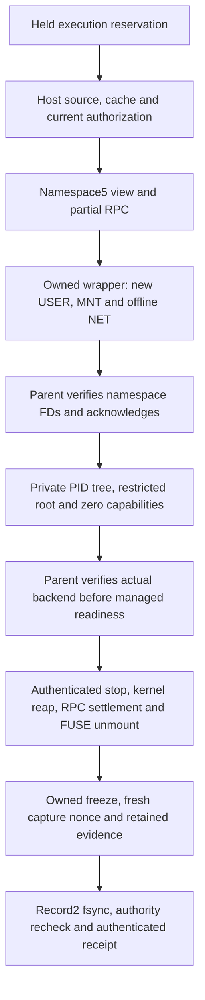

# Rudder v4 implementation and restart record

Updated: 2026-10-31. Read with [the plan](../../PLAN.md),
[research](research.md), [gates](experiments.md) and repository `AGENTS.md`.
This file preserves the working agreement across context compaction. An entry
here is not deployment proof; record exact checks and delivery identities below.

## Authorized scope and accepted direction

The user authorized implementing the plan and shipping to main, with tighter
Tailscale integration and smoother Cloud terminal text/buffering. The full
rewrite is Rudder v4 and spans multiple engineering milestones. Preserve the
main checkout and unrelated changes; do not restart live production agents to
force image adoption. Follow the version/tag/CI npm workflow and the separate
Fly worker/control-plane workflow.

Accepted architecture:

- Rudder owns immutable source/environment roots, persistent workspace metadata,
  private writes, checkpoints and distributed CAS/hydration. Qualify actual
  materializers before selecting or forking a VFS implementation.
- Keep jj history/conflicts/Git exchange behind a pinned adapter; a narrow fork
  is acceptable if required. CoW alone does not require a new VCS.
- Prefer a supported Buck2 Cloud profile, with REAPI interoperability for Bazel.
  Stock Buck2 does not automatically share one graph across divergent branches.
- One persistent Rust machine engine owns execution; SQLite is local journal,
  transactional project authority is the fleet truth. Fenced ownership and
  version-checked integration protect source and accepted knowledge.
- Direct durable agent mailboxes, first-class Codex app-server and Claude
  Channels adapters, authenticated provenance, active steer/interrupt/resume and
  explicit acknowledgments. Messages and accepted decisions are distinct.
- Native Mac remains supported. Filesystem/source snapshots, build actions,
  conversation forks and process-memory snapshots are distinct contracts.
- Ordinary input chooses discussion, direct work or decomposition automatically.
  Decisions is an optional bounded classifier, not a planner or authority.
  Sunset standalone `/gam` and `/nudge`; retain `/plan` only as compatibility.
- Private previews reuse Tailscale identity and live project/process attribution.
  The existing relay remains available; direct networking does not replace
  authorization. Responsive terminal transport has bounded queues/recovery.

## Execution efficiency, 2026-10-31

Read the independent agent-efficiency README and session report in the research
worktree (research/agent-efficiency, local commit e684468). Apply short edit/check
loops, bounded output, scoped fresh worker briefs and one result handoff. Avoid
repeated unchanged-input checks, polling-only turns and speculative expansion.
Finish the current integration batch before adding another lane. The research
worktree stays on its own branch and is not edited by this implementation owner.

## Current local batch after alpha.15

The combined pre-join Rust check passed 1,276 tests with zero failures. Context2
passed 12 focused tests after using a joined refresh owner only during fixture
startup. StopV4 carries the original parent deadline through queueing, framed I/O
and finalization phases. The verifier uses one status decision; its 16 regression
cases passed.

## Owner change and launch policy, alpha.17

At 07:19 UTC on 2026-10-31 the user moved this job from the Codex owner to a
Claude owner. The Codex owner stopped at a clean checkout with `39ca500` and
`3179f71` unpushed and the local `v4.0.0-alpha.16` tag unpushed. Its unapplied
binding4 readiness patch and interrupted managed-source preparation stay outside
the checkout; Runtime5 remains refused. Alpha.17 ships those two commits plus
the single Codex launch policy (PLAN.md section 20): effort `high` when unset,
compaction at 150K tokens and tool output at 6K tokens. These shipped before
E14 and are unproven; E14 decides whether each value stays.

The next merged changes add an opaque provisional source receipt, actual helper
exit custody and a fresh off-App issuer query. They also add a local build DATA
helper/client using the retained RunnableRoot, snapshot profile, preparation
index and existing Buck2 adapter. Their 62 focused Rust checks and 22 TS/client regressions passed. The actual-source qualification passed for `src/agent-attention.ts`: cold execution1,
fresh-scratch REAPI restore1 with no execution, identical outputs and independent
compiler/behavior checks. Debug walls75.502s/71.689s expose setup/verification
costs; this is neither a full-app nor production-speed result. Runtime5 is still refused; do not
count these interfaces as default migration or complete v4 delivery.

## Release gate and wait rule, alpha.18

Alpha.12 through alpha.17 built their native binaries but failed the macOS
release tests, so npm `next` stayed at alpha.7. Alpha.17 failed only because
macOS adds `__CF_USER_TEXT_ENCODING` to every process environment; the build
client test now ignores that key on macOS. The Release workflow also runs on
`release-check/**` branches with publication skipped, and a version is tagged
only after that run passes. Alpha.18 adds one wait-and-read rule to every agent
prompt (PLAN.md section 20) and fixes Codex session pinning: a `session_meta`
line is about 22 KB because it carries the base instructions, and the old 8 KB
head read could not parse it, so current Codex runs did not record a session id.

## Resumed ownership after alpha.18

Opus handed the checkout and unfinished runtime patches back to Sol. Alpha.18
commit `243728b` contains the launch policy, wait/read prompt rule, full Codex
session pinning and the release-check branch gate. Release run41189571495 passed;
both npm next tags now resolve to alpha.18. Both registry packages also passed
isolated installation, CLI/native/jj checks and archive/manifest verification at
2026-10-31T10:21Z. Cloud release168 passed fresh app,
health and authentication smoke checks on 2026-10-31T10:12Z. The live home was
not restarted. See [delivery](delivery-alpha18.json) for exact identities.

The next runtime batch is uncommitted: Binding4 readiness and helper custody,
source preparation, missing context2 writer/runtime APIs and bounded startup /
grant expiry. The 15 source-preparation tests pass after correcting endpoint
authority layout, broker projection/validation order and pending activation.
The original startup budget now bounds preparation and activation and covers
execution plus finalization in the fixed grant expiry. Runtime5 stays refused until
owned launch, actual kernel readiness and shutdown composition are qualified.

## Current implementation track

Base: `91579cf631b1d9d78afbbd786a6dc1f8120cc1ca` on `origin/main` at start.
All edits are in the user's main checkout. No product edits predated this track;
the three architecture documents already contained this session's planning work.

| Track | Concrete scope | Gate and state |
|---|---|---|
| Planning/commands | Shared deterministic routing with an optional Decisions helper; read-only intent; home Cloud ingress; retired public pair/nudge entries | E11/E12 subset implemented and CI verified; legacy sail limitation below |
| Private previews | Persisted Tailscale login, actual readiness, bounded async probes, exact project ownership, ready links and local open | E13 subset implemented; real userspace/Serve check passed; laptop/phone access remains untested |
| Terminal stream | Shared home/sail helper, short output batching, bounded backpressure, connection fencing, UTF-8 and repaint recovery | E13 subset deployed in the worker image; real WS/PTY VM checks passed; existing homes adopt when idle |
| Startup/download caches | Background CLI update, persistent account-local npm/pnpm/uv cache defaults, explicit overrides retained | Behavior tests pass; no distributed action-cache claim |
| Full storage/engine rewrite | Milestones below | Cloud release168 / worker alpha.18 is deployed and verified; the alpha.18 release matrix passed and both npm next tags name alpha.18. Both packages passed isolated installation, CLI/native/jj smoke checks and all-platform artifact verification. Default workspace integration, fleet and migration gates remain open |

The current native simple-execution path remains an isolated worker; explicit
main-checkout mode remains available. The initial automatic DAG path retains
the existing approval gate. This first change does not establish the eventual
single persistent task owner through every v4 engine operation. The standalone
TS board/CLI and old installed clients need separate migration checks.

Home web/phone task ingress uses native routing. Legacy task sails have a
different finite TS lifecycle: discussion/planning fail closed with a
home/dashboard alternative until that adapter migrates. Starting a permanent
dashboard in its place without task identity/approval/completion tracking would
misreport completion. Local `/cloud` task forwarding still reaches that legacy
path, so this is a stated alpha limitation, not complete Cloud routing parity.

## Latest delivery and next implementation, alpha.15

Main/tag `v4.0.0-alpha.15` is revision `a048aad42734dcb87b6c3ccfecabba1377b19764`.
Fly release166 is deployed: canonical app/health/authentication, exact runtime
hashes and SQLite integrity pass at2026-10-31T06:24:56Z. Active home instance/image
are unchanged. Fresh stock15 S3/Native-CAS DATA restore passes06:26:25Z; a separate
digest-pinned exact-source qualifier passes actual UID1500/FUSE/offline-source
finalization and historical reopen at06:26:33Z. Both canaries and the synthetic
credential row are independently absent at06:27:15Z. These are synthetic
source/grant qualification cases, not managed-default or model-provider claims.
See [delivery](delivery-alpha15.json),
[local checks](../../examples/execution/evidence/2026-10-31-alpha15-foundations/README.md)
and [runtime proof](../../examples/execution/evidence/2026-10-31-alpha15-runtime/README.md).

Local verification:1,204 baseline Rust tests,82 final affected tests,25 separate
execution compatibility cases, JavaScript739passed/9skipped and real-binary
TUI59passed. The local production build stamped candidate30658fa; the final tag's
only later change is the Fly image pin. Exact-tag CI/Fly builds are separate.
The original unpublished local15 tag was corrected before any push. All three
native release builds passed. Release run41176059172 then failed seven tests
at the same macOS rpc_view fixture assertion: `/tmp` was compared against its
canonical `/private/tmp` form. Both npm publication steps were skipped. The
fixture now creates its short root under canonical `/tmp`; verify the next
release before claiming registry availability. Cloud release166 stays verified.

The next local batch implements the Spec5 / Binding4 codec, a parent-clocked stop protocol and host context2 with separate guest and source lifetimes. Runtime5 remains refused while shutdown and launch ownership are connected. The verifier also replaces redundant full-patch generation with one status check. Remaining integration starts with joint Spec5 /
Binding4, protected context2 and actual host-source client/controller witness;
separate guest ingress from source finalization, carry the original parent
stop deadline, and join provisional receipt +successful helper exit +fresh
issuer authorization. Then compose the qualified connected transport and run
physical/model checks before default migration. Private-jj partial projection /
acceptance, a production build-cache caller with independent speed trials,
fleet authority and real-device Tailscale continuity remain open. Do not mark
the full v4 goal complete at this release.

## V4 foundations and current continuation, 2026-10-31

Cloud alpha.14 is live as release 165 from tagged revision
`13889d1e0860b5a806f5513d32cf0f215747759f`. Canonical app/health/authentication,
database integrity, source and compiled runtime hashes pass at
`2026-10-31T04:43:15Z`. The active home retains its original instance/image.
The actual S3 checkpoint DATA publication and fresh stock14 native-CAS restore
pass at `2026-10-31T04:51:07Z`: nine new uploads, thirteen exact objects/12,953
bytes, opaque high-u64 values, zero-upload same-ID retry, and retention across
two settled Native helpers. All three alpha14 canaries and both synthetic
credential rows are independently absent at `2026-10-31T04:53:47Z`.
See [delivery proof](delivery-alpha14.json) and
[tagged runtime evidence](../../examples/execution/evidence/2026-10-31-alpha14-runtime/README.md).

All three native alpha.14 platform artifacts pass CI. The first publish
attempt passed JavaScript checks, then failed one Darwin fixture setup race:
994 Native tests passed, one failed and11 were ignored. Peer rejection can
close the client before the test server sets its read timeout. Managed jj/TUI
and publication were skipped. The single failed-job retry failed on the same fixture against the unchanged
immutable tag. No more retries are planned; the next source release adds the
server-ready barrier that passes the local merged Native suite.
Registry publication and isolated npm installations remain open. Both npm
`next` tags still name alpha.7; `latest` remains 3.9.13. Do not retag or
hand-publish. See the runtime evidence ci.json and registry.json.
The real S3 controller needed an exact archived-source exception and a
top-level-await correction. Its failed canary/credential were removed; the
corrected serialized-preload negative control and subsequent real run pass.

After the alpha.14 source boundary, main has the following uncommitted work.
These changes are absent from the deployed immutable tag:

- Host-only Journal source authorization uses a distinct purpose, operation and
  domain-separated exact-binding scope. Its non-Serde result is identity/expiry
  DATA from one read transaction. Thirteen actual SQLite/golden/expiry tests,
  five guest-partial compatibility cases and one current-attempt case pass.
  The Native issuer must still hold actual EngineOwnership and clamp expiry
  against fresh post-query and original sent time.
- Actual Fabric EngineOwnership now supplies an opaque source lease retaining
  the real checkout lock through callback settlement. Retirement revokes before
  fallible writes; stopping retains existing leases and denies new acquisition.
  Thirty-three focused cases pass, including nine new lifetime tests and ten
  fresh-process OS-lock probes. This is local held custody, not a source grant
  or active remote session.
- Six Native CLI/prompt files provide five primary slash choices, shared help,
  truthful historical Gam notices and one conductor contract. Focused coverage
  passes 170 unique tests with one pre-existing simulation ignored. Legacy
  dispatch/recovery and combined nudge behavior are retained; source-authorizer
  module wiring is deferred until the transport review settles.
- The accidentally tracked legacy Native `.ledger` session is removed from
  future source, with an exact mode0600 private copy retained outside the repo.
  The directory was already ignored. Tagged source/history are unchanged.

The Native source-authorizer transport is now applied and compiled. Its
24 actual Unix fixtures pass, including request/reply MAC authentication, exact
post-query expiry clamping, issuer-peer checks, conservative pathname retention,
callback panic retirement and an actual TLS-destructor timeout/retry. The fixed
join coordinator retains actual workers and only reports their real settlement;
its own final teardown is excluded from that endpoint-only receipt. Independent
source review passes. A merged Native test executable passes1,054 tests with
13 explicit ignores; its proof binds the exact compiled foundations and does
not claim the later budget module was linked into that executable.

A shared finalization budget now provides one suspend-aware host deadline,
original-deadline adoption constraints, per-phase remaining-time caps and
absorbing expiry/cancellation. Four library tests pass, including actual stalled
Unix I/O and exact decimal nanoseconds above JavaScript's integer range. This
is a time constraint, never shutdown or checkpoint authority. New managed stop
wire dispatch and phase plumbing remain to be integrated.

The controller witness and actual Journal source issuer are integrated. The
SQLite-owned keeper passes70 focused cases, including cross-process writer
exclusion, checkpoints and fresh writes; the unsafe raw-descriptor preparation
and two fixture/compiler failures are retained privately as superseded evidence.
The real cleared-environment child composition passes: authenticated3FD
handoff, retained controller witness after control close, actual guest token
rotation/broker closure, continuing host authorization and sticky denial after
host revocation. Its first fixture attempt blocked on the retired guest probe;
that probe now runs after the active source exchange.

The integrated foundations pass1,204 library/Native tests with15 explicit
ignores. Final source-lifetime and live-fleet patches are applied;82 affected
checks pass with one explicit child-helper ignore. The13 source-lifetime cases
include actual blocked callbacks, observer-first spawn failure, source loss
around fsync/packet delivery, original deadlines and an unslept27-query burst.
The endpoint uses a bounded token bucket: default16 requests/second with64 burst
credits, fixed workers/admissions unchanged. Legacy helper-observed finalization
starts one30s budget and does not renew for duplicate packets; original parent
queue time still needs the new stop wire. Fleet notes no longer start unavailable
workers, and deferred Enter is bound to the same terminal instance. Explicit
resume is preserved. Production build, Node/TUI verification, versioning and
actual delivery are next. No new user feature flag is added. Source authority,
guest ingress closure, provisional shutdown packet, successful helper exit,
fresh final authorization and accepted history remain separate facts. The new
managed family must join them before default adoption.

Cloud alpha.13 was deployed as release 164 from
`030ebeff621089649c0cfb50e55f8fc9c7642d61`, verified at
`2026-10-31T03:13:36Z`. The canonical app, health/authentication, database and
unchanged active home pass. Its stock worker boot and S3-to-fresh-native-CAS
restore pass. A directly derived image adds only the tagged qualifier and
provenance; the actual offline remote guest, partial checkpoint finalization
and historical reopen pass. All seven alpha.13 canaries, including the four
candidate attempts, and the temporary credential row were independently absent
at `2026-10-31T03:17:30Z`. The tagged config now names the actual alpha.13 worker.
See [delivery proof](delivery-alpha13.json) and
[tagged runtime evidence](../../examples/execution/evidence/2026-10-31-alpha13-runtime/README.md).
The active home retains alpha.7 until idle. This does not activate remote launch
by default or qualify connected inference, accepted history or faster builds.

All three alpha.13 native platform artifacts, publication JavaScript checks and
separate TUI CI pass. Publication then stopped on four Mac socket fixtures:
Darwin reports an exhausted accept queue as ConnectionRefused, one fixture path
exceeded SUN_LEN, and another dropped its peer before the oversized-frame parser
completed. Both npm publish steps were skipped. Next-tag corrections preserve
the exact authentication, 8,193-byte rejection and deadline assertions without
production changes. Both npm `next` tags remain alpha.7 as of
`2026-10-31T03:18:20Z`; actual publication and fresh installations remain gates.

Post-alpha.13 main contains the verified completion/prompt cleanup and retained
Plan/reviewer resume-mode correction in `6ef9e41`. The alpha.14 candidate adds
[partial checkpoint DATA publication](partial-checkpoint-publication.md) and
[bounded connected networking](connected-network-transport.md). Neither path
enables managed remote execution by default. Both are absent from the frozen
alpha.13 images. Full v4 remains the active objective.

Checkpoint publication retains the exact new source-complement bytes, plan and
freeze/drain audit documents without hydrating inherited content or the private
accepted seed. Rust, opaque native RPC, TypeScript and Cloud share the canonical
fixture with above-JS-integer counters. A DATA bundle remains distinct from an
accepted source/history or live execution grant. Transfer readers settle before
their exact clone is released. Lost acknowledgment cleanup preserves uncertain
retention rather than adopting a newer pin generation by name.

The connected transport transfers an actual guest loopback listener to a host
supervisor, validates its namespace and process witnesses, and dials only sealed
public IPv4 pins. DNS workers, accepted connections, buffers and lifetimes are
bounded. Settlement waits for actual owned workers and sockets. The standalone
no-key TLS qualifier has a source-bound disposable Fly VM result below;
transport tests do not establish provider inference or managed launch qualification.

Candidate `96c7b25` passes the fresh production build and native checkpoint RPC,
737 JavaScript tests with no failures, and all 59 TUI journeys. Two worker cases
initially skipped for missing archive dependencies pass separately, leaving nine
optional skips. The earlier coordinated Linux library/dashboard run passes
1,139 tests with 12 explicitly ignored fixtures; the later network correction
passes 17 units and five integration cases, including a failing old-code control.
This is composed coverage, not one final successful full-workspace Rust command.
See [local evidence](../../examples/execution/evidence/2026-10-31-alpha14-foundations/README.md).

At `2026-10-31T04:18:26Z`, the corrected candidate passes the actual disposable
Fly connected transport case: separate USER/NET, socket-namespace ioctl,
loopback-only networking, zero capabilities/NNP, verified TLS1.3 HEAD with
HTTP200, one DNS job/upstream and actual worker/process/socket settlement.
The canary is destroyed and independently absent. Its derived image uses stock
alpha.13 plus the exact candidate release qualifier; this remains distinct from
an alpha.14 tag/deployment or provider inference. See
[physical transport evidence](../../examples/execution/evidence/2026-10-31-alpha14-connected/README.md).

The immutable archive test setup needed the shared Cargo target and SQLite/PTY
native dependencies. Failed/stopped setup runs remain private; final checks bind
the unchanged source and fresh binaries. Tagged Fly images, deployment and the
real S3 checkpoint DATA smoke now pass as recorded above. Mac test CI, both npm
publications and isolated installs remain the alpha.14 delivery gates.
Host-only Journal authorization and Native CLI cleanup are applied/tested after
the tag; the source transport remains private pending corrections. Managed
defaults, private-jj acceptance, production
build-cache adoption, fleet/migration and the remaining command cleanup remain
full v4 work.

The previous Cloud checkpoint, alpha.12, deployed as release 163 from
`f609730d27ee7d02b1886eb343477d1c09aa7255`; the canonical app, health,
authentication, database integrity and unchanged active-home instance were
verified at `2026-10-31T01:28:36Z`. Its complete worker image passed an owned
Fly bootstrap/runtime smoke, including packaged CLI/native/buddy, changed-remote
Git/jj fetch and auxiliary tool entrypoints. A fresh worker restored the synthetic
RunnableRoot from deployed S3 into its native CAS and retained it across helper
restart. Six separate network primitive modes and five local execution plus
four RPC cases passed on the explicitly supplemented qualification image.
All seven canaries, including three earlier refused/failed fixture attempts,
and the temporary credential row were independently absent at
`2026-10-31T01:34:09Z`. The frozen Fly config still names alpha.11; the deployment
explicitly overrides its worker image to alpha.12, verified in runtime config.
See [exact delivery evidence](delivery-alpha12.json) and
[runtime provenance](../../examples/execution/evidence/2026-10-31-alpha12-runtime/README.md).
The active home keeps its running alpha.7 image until idle. This CAS-format
round trip does not establish filesystem materialization or agent-launch latency.

Both npm `next` tags still point to alpha.7, verified at `2026-10-31T01:34:20Z`.
All three alpha.12 native artifacts and separate TUI CI passed. The board host
preflight passed on both actual Mac platforms and Linux, and publication's
JavaScript checks passed. Native tests then found one more Mac path fixture:
the journal getter returns canonical `/private/var`, while the test expected
lexical `/var`. The next tag canonicalizes only that expected temporary path.
Both npm publish steps were skipped. The alpha.13 candidate has since passed
the affected full Rust targets under a symlinked TMPDIR, 712 JavaScript tests
and all 59 terminal journeys against its newly built production pair. Actual macOS CI,
registry availability and fresh installation remain separate release gates.

All three alpha.11 native artifacts and separate Mac/iOS and TUI CI passed.
The publication job failed four macOS board fixtures before either npm publish
step: three assumed a short socket path and one mocked only Linux's opener.
A controlled long-TMPDIR run reproduces the old fixtures' three path failures;
the corrected fixtures pass all ten cases, including an explicit long-home
case. The Darwin opener selection also passes an isolated branch check on
Linux; actual Darwin qualification remains the next tag's CI gate.
See [fixture correction evidence](../../examples/board/evidence/2026-10-31-ci-fixtures/report.json).
Registry availability and fresh installs remain separate gates.
All three alpha.10 native platform builds, Mac/iOS and TUI CI passed. Its
publication job then stopped on two managed-guard test path assertions. A
symlinked TMPDIR reproduces both failures on Linux: child process.cwd() resolves
the parent while the fixture compared its original spelling. Canonicalizing only
the disposable fixture identity preserves exact refusal checks and changes that
controlled run from 1 pass / 2 failures to 3 passes. The correction is in the
alpha.11 tag; alpha.10 remains unpublished. Alpha.9 publication failed twice in
the macOS remote-root HTTP fixture before npm publication. Darwin inherits a
listener's nonblocking flag, while the fixture assumed blocking full-body
writes. Alpha.10 normalizes accepted streams and adds forced
backpressure tests, including the real engine-control handler. Do not retag
alpha.9, publish by hand or treat its Cloud deployment as npm availability.

The shorter startup context from alpha.4 is included. Partial-capture namespace4,
the inactive PostgreSQL authority adapter and explicit internal managed App
composition are included in Cloud alpha.12, alongside private managed storage,
writer floors, board capabilities and paired native build artifacts. Alpha.13
main-checkout work joins logical freeze, distinct partial RPC and Record2 data
with physical execution drain; it is included in the frozen alpha.13 images. CLI publication,
configured worker image and live adoption remain separate facts. The active
objective remains the full plan.

The deployed alpha.12 adds the
[execution workspace ownership contract](execution-workspace.md), strict
source-only remote selection and explicit network configuration/kernel
primitives. It also corrects the Mac board fixtures and runs them before native
compilation in each platform release job. Cross-review caught and closed a late
checkpoint-custody gap: State now verifies its actual lock/directory/sidecar
before and after checkpoint retention. Production build, all 1,466 Rust tests, 712 JavaScript tests and 59 terminal
journeys passed; 19 Rust cases and 9 optional Node cases were skipped.
[Exact local evidence](../../examples/execution/evidence/2026-10-31-alpha12-foundations/local-checks.json)
keeps host-unsupported qualification separate. Npm availability remains blocked
by the Mac journal fixture above. Remote activation and the new partial
checkpoint/transfer protocols remain open.

The alpha.13 tag implements the offline physical composition in
source: jointly versioned Spec4/Binding3, separate partial RPC1, namespace5
whole-effect admission and actual frozen-view ownership, Record2's explicit
complete/partial families, and one-shot partial finalization after real kernel,
RPC and FUSE drain. The host checks actual namespace descriptors against owned
pidfds before guest launch and checks all five backend capability sets. The
frozen guard and exact retained capture/evidence remain owned through the final
authenticated receipt. Saved records expose historical data rather than new
execution authority.

The Native source factory uses a protected context, actual Node transport and
fresh root admission. Its in-memory current-authority check is separate from
bounded broker I/O and permanently fences failed/expired attempts. Full
workspace compilation passed. Under a symlinked temporary directory, 61 execution
units, 4 handoff and 7 RPC integrations passed; partial RPC/journal checks passed
18 cases, Native source factory 9 cases and broker 16 cases (one existing ignored
exporter). Corrected test-only file modes, missing imports, temporary-directory
helpers and HTTP fixture routing retain their original failure logs. No product
authorization checks were weakened. Aggregate Rust coverage now passes 1,540
unique tests with 17 existing ignored cases. The original full commands found
two test-only timing/path assumptions; controlled corrections and full affected
target reruns pass. This is composed coverage, not one successful full-workspace
command. Production TS/board and the paired native build pass, along with 712
JavaScript tests (nine optional skips) and all 59 real terminal journeys. These
checks use a symlinked TMPDIR. [Local check identities and coverage](../../examples/execution/evidence/2026-10-31-alpha13-foundations/local-checks.json)
remain separate from tagged CI and delivery.

One actual offline remote guest passed on Fly at `2026-10-31T02:44:05Z`, from
the frozen candidate `c04b4c632206068900df9717b51c4120516e268e`. It scanned
100,101 names, statted a shared 208 MiB logical File, kept a changed file open
and mmap-held in a descendant, then returned the authenticated partial Record2
after real process/RPC/FUSE drain. No unchanged payload or accepted seed was
fetched. Five capture objects and two evidence objects survived GC; complete
local pins remained zero. A second helper returned historical data without
another factory or current shutdown authority. The caller's namespace/status
witnesses stayed unchanged. All four owned canaries, including three earlier
controller fixture failures, were independently absent at
`2026-10-31T02:46:57Z`; the active home's instance/image stayed unchanged.
See [candidate source, image, exact proof and limitations](../../examples/execution/evidence/2026-10-31-alpha13-candidate-remote/README.md).
This derived image uses the stock alpha.12 worker plus the pinned candidate
qualifier. It is not tagged alpha.13 delivery or a build/agent-start benchmark.

Current composition:

This candidate does not enable Native remote launch by default. Next composition
gates are a separate host source authorizer during guest ingress retirement,
remote stop budgets, partial checkpoint transfer/publication, private-jj
projection/history acceptance, connected provider networking and physical legacy
retirement. A replicated byte-data candidate and accepted versioned history are
different facts. A future publication must retain the proof closure as well as
the RunnableRoot graph; uploading a few extra unreferenced Blobs is insufficient.

Alpha.11 includes:

- [Private managed storage](managed-storage.md), explicit journal schema5 opt-in,
  receipt-scoped recovery and pre-startup Native refusal. Focused checks cover
  55 managed cases, 24 owner cases, 11 Runtime cases and 41 journal cases. The
  exact tagged alpha.10 Linux CI artifact refuses the floor without rewriting
  ownership. [Component proof](../../examples/execution/compatibility/evidence/2026-10-30-alpha11-floor/README.md).
  TypeScript/alternate-home physical retirement, same-run retry and activation
  remain unimplemented.
- [Private board sessions](board-access.md), authenticated reads/control/SSE and
  a bounded native browser callback. A disposable real Chromium run passed
  bootstrap, reload, usage, live updates and daemon-restart behavior with
  synthetic data. A subsequent Rust test-only temp-path correction keeps all
  fixture endpoints within their disposable root on macOS too.
- One native Cargo graph and complete, source-bound manifests for all three
  release platforms. Frozen alpha.10 inputs qualified the graph with one
  engine/bridge compilation each; that warm-cache run took 599.8s with two jobs.
  It is not a controlled speedup measurement. Local candidate checks passed:
  350 engine, 1,030 native, 32 bridge and 711 Node tests (9 optional skips), all 59 real
  terminal journeys, production/Cloud builds and the context audit. The prior
  full-workspace command exposed an obsolete test that bypassed production's
  EOF-aware PTY wait; its summary assertion was retained and the corrected
  Native/unit suites passed. Cloud rollout is verified; registry/fresh-install verification remains pending.

The separate owned NEWNET/TUN observation is in
[the networking gate](managed-network-isolation.md). It changes no product
network defaults and does not establish egress, packet-helper or preview support.

Alpha.10's mounted partial-capture proof passed
as root and UID1500, retaining dirty chunks across lost replies, later FD writes,
mmap and collection without creating a complete pin. Capture through data ACK
took 711/724 ms in those individual loopback samples. The owned VM was deleted;
[frozen source, failures and checksums are archived](../../examples/vfs/evidence/2026-10-30-partial-capture/README.md).
Complete remote checkpoint/observation and accepted-source publication stay
closed until their separate consumers are integrated.

Local release checks passed: engine baseline 338 (before the subsequent auth
control edits) plus 11 affected execution/control tests afterward; native 1,002;
VCS bridge with CLI 32; JavaScript 650 passed/9 explicit skips; real terminal 59.
TypeScript/Cloud compilation, optimized paired build, context audit, public
artifact checksums and the inactive infrastructure validator also passed.
These local checks are separate from the linked Cloud proof and pending npm gate.

The inactive Cloud PostgreSQL adapter passed 19 actual Node/pg transaction and
crash/recovery tests on PostgreSQL17.11. A new native process-local lease guard
passed 18 tests and the shared duration vectors. Neither activates a project,
connects the production control plane nor qualifies provider failover/RPO.
[Adapter evidence and remaining enrollment/provider gates](../../examples/fleet-authority/evidence/2026-10-30-node-adapter/README.md).

The managed App path now has bounded preparation, fsynced reservation/assignment,
actual backend process binding and authenticated stop/checkpoint receipts. It
is an internal API without a public/default caller. Selected Codex key bootstrap
passed against actual 0.166.0 with ephemeral storage and no model calls; its
mandatory private v2 frontend gate, current TS consumer refusal and old-client
recovery qualification are implemented/tested. See [auth evidence](../../examples/agent-runtime/evidence/2026-10-30-managed-auth/README.md)
and [released-client refusal and its missing-owner limitation](../../examples/execution/compatibility/evidence/2026-10-30-alpha9-refusal/README.md).
Default activation additionally needs a separate managed record namespace and
durable protocol floor under the real owner/quiescence boundary.
A new marker cannot physically fence an older native client.
[Managed launch contract and open gates](managed-launch.md).

Source review also found a concrete managed-network activation gate: the helper
shares host TCP loopback, while the normal board serves its browser token to
loopback clients. Filesystem/PID isolation cannot authenticate that raw HTTP
client. No live exploit was attempted. Keep managed launch inactive until
controlled guest networking and board access close that path. Cloud worker
control and CAS retain their separate bearer/account checks.

Next implementation contracts are [controlled networking and board access](managed-network-isolation.md),
[remote launch and quiescent partial publication](remote-managed-launch.md),
and [public provider caches with private CoW state](provider-runtime-cache.md).
The last addresses a measured fresh-home finding: Codex populated roughly 87 MB
across 5,502 public plugin-cache files without inference. Its supported
catalog-free policy is a proposed selected profile, not a change to installed
user plugins or a demonstrated cold-start speedup. The [provider rollout](authority-provider-rollout.md)
and default-disabled RDS foundation are unapplied; no database or new persistent
provider spend was created. Full fleet ingress/activation and migration remain open.

The alpha.11 build-pipeline changes unify native and its jj companion under
`rudder-vcs-bridge/cli` and validate exact-source paired prebuilt manifests.
Forty-seven focused JS cases pass. A read-only frozen alpha.10 build compiled
each workspace library/binary once in 599.79 seconds with two jobs and reused
dependencies. That run qualifies the command/outputs, not a controlled speedup;
integrated current-source tests and all three release platforms remain pending.

- `engine/` provides typed immutable roots, local checksummed CAS, staged
  publication, retained closures and conservative collection. Source,
  environment, full private view and hardlink topology have separate identities.
  Checkpoint v3 retains the topology; validated build inputs include it in both
  Rudder and native frontend action contracts. Local retention cannot assert
  remote durability by itself.
- The opt-in persistent native host owns one checkout after its terminal views
  disconnect. It fences compatible owners with an OS lock and journal epochs,
  refuses known live legacy schedulers, and exposes authenticated control and
  existing attach views. This extracts the existing App; it is still one project
  per host process. Fleet authority ingress/activation and the final machine-wide
  multi-project actor have not been implemented; the inactive tested PostgreSQL
  adapter is a foundation for that work.
- The SQLite WAL journal records capability-scoped commands, effects, mailboxes,
  explicit acknowledgments, topic versions and exact-root integration evidence.
  Retries by the original sender return historical receipts after a recipient
  restart; they never route into its replacement. Started effects recover as
  uncertain and require reconciliation. Exact live thread/turn observations gate
  controls; a pending command rechecks its original grant and both run epochs
  before dispatch. Retired pending targets receive a rejected receipt; started
  effects remain uncertain. Real Claude 2.1.314 and Codex 0.166.0 engine/dashboard
  steering passed, including attributed peer input and explicit same-thread
  resume. Ordinary mail still requires inbox/ack; automatic wake is not shipped.
  Codex model-turn interruption can leave a yielded shell running until process
  cancellation or engine shutdown. See [actual provider evidence](../../examples/agent-runtime/evidence/2026-10-30/README.md).
- Rudder's Rust VFS has immutable prepared directory indexes and private
  persistent inode/namespace deltas. Actual mounted Fly tests cover inherited
  directory rename, raw names, hardlinks, shared mmap/fsync, atomic saves,
  open-unlinked files, strict busy unmount and server-abort recovery. A 100,000
  child directory rename visited no children. A rootless UID1500 self-mapped
  user/mount namespace can open a boot-delegated `/dev/fuse` without a custom
  privileged broker. The explicit restricted execution helper also passed the
  real `TerminalPane` path with Node/gcc, private roots, external broker auth,
  credential/CAS/peer denial, Ctrl+C and witnessed crash teardown. Its owned VM
  was deleted and absence verified at `2026-10-30T13:19:39Z`. Default launch,
  managed view/VCS integration and uncertain-run reconciliation remain open.
  [Execution proof and limits](worker-execution.md), including uninterruptible
  I/O limits, are separate from [VFS qualification](vfs-qualification.md).
- The next unshipped storage track adds 4 MiB immutable chunks, bounded radix
  directory shards and ancestry-free SourceRoot/EnvironmentRoot descriptors.
  A frozen optimized Buck2 workload using those formats returned actual Rust
  and TypeScript results: 6.322 s for a fresh graph and 3.261–3.872 s warm,
  reusing an existing local prepared CAS/SDK. SDK verification remains a large
  repeated cost; these are not download or agent-launch timings. See the
  [exact build inputs and stage reports](../../examples/build-profile/evidence/2026-10-30-runnable-v2/README.md).
- Scoped lazy remote sessions authorize objects through verified parent paths,
  with bounded cache/source workers and stale-attempt rejection. Mounted Fly
  root and UID1500 cases fetched only two data chunks from a 208 MiB file while
  exercising private writes, mmap, rename/link/unlink and strict cleanup.
  Constructor/fork measured 49–55 ms after fixture preparation. The source was
  authenticated loopback HTTP, not production S3 or cross-machine latency.
  [Frozen mounted evidence](../../examples/vfs/evidence/2026-10-30-remote-ranges/README.md).
- The bounded remote directory pager now passed actual mounted `getdents64`,
  tiny-buffer cookies, seeks, rewind across mutations and reopen on Fly as root
  and UID1500. Both listed 100,101 names without File/Blob reads; first listing
  took 24.564–25.579 s. This is a cold metadata cost to improve, separate from
  root construction/private fork (70–115 ms in those samples). The final helper
  matched all 182 qualified inputs and its VM was deleted. See the
  [exact paging evidence](../../examples/vfs/evidence/2026-10-30-remote-readdir/README.md).
- Individual-object retention and partial delta plans now preserve new bytes
  across collection without hydrating their inherited closure. Transfer clones
  only its own retention and preserves native receipt generations as opaque JSON.
  The scoped upload path sends new units and lets Cloud validate the complete
  resulting directory before issuing a replicated data receipt. Eight partial
  retention cases, the real native wire case, 20 transfer/download cases and 51
  Cloud CAS regressions pass. Producer checkpoint/journal integration and the
  default launch path remain separate gates. See [partial retention](partial-retention.md).
- The native v3 helper now composes its own protected VCS service and real
  external capability broker, then settles its writers before finalization.
  Mounted local-root cases exercised jj status/diff/log/new/edit, open-FD writes
  and real journal epoch revocation. The revoked attempt produced no checkpoint;
  all owned process descriptors settled. These were debug/stripped binaries,
  not optimized latency or real-model/default-launch proof. See
  [native helper evidence](../../examples/vcs/evidence/2026-10-30/native-v3/README.md)
  and the [managed-launch next slice](managed-launch.md).
- A pinned Buck2 profile builds real Rust and TypeScript against a real native
  REAPI cache. Archived whole-build warm samples range from 2.45 to 3.56 s.
  The latest topology-aware matrix measured a fresh-graph remote hit at 3.216 s
  and a source edit at 5.287 s under concurrent development load. Prepared-index
  lookup is 2 ms; initial preparation/materialization remains substantial. This profile does
  not yet build arbitrary Cargo/build scripts or prove cross-engine action
  interoperability. See [build profile and raw samples](build-profile.md).
- The new remote store has a retained/versioned S3 bucket and a Fly OIDC workload
  role. CloudFormation `rudder-fabric-v1` completed at
  `2026-10-30T11:29:29.573Z`. Workload-role conditional-write, no-overwrite,
  immutable-delete denial and staging-renewal checks passed at
  `2026-10-30T11:38:28.450Z`. Default-profile admin credentials remain outside
  application configuration; the app uses temporary workload credentials. The
  cache-miss policy update completed at `2026-10-30T13:01:57.637Z`: the dedicated
  bucket allows the role to distinguish missing keys (404) from denial (403).
  At `2026-10-30T13:09:26.122Z`, the actual Fly OIDC role passed a loopback test
  of the current HTTP handler: fresh miss, conditional upload, hit, root
  publication/read, identical download and immutable-delete denial. Deployed
  login/worker authentication subsequently passed against the deployed API on
  two independent workers at `2026-10-30T14:40:53.368Z`.
  [Safe reports](../../examples/fabric/evidence/2026-10-30/README.md).
- The Cloud CAS API streams large downloads and spools uploads privately before
  checksum-verified conditional S3 writes. A real 70 MiB S3 round trip and strict
  root publication passed at `2026-10-30T12:14:20.550Z`: upload 964 ms, download
  745 ms, publication 884 ms, peak process RSS 126,623,744 bytes. That check used
  the admin default profile; deployed worker authentication is a separate gate.
  Blob limits are 256 MiB; directory metadata remains bounded at 4 MiB. Large
  flat directories in that deployed baseline are not a general scale claim;
  bounded sharded metadata is in the unshipped track above.
- One persistent framed native helper supplies pinned source and staged target
  transfer adapters. The actual HTTP handler, 70 MiB blob and an independent
  fresh native CAS are tested together, including loss/corruption and u64
  checkpoint cursors. Two fresh alpha.4 Fly workers restored the same
  767,656,523-byte prepared environment through the deployed API, then built a
  Rust library/dependent library and compiled/ran TypeScript. Cold download was
  132–152 s; eager export took about 49 s. This is the full-transfer baseline,
  not a lazy-launch claim. Both VMs and temporary credentials were removed.
  See [transfer contracts and proof](fabric-transfer.md).
- Startup prompt and generated guidance now request relevant context on demand.
  The main role contract is 1,167 bytes, worker contract 915 bytes, and Rudder's
  own always-loaded `AGENTS.md` is 5,820 bytes, down from 193,536. Full reference
  material remains linked. Current context audit has no findings. See
  [prompt context](prompt-context.md).

Both npm `next` tags now resolve to alpha.7, and fresh isolated Linux installs
ran the packaged CLI and native binary. Alpha.7 fixes the Mac PTY teardown,
inherited checkout-lock and broker response problems that blocked alpha.4/5/6
publication. The full release workflow passed on all three native platforms,
including 931 Mac dashboard tests, 27 library tests and all 59 terminal journeys.
The stable `latest` tag remains 3.9.13. See [current delivery proof](delivery-alpha7.json).

The alpha.4 release candidate passed the production and Cloud builds, 1,063
Rust tests (16 ignored), 577 Node tests (8 additional optional skips), and all 59
real-terminal tests. The final output changes also passed the focused Cloud
home and PTY regressions: completed command output remains readable, failures
include drained final text, and a managed backend still needs typed completion.
The context audit has no findings. Source/evidence inspection found no matches
to the configured AWS, Claude or Codex secrets, including compressed sources.
These are local checks; the tag workflow, registry and rollout remain separate.

## Dependency-ordered continuation

1. Finish and ship the current verified track with actual npm/Fly identities,
   installation/runtime smoke checks and a truthful rollout record. Reserve a
   complete stable-v4 claim for the full launch gates.
2. Reproduce E0 baselines on representative TS/Rust, dependency-heavy JS, Python
   and native Apple workloads. Publish workload manifests and raw samples.
3. Ratify serialized source/environment/checkpoint/command contracts, durability
   levels and ownership transfer. Build filesystem/crash/recovery fixtures first.
4. Qualify E1/E2 candidate materializers on disposable Linux views and two Fly
   workers; compare entry-count/byte scaling, copy-up, lazy hydration, publication
   pins and GC races. Do not mount experiments over user checkouts.
5. Extract the persistent Rust engine with one authority flag and legacy attach
   adapter. Prove surface-close survival, restart deduplication and old-owner
   quiescence before giving it scheduling control.
6. Implement durable roots/CAS, private workspace views and checkpoint export,
   then remote publication/retention/restore. Meet E5 fault and filesystem gates.
7. Convert one canonical build workload to the Rudder Buck2 profile, compare
   Bazel/REAPI, prove action-key invalidation and measure completed builds.
   Branch-aware graph/compiler reuse is a separate qualified extension.
8. Extract/generalize adapters and add transactional mailboxes, decision/topic
   versions, scope authority and active peer controls. Prove E6 races and real
   Codex/Claude behavior; PTY output is never an acknowledgment.
9. Embed/bridge pinned jj, implement fenced exact-tree/version integration and
   migration/export/undo. Complete E7/E8, including offline Mac behavior.
10. Add cache-aware fleet placement, migrate each surface to engine projections,
    retire duplicate schedulers/file fan-out/command machinery only after caller
    migration, and complete E9/E10/E11 recovery/scale/release drills.

Workstreams may overlap after shared contracts and dependencies are stable.
Keep one editor per file and one integration/release owner. Do not let parallel
implementation turn independent journals into competing project authorities.

## Verification and delivery record

Current checks: root production build, Cloud TypeScript build and typechecking
pass. Alpha.3 Node suite: 483 passed, 8 skipped, 0 failed (491 total); native suite:
859 dashboard tests plus 19 library and 1 terminal-color integration test pass
(10 documented ignored tests). Persistent cache/boot behavior, shared terminal
and private-preview fixtures pass. A 1,000-write burst coalesced into one WS
frame in the loopback fixture; this is not a production latency measurement.
Real release-binary terminal end-to-end suite: 53 passed, no failures/skips.
It exercises natural automatic planning through approval/workers/merge,
discussion scope and command retirement. Final Node suite includes the added
legacy sail guard. Alpha.3 CI also passed on the release runner: 481 Node tests
passed with 10 optional skips, 880 native tests passed with 10 ignored, and all
53 real-terminal tests passed. All three native platform artifacts built.

Before closing this implementation track, replace pending entries with exact
revision, version, CI workflow result, published npm dist-tag, worker image
digest, Fly release/deployment identity, canonical URL, UTC verification time,
checks and active-home adoption state. A pushed commit is not a Cloud rollout.

### Earlier alpha.7 CLI and Cloud delivery checkpoint

[Cloud release 159](delivery-alpha7.json) runs alpha.7 revision
`a24bc4171d55ce9554068cdeb1b6e228b461d54d`. The canonical app/health returned
200 and unauthenticated app/CAS access returned 401. The deployed process reports
the alpha.7 worker pin, SQLite quick-check is `ok`, and the existing active home
record survived deployment. Exact UTC times and image digests are in the report.

The actual alpha.7 worker image passed CLI/native/provider checks as UID1500 on
a fresh Fly VM; that VM was deleted and absence verified at
`2026-10-30T16:23:00.385Z`. Fresh installs of both npm packages passed at
`2026-10-30T16:29:09.114Z`. Existing active home `8edd225a7d0378` remains started
on its original 3.9.12 instance; no live agents were restarted. Full fleet adoption
and local Mac installation are not claimed.

The deploy used the frozen tag source with an explicit alpha.7 worker-image
override. Tracked `cloud/fly.toml` still pins alpha.4; update that pin as part of
the next versioned product release before redeploying from the checkout.

The next uncommitted slice adds bounded File chunks, paged directories, explicit
V1/V2 streaming tree adapters and ancestry-free RunnableRoot metadata. New roots
require SourceRoot v2 with a projection policy and EnvironmentRoot v2 with
content-only installer inputs. They cannot pull checkpoint/source ancestry into
launch; history pins stay explicit. Rust/Cloud validators and a real
native→HTTP→native round trip cover these formats, but default consumers and
deployment remain open. Private block writes/live observations and the embedded
jj provider/journal publication bridge are being integrated in separate owned
files. These are not yet the qualified default agent-launch path.

### Earlier alpha.3 delivery checkpoint

Runtime source: `f1403d43b739a4ef61caa7c76ce7cee6fcab0eec`, tag
`v4.0.0-alpha.3`, on `origin/main`. The
[release workflow](https://github.com/exla-ai/rudder/actions/runs/41034639170)
succeeded, including both npm uploads with `next` and signed provenance.

Fly.io control-plane release **157**, machine instance
`01M663AJSZP0492409NN1YEXP4`, runs that revision. The canonical
[Rudder Cloud app](https://rudder.exla.ai/app), health endpoint and app asset
returned HTTP 200; unauthenticated state access returned 401. Verified
`2026-10-30T10:02:07Z`.

- Control image: `sha256:32dac353e59cf60a9434881d836794927a3c154710f762b71db1281a974c30da`.
- Worker image: `registry.fly.io/rudder-workers-exla:4.0.0-alpha.3`, digest
  `sha256:6dc1d1fbbc30bee1ff18365e1332bf2124d0c92b8e946d7d51a380f680e1c2dd`.
- Seven checks passed inside a disposable VM using the actual image, including
  native Unicode/control keys, packaged routing/ownership, real WebSocket/PTY
  roundtrip and output/control ordering. All temporary canary VMs were removed.
- Real private HTTP Serve returned the exact fixture body through `tailscale nc`.
  The temporary listener/route were removed and all seven prior routes preserved.
  This was same-host userspace/Serve proof, not a laptop/phone latency result.
- Existing homes were left on their running images. The configured idle updater
  adopts the new image without interrupting active agents; full fleet adoption
  is not claimed.

Npm accepted both uploads but initially reported package processing. At
`2026-10-30T10:06:35Z`, `@viraatdas/rudder@4.0.0-alpha.3` was available with
the correct Git revision; an isolated install, CLI version, Linux native smoke,
new modules and all three platform files were verified. Primary
`@exla/rudder@4.0.0-alpha.3` still returned **404**. A later registry check
confirmed both packages resolve alpha.3 through `next`; that blocker has
cleared. No republishing or retagging was needed.

[Structured evidence](delivery-alpha3.json) contains the machine, image, CI,
registry, canary, preview and cleanup checks. Refresh provider/registry state
before making a later claim that it is available everywhere.

### Storage restart point

[The Linux E0/E1 report](phase0-linux-evidence.md) and its exact runner/raw archive
are the first measured storage evidence. Warm view construction worked on the
ext4 volume, with empty initial uppers and scoped parent/sibling write isolation;
native reflinking did not. Namespace startup, agents, jj, real compilation,
network, remote hydration and durability are outside these mount timings.

This earlier baseline has since been extended by the custom VFS, persistent
project engine, real peer adapters, build-profile and two-worker restore
evidence above. Next: finish the Mac release gate, qualify private block writes
and lazy remote hydration with the VCS provider, wire managed agent launch and
exact-tree publication, then complete fleet authority, migration, representative
build workloads and scale/recovery gates. A project-local engine is not yet the
final machine-wide/fleet architecture.

Release preference was asked asynchronously: v4 prereleases on `next` versus
3.x foundations or waiting for all gates. The user confirmed continuing to
publish even unstable increments. Use the established v4 `next` channel.
An alpha must not move npm `latest` or masquerade as complete stable v4.

The first alpha CI run built all three native artifacts, then caught a macOS
test-fixture assumption about GNU `timeout`. Publication was stopped; no alpha.1
package reached npm. The fixture now supplies its own command wrapper. Keep
the original tag and cut alpha.2, then verify the complete release workflow.

Alpha.2 passed all CI gates and was accepted by npm with signed provenance.
Fly control-plane release 156 and the alpha.2 worker image passed deployment
and disposable-VM checks. Npm reported asynchronous package processing: the
legacy name became visible while the primary name remained pending.

The next incremental fix, alpha.3, tightens legacy preview ownership so `foo`
cannot capture `foo-bar`'s sibling workspace. Modern nested workspace paths,
exact legacy group/hash boundaries and ambiguous-owner rejection have focused
regression coverage. Current source creates workspaces under the repository's
excluded managed directory; earlier guidance about a sibling default was stale.

The user confirmed continuing to publish even unstable increments. Keep the
implementation/deployment facts distinct from the still-planned v4 engine,
distributed CoW storage, build graph and durable coordination workstreams.
