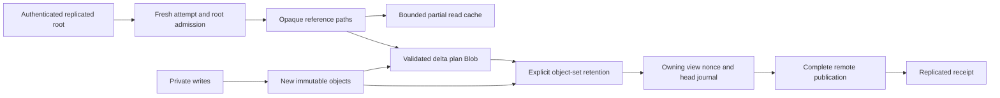

# Partial workspaces and local delta retention

Updated 2026-10-30. Object-set retention and delta transfer are included in Cloud
alpha.9. The owning partial-capture journal below is new working-tree code;
npm remains alpha.7 and default agent launch is unchanged.

A remotely retained workspace need not exist completely on a worker. New
private writes, however, must survive the worker process restarting on that
volume. These are separate guarantees. A partial cache entry or an individual
object pin never becomes a complete local snapshot.

Writer barriers, accepted source history and publication authority are separate
from this data flow. Neither storing a plan nor receiving a cache hit proves
that writers have stopped or that a source change was accepted.

## Fresh remote admission

`RemoteRootRegistry` binds a provider/tenant scope, fresh authenticated root
receipt, exact expected RunnableRoot and current project/run/owner/execution
attempt. Saved receipts and availability hints cannot authorize another attempt.
Requests, Future polling and byte exposure use a bounded in-memory authority
callback; the host explicitly invalidates sessions when ownership is fenced.

Only the admitted root starts with a handle. Child handles derive from verified
parent metadata. Reads validate the actual child shape, including radix routes,
counts, File logical lengths/spans and Source/Environment schema2. A physically
present local object is not evidence that it belongs to this root.

`RemoteObjectPath` records the typed reference and bounded child-edge indices.
It contains no capability or credentials. Replaying it requires a fresh
authorized session, bounded metadata reads and an exact final-reference match.
This lets retained data describe its remote dependencies after restart without
turning a saved path into authorization.

The scoped partial cache has fixed workers, coalesced requests and independent
job, payload, borrowed-memory and disk limits. Deadline/cancellation notification
does not release a stuck transport's admission. One private Node helper owns
fixed-origin HTTP and credentials outside the guest; requests do not spawn a
new process or accept their own endpoint/auth headers.

## Individual-object retention

`LocalStore::retain_object_set(stage, pin, refs)` verifies and syncs the exact
listed objects. It does not follow their remote children. A FULL SQLite ledger
commit precedes removal of the original staging lease. A crash between those
steps retains both; retrying the same pin, original stage and object set returns
the original receipt and completes staging cleanup.

The receipt binds a canonical set digest, original stage, monotonic generation,
count and bytes. A delayed release cannot remove a replacement pin. Missing or
corrupt ledger/object data abort collection before deletion. The ledger has
explicit record, reference, encoded-byte, database and validation-time bounds;
exhaustion does not silently discard retention.

Enabling the ledger permanently upgrades `retention.json` to schema2. Normal
complete-only stores remain schema1. Old clients reject schema2 rather than
collect objects whose retention they cannot understand. The actual published
alpha.7 CLI refusal is recorded in
[compatibility evidence](../../examples/fabric/evidence/2026-10-30/object-set-compatibility.json).

Complete root pins, `pin_existing` and `retained_closure` keep their original
meaning. An individual-object receipt grants none of them. SQLite is local-volume
authority, not a replicated retention catalog. Loss of that volume still needs
a verified remote publication receipt for recovery.

## Validated partial trees

`delta::retain_partial_tree` accepts producer-collected new refs and opaque
same-session remote boundary handles. It walks only the new graph, validates
new parent/child claims, and stops at authorized remote boundaries. Remote Blob
boundaries do not trigger content downloads. Unknown refs cannot fall back to
other bytes present in the local CAS.

The canonical DeltaPlan Blob binds the capture UUID, exact base root and
attempt, derived directory/topology, reachable new objects and replayable remote
paths. The plan itself joins the same individual-object set. Changing the
capture or tree cannot reuse a previous pin even when every tree object remains
remote. Unreachable intermediate producer objects are excluded from retention.

`PartialTreeReceipt` is data-retention evidence only. Reading it after restart
does not restore a live session, writer ownership, quiescence, complete local
availability or replication. The owning VFS/RPC journal must publish its nonce
and head separately, preserving uncertain results for reconciliation.

The first delta profile requires empty topology; nonempty links require the
qualified whole-path/inode adapter. Runtime VFS links still retain their inode
semantics. General remote checkpoint/observation remains explicitly gated. A
complete remote publisher must verify its own closure before returning
replicated durability.

## Owning view capture journal

`VfsView::capture_partial_source` now collects producer references and authorized
remote boundaries under explicit content, metadata, object, work and time
budgets. Its receipt binds an exact begin/end dirty cursor, nonce, prior head,
policy, view and remote attempt. It is `LiveBestEffort` data retention; writers
may continue and the mutable base is unchanged.

The namespace journal commits its immutable candidate before object retention
and commits the receipt/head afterward. Lost replies reconcile the original
candidate instead of capturing later writes under the same nonce. Permanent
namespace version4 prevents alpha.9 clients from reopening activated namespaces.
Retirement is generation-exact and cannot release the current head. General
complete observation/RPC/checkpoint remain explicitly unsupported for remote
views.

Mounted root and UID1500 Fly cases completed capture through data ACK in 711 and
724 ms, with 19 producer objects, two dirty 4 MiB chunks and zero complete pins.
The actual FD remained open for later writes; nonce replay, mmap bytes,
collection and retirement preserved the intended generations. The owned VM was
deleted. These samples used authenticated loopback HTTP and a frozen driver,
not production S3 or default provider launch. See [source, tests and exact
limits](../../examples/vfs/evidence/2026-10-30-partial-capture/README.md).

## Delta transfer and remote validation

`TransferSession::pin_partial_source` reads the exact retained plan and clones
its individual-object units under a new transfer-owned receipt. It starts a
staging lease before reading the producer record, so concurrent producer
retirement and collection cannot remove acknowledged transfer inputs. Closing
the connection removes only its cloned retention. This does not authorize an
inventory walk over the missing inherited closure.

The native `pin_partial_source` binary RPC accepts `receipt_json` as an opaque
string. TypeScript passes it unchanged; the Rust parser preserves receipt
generations above JavaScript's exact integer range. Its response has bounded
object references and a provider/tenant/base binding, rather than an execution
epoch or generation converted to a JavaScript number.

`FabricRemoteClient.uploadPartialTree` requires trusted provider/tenant
configuration and checks the exact immutable base publication before starting
staging. It uploads only the retained new units, with the same checksum, byte
budget, concurrency and lease-renewal rules as complete transfers. Cloud must
walk and validate the complete resulting directory, including inherited
objects already in its namespace, before issuing replicated durability. A
missing inherited object fails publication. A lost publication reply remains
uncertain; retry reconciles the immutable root record. Staging cleanup is
idempotent and account-scoped and never deletes immutable objects or roots.

This intermediate API publishes **directory data**. It does not establish
writer quiescence, publish an accepted source change, create a new runnable
checkpoint or retain the plan as a strong child of that directory. The producer
retains its original record until the owning journal completes those steps.
No default agent launch uses this intermediate path yet.

## Verification and remaining work

Eight individual-retention cases and 22 existing store cases pass, including
actual process abort after acknowledgment, conservative staging recovery,
concurrent collection, corruption and stale release. Eight partial-tree cases
cover no-hydration capture, all-remote identity binding, unauthorized local
presence, malformed File length, foreign handles, budget/revocation and data-only
recovery, plus transfer retention after producer retirement and preservation of
producer retention on connection close. Twenty HTTP transfer/download cases
pass, including the new delta path, actual complete remote graph validation,
scope/base failures, corrupt input, missing inherited data and lost replies.
The cache/source/root layer also has actual persistent-helper HTTP qualification.

The real native RPC integration also passes with a valid retention generation
of `9007199254740993`. It clones retention, releases the producer record, reads
the retained bytes across collection, rejects another pin and a complete-closure
inventory, and confirms EOF removes only transfer-owned units. The generation
travels as opaque JSON to Rust without a JavaScript numeric conversion.

The [remote mounted evidence](../../examples/vfs/evidence/2026-10-30-remote-ranges/README.md)
qualifies lookup, private CoW and cleanup on Fly as root and UID1500. It uses
authenticated loopback HTTP, not the deployed S3 API or a network latency SLA.
Paged readdir now also passed actual mounted 100,101-entry enumeration as root
and UID1500, with no File/Blob hydration. Its roughly 25-second cold listing
samples remain a performance cost, distinct from fast narrow lookup and capture.
See [paging evidence](../../examples/vfs/evidence/2026-10-30-remote-readdir/README.md).
Remaining gates include quiescent partial publication and source acceptance,
nonempty inherited topology, deployed lazy restore, native factory adoption,
controlled guest networking, macOS, fleet authority and migration.
